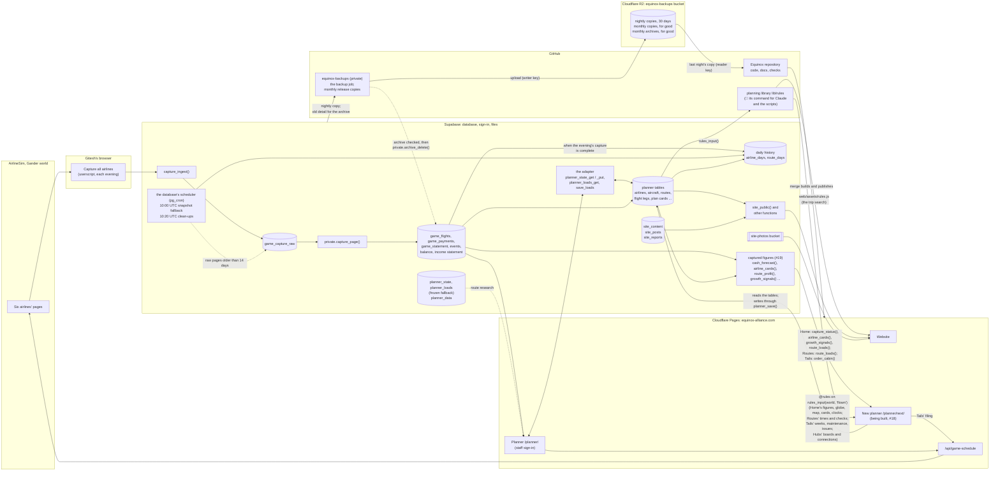

# How equinox. fits together

The map of the whole system: what each part is, where it lives, what runs when, where keys are kept, and what to do when
something breaks. Decision #10. The rules are in `docs/operating-manual.md`, the reasons in `docs/decisions.md`,
the tables in `docs/data.md`.

## The parts

| Part | What it is | Where |
|---|---|---|
| **Website** | The public airline site: home, flights, destinations, live network, our airlines, newsroom, investors, gander monthly. A single page that reads everything from `site_public()`, our airlines' names, colours and text included (its own copy is only a fallback). Its trip search finds connections with the planning library's rule (#19, build pull request 4): from each airport's minimum connection time (`content.mct`, 90 minutes where unknown) to `content.connection_max_wait_h` (8 hours; 8 when the feed lacks it), from `web/assets/rules.js`. | `web/index.html`, `web/assets/` (`rules.js` is built, not committed); served by Cloudflare Pages at equinox-alliance.com |
| **Planner** | The staff tool: routes, aircraft, hubs, the nightly capture's numbers, the cash forecast, to-dos. One HTML file. It reads its document and loads from the planner tables through the adapter (`planner_state_get()`, `planner_loads_get()`) and saves 0.3 seconds after every change through `planner_state_put()`, which writes only what changed; a save that meets someone else's newer change to the same item skips that item, keeps the rest and reloads (#13, pull request 9). Previews are look-only (#8): they read through the same getters and save nothing. | `web/planner/index.html`, at equinox-alliance.com/planner/ |
| **New planner** | The planner rebuilt in React with TypeScript (#18), screen by screen, beside the old one until the switch (design `docs/design/2026-10-12-planner-app.md`). So far the shell (build pull request 1): sign-in and the staff check (`is_planner_user()`), the header (brand, local/UTC toggle, save state, sign-out) with the game clocks under it on every screen (one per time zone of our bases, from the library's `time.clocks`; the old planner's band of the UTC day is there too, hidden as the old planner hides it), the nine screens' navigation, each unbuilt screen linking to the old planner; Home (build pull request 5, below), Routes (build pull request 6, below), Tails (build pull request 7, below) and Hubs (build pull request 8, below). It reads the tables straight through supabase-js, with types generated from the database (`app/planner/src/db/types.ts`) and TanStack Query, and the database functions that only read with GET (so a preview reads them too), and writes only through `planner_save()`: one call per action, all or nothing (an insert may name the row it makes, and a later change in the same call take its key, so a to-do and its steps are one action). **Its start is light** (design §5): the planning library's input is `rules_input(world, 'flown')`, only the routes that have rotations and the airports they, the legs, the bases and the aircraft use (`'all'`, about 1 MB on live, stays the scripts'). **Home** looks and works as the old Home (the Building chat's review): the operations hero with the globe, the network map, aircraft on order, needs attention, coming up, the to-do board and the airline cards. **Its sources** (#19, one home each): from the planning library on that input, the key figures (`summary.keyFigures`), the hero's figures (`summary.now`: aircraft in the air, flights today and in the next hour), the aircraft's positions (`positions`), each airline's card (`summary.airlineCards`), each route's round trips on the map (`summary.roundTrips`), the one-week checks (`checks.oneWeek`, with the aircraft's and rotations' dates from their tables) and the schedule checks (maintenance, turns and positions, night bans, flight numbers used twice, the airport caps from `airport_cap_warning_pct`); from the database, the capture warning from `capture_status()` (asked at the moment and a day earlier, reaching back to midnight UTC two days ago as the old Home did), the backup and job warnings from `backup_runs` and `job_runs`, the group's average economy load and can order from `airline_cards()`, routes to fix (and, with no profit captured, the load patterns) from `growth_signals()`, and each route's loads with one airline picked on the map from `route_loads()`; aircraft on order, plan cards (the map's Planned routes), to-dos and dismissals from their tables; the hub-city photos from `site_public()`. The globe is three.js (pinned in `package.json`), loaded only on Home, with the old planner's earth pictures (three-globe's, from cdn.jsdelivr.net); the map draws the website's world outline (`web/assets/world.js`) and the cards its logos (`web/assets/logos.js`), each read from `/assets/`. **Routes** (build pull request 6, spec `docs/specs/2026-10-13-routes.md`) does what the old Routes does: the list (one airline at a time, its filters and sort in the address, `/planner/next/routes?airline=PA&bases=JFK&sort=load`), a route (`/planner/next/routes/PA/JFK-ORD`: its header, edit and remove, the next free numbers, its frequencies with every check and the connections at both ends) and the route pop-up Home's map opens. **Its sources:** one airline's `routes` (with their override columns), its `rotations` and `flight_legs`, `markets`, `service_profiles`, the aircraft in service and the airports a route uses (`airports`, `world_airports`), read from the tables when the screen needs them, not at start; each route's and each flight's loads over 7 days from `route_loads()` (its `flights`, added for Routes); the load pattern's signal in the pop-up from `growth_signals()`; and from the planning library, on the start's input with the airline's own rows in place of the start's, the frequency's times both ways (`frequency`: typed in local time at each end, stored in UTC, the return on the old planner's day), the block estimates, the bank fit (`banks.wave`), the connections, turns, positions, night bans, flight numbers used twice, the second-daily gap and the next free pair. **Its saves,** one `planner_save()` call each: add a route (a `routes` row, or a removed one brought back), edit it (the override columns), remove routes (`removed`, never a delete); add a frequency (a rotation and its two legs), change one (its legs, its rotation, and the aircraft's `schedule_changed_on` when its schedule changes), delete one (the legs, then the rotation); and a UTC offset (`world_airports.utc_offset_override`, with every leg and plan-card leg touching the airport re-timed to keep its local times, after the page lists what moves and asks). **Tails** (build pull request 7, spec `docs/specs/2026-10-13-tails.md`) does what the old Tails does: the list (one airline at a time, base, type and Flying / No flights / Needs a look in the address, `/planner/next/tails?airline=PA&status=warn`; on a phone, cards), an aircraft (`/planner/next/tails/N001AW`: its header, the fields that change it, its issues, its week strip and its legs by flight number), the deliveries board with each plan card, filing an arrived aircraft (Home's **File into planner** opens `?file=<registration>`) and the aircraft pop-up Home's needs attention opens (`/planner/next/?aircraft=<registration>`). **Its sources:** every aircraft of the world (`aircraft`, any status, with its old-list places in `extra`), `cabin_configs`, `airline_aircraft_types` (the types an aircraft may have), `plan_cards` and `plan_card_legs`, the rotations' launch days, `worlds.game_host` and `airlines.game_id` (the game link); from the planning library on the start's input, each aircraft's week (`aircraftWeek`), maintenance and issues (`tails`, with the block-hours target `aircraft_block_target_h`), the card's local times (`time`) and filing's legs (`frequency.toLegs`); from the database, the cabin an order comes with (`order_cabin()`, around `private.fig_order_cabin`, the old `DEFAULT_CABIN`); and the game's schedule from `/api/game-schedule`. **Its saves,** one `planner_save()` call each: add a tail (an `aircraft` row in service, its place at the end of the old planner's list of tails), change one field of it, remove it (`status` retired and `retired_on`, never a delete, out of the old lists), Delete aircraft… (its rotations and legs, and retired), mark its one-week check; and **filing** (the aircraft in service with its base, cabin and place in the list of tails, its first cabin fit in `spending_log`, each outbound and its return as a rotation with its two legs, paired as the old `filePlan` pairs them, local times stored in UTC by Routes' rule, a route added where the airline has none, and, with the game's times, the plan card's legs taking them, and any copy of its typed legs the old planner's storage keeps in `plan_cards.extra.legs`, now out of date, dropped, so the old planner reads the legs from their rows). **Hubs** (build pull request 8, spec `docs/specs/2026-10-13-hubs.md`) does what the old Hubs does, and only reads: one airport's board on one day (`/planner/next/hubs/DEL?day=2`; `/planner/next/hubs` is the first base on Monday): the toolbar (every base and focus city, the seven days, the count line with departures a week against the cap and the next free pair), a focus city's note, the day strip with the bank windows and a tick for every flight, the hourly bars, the week in 15-minute slots (scrolling in its own box on a phone, as the strip does), the day's flights with their bank pill, and the connections by bank. **Its sources:** only the start's input (`rules_input(world, 'flown')`), through the planning library's `hubs.board` and `hubs.connectionsTable` (on `banks`, `connections` and `schedule`); times local at the airport, as the old Hubs. The connections count each row's flights by country (`airports.country_code`) where the old Hubs named regions from a list in its own code, which isn't in the database. Shared parts for later screens are in `src/ui/` (board, pill, attention list, airline mark, dates as words, the in-page question, the game clocks, the website's files), with the old planner's styles as its cascade leaves them (the Home side by side compares their computed styles). Previews are look-only (#8): saving only at `equinox-alliance.com` and `www`. Nothing is kept on the device (design §14, choice 3). | Source `app/planner/` (`src/screens/`, `src/data/`, `src/ui/`, `src/db/types.ts`); `npm run build` makes `web/app/` (not committed), served under `/app/`, its page mapped to equinox-alliance.com/planner/next/ |
| **Planning library** | The planning rules in one home (#19, design §7): local and UTC times, block times, turns, connections (at both ends of a leg, and a hub's city pairs across our airlines), bank windows, maintenance, an aircraft's week and its issues (`tails`, build pull request 7), an airport's board and connections table for the Hubs screen (`hubs`, build pull request 8), the schedule checks (night bans, the second-daily gap, flight numbers used twice, airport caps, the next free flight numbers), where each aircraft is at a moment, Home's figures (`summary`: key figures, the hero, the airline cards, round trips), the one-week aircraft checks (`checks`), the game clocks (`time.clocks`), and the optimiser. TypeScript with no screen code, no clock and no network: plain data in, plain data out. Every number comes from the database through one call, `rules_input(world)` (staff; the new planner asks `rules_input(world, 'flown')`, only the routes with rotations and the airports they, the legs, the bases and the aircraft use), or `export_for_report(secret, 'rules')` for the scripts (always the whole document): settings (an airline's own where it has one), world rules, aircraft types, airports, airlines, bases, aircraft, routes, rotations and every flight leg. Its callers since build pull request 4: Claude's schedule optimiser (the command's `optimise`; `scripts/planning/plan.py` is retired), the weekly report (each airline's aircraft, routes, flights, seats and block hours a day, through the command's `aircraft`) and the website's trip search (its connection test, from `web/assets/rules.js`). The new planner imports it from source as `@rules` from its screens: Home since pull request 5, for its figures (`summary`), the globe's positions, the one-week checks, the game clocks and the attention checks. Claude runs it as a command: `node lib/rules/dist/cli.js` with block, connections, aircraft, check-card or optimise | `lib/rules/` (`src/`, its tests in `test/`, hand-made cases in `cases/`, `README.md`); `npm run build` writes the command to `lib/rules/dist/` and `src/browser.ts` to `web/assets/rules.js` (neither committed) |
| **Captured figures** | The figures worked out from what the capture recorded, in one home, the database (#19, design §8): `cash_forecast()` ("Cash, next 14 days" and when an airline can order, manual §3, with several orders tested together), `airline_cards()` (Review's cards and the group today), `airline_profit()` (profit for each day between captures), `route_profit()` and `aircraft_profit()` (over 1, 3 or 7 days), `fare_changes()`, `growth_signals()` (the Check screen's growth lists and the load patterns), `hub_progress()` (hubs first, with contested bases from the latest world scan), `capture_status()` (the capture board) and `route_loads()` (each route's and, since build pull request 6, each flight number's loads over 7 days, the old `loadStats`; for Home's map and Routes). `airline_cards()` also gives the group's average economy load over 7 days (the old Home's figure) and `growth_signals()` whether any profit was captured. Each is a faithful port of the old planner's code, takes an "as of" moment (now by default) and uses only what the capture had recorded by then; staff call them, the scripts get them all through `export_for_report('figures')`. Their builders are `private.fig_*`. The weekly report takes all its money from them since build pull request 4 (no surplus figure, no group totals), and the new planner's screens will from pull request 5; until the switch the old planner works out the same figures in the browser, and the rehearsal checks the two agree (`tests/captured_figures_test.py`) | `database/migrations/20261012210000_captured_figures.sql`; what each answers in `docs/data.md` |
| **Schedule check** | Reads an airline's public schedule from the game and returns it as JSON; the planner's Check screen compares it with the plan, and filing an arrived aircraft (the old Home's **File into planner**, the new planner's Tails) checks its plan card against it. | `functions/api/game-schedule.js`, a Cloudflare Pages Function at `/api/game-schedule` |
| **Database** | Supabase project `ulecwsyedvwcxgdzmhoq` (free plan): 63 tables, 8 views and 46 functions in `public`, 138 internal functions in `private` (which the data API doesn't expose), staff sign-in, and the `site-photos` file bucket. 32 of the tables are the planner's data in proper tables (#13: worlds, airlines, aircraft, routes, flight legs, plan cards, to-dos, settings and more), loaded from the old storage by `private.load_planner()` (#13, pull request 4). Since the switch-over (pull request 9) they are the truth: the planner reads and saves them through the adapter (getters `planner_state_get()`, `planner_loads_get()`, `planner_state_version()`; writes `planner_state_put()`, `save_loads()`, and for other chats `planner_item_put()` and `planner_item_delete()`), writing only what changed. The new planner (#18) writes through `planner_save()` instead: one call per action, all or nothing, refused if any row it changes was changed elsewhere since it was read (its `updated_at`), only the 32 planner tables, actor planner with the tab's ID. The old rows, `planner_state` and `planner_loads`, are frozen: every write is refused ("frozen since <date>; write to the tables"), and they stay as the fallback until #18; `private.unfreeze_planner_state()` undoes the switch-over in one step. Every change to the tables is recorded in `change_log`, with who made it. The rule numbers are rows too (`settings`, `world_rules`), and a check keeps the old planner's copies equal to them. The capture's data is in the new model already: one row per flown flight (`game_flights`) and the payments not tied to a flight (`game_payments`), each with its world and airline. The daily history is kept for good (#15, #13 pull request 6): `airline_days` (each airline's fleet, schedule and cash each evening, and each UTC day's flights, passengers, money and payments) and `route_days` (per route, direction and day), filled back to 29 Sep. The world scans are `game_scans` and its tables, with each airline's totals and its departures per airport and per market kept for good (`scan_airline_airports`, `scan_airline_markets`). Two jobs run inside the database on Supabase's scheduler (`pg_cron`, #13 pull request 7): the 10:00 UTC snapshot fallback and the 10:20 UTC clean-ups. Every job's runs are in `job_runs` (the nightly backup's too: `backup_runs` is now a view of it). Nothing signed out can read any table or view; the website, the investor page, the capture and the scripts go through functions. | supabase.com; tables in `docs/data.md`; every change in `database/migrations/` |
| **Capture** | A userscript in Gitesh's browser. It asks the database which airlines to capture (`capture_airlines()`, the capture key's world), then one button captures each airline's events, bank statement (last 3 days), income statement, balance sheet and loads, sends them to `capture_ingest()` by the airline's game ID. It doesn't touch salaries. The older userscript (sending names) and the bookmark still work. A second userscript, "Salaries: this airline", sets the open airline's salaries to 10% above the country average when Gitesh presses it (manual §7); it never talks to the database. | `capture/capture_all.user.js` (the key is a placeholder in the repository), `capture/salary_adjust.user.js` |
| **Scripts** | Python scripts Claude runs for the weekly report, gander monthly and the world scan. The weekly report's money comes from the captured figures and its airlines, bases and networks from the planning library's input, through `export_for_report()`; its week's words from a `notes.json` the Saturday review writes. The schedule optimiser is the planning library's command. | `scripts/`, how to run them in `scripts/README.md` |
| **Repository** | All code, database changes, tests and documents. Every change is a pull request that Gitesh approves with "merge" (#2). The new planner's dependencies are pinned in `package.json` and `package-lock.json` (Node 22, `.nvmrc`). | GitHub `GiteshJain/Equinox` |
| **Build** | Cloudflare builds before it publishes: `if [ -f package.json ]; then npm ci && npm run build; fi`, output folder `web` (set in Cloudflare's dashboard, Workers & Pages → equinox-alliance → Settings → Build). The build makes the new planner into `web/app/`, the planning library's command into `lib/rules/dist/` (outside `web`, so never published) and its browser file for the website's trip search into `web/assets/rules.js`; the rest of the website and the old planner need no build. A build that fails leaves the last good version live, and the checks run the same build on every pull request. | Cloudflare Pages; `package.json` (`build`, `typecheck`, `lint`, `test`) |
| **Backups** | A nightly copy of the database and files, restored each night to prove it works (#6), then uploaded to Cloudflare R2 (#16). Each night's copy is kept 30 days. The month's first is kept for good, in R2 and as a file on a GitHub release. Copies no longer go into git (since 9 Oct). The same job runs the monthly archive (#16, design §7): detail more than one full calendar month old (the change log after 12) is exported to R2 and the month's release, both copies are checked, and only then is it deleted, through `private.archive_delete()`, which refuses anything else. | The job: GitHub `GiteshJain/equinox-backups` (private). The copies: R2 bucket `equinox-backups` (`nightly/`, `monthly/`, `archive/`, `latest.json`), and releases `backup-<YYYY-MM>` in `equinox-backups` (the month's copy and its archive files) |
| **Checks** | On every pull request: no keys, the schedule check, the new planner's and the planning library's type check, lint, unit tests (the library's hand-made cases included) and build (#18, #19), the library's optimiser against plan.py's saved answer on one fixed input (`tests/optimiser_saved_answer_test.py`), the weekly report end to end on a small sample from the rehearsal's copy with each airline's money checked against the figures (`tests/report_test.py`; its PDF is the run's `weekly-report` artifact), every planner screen and its key numbers, every website page, the trip search on the library's connection rule, and the new planner's sign-in at `/planner/next/` (#9), and the new planner's Home side by side with the old Home on last night's copy, saving through its own buttons (`tests/home_side_by_side_test.py`; its screenshots at 380 and 1280 px are the run's `home-screens` artifact), then its Routes (`tests/routes_side_by_side_test.py`, `routes-screens`), its Tails (`tests/tails_side_by_side_test.py`: every list, aircraft, pop-up and delivery against the old Tails, filing one arrived aircraft in both planners with the game answered from a saved sample and the rows compared, and adding, changing and removing a tail; `tails-screens`) and its Hubs (`tests/hubs_side_by_side_test.py`, last in the rehearsal: every base's and focus city's board on every day and its connections table against the old Hubs, its addresses, a preview and 380 px; `hubs-screens`). The database rehearsal runs when the database, either planner or the planning library changes (#8); for the new planner it generates the types again from the copy and fails if they differ from `app/planner/src/db/types.ts` (keeping the generated file as the run's `planner-types` artifact), builds it, and has it sign in, read and save through `planner_save()` on the copy (`tests/planner_next_test.py`); for the library it runs `rules_input()` on the copy through the command and compares its figures with the old planner's Tails and Hubs screens at the same frozen moment, allowing only the known differences listed in the test (`tests/rules_library_test.py`); for the captured figures it compares every Review and Check figure for every airline with the database functions at the copy's latest capture plus one hour, and times each function (`tests/captured_figures_test.py`). For the old planner: it restores last night's copy from R2 into a full local Supabase on GitHub's runner (database, data API and sign-in), tries the database changes, then lets the pull request's own planner sign in as a test staff user and save into the copy for real, and reads the tables back (#17). A pull request that changes both the planner and the database is also tried the other way round first: its planner on a copy as live has it before the pull request's changes, since Cloudflare publishes the planner on merge and the migration comes afterwards (#13, pull request 9). Every pull request also checks the old planner's rule numbers against `settings` and `world_rules`. | `.github/workflows/`, `tests/`, `database/rehearse.sh`, `database/backup/` |
| **Claude** | The Equinox project in Claude: four chats (Scheduling, Saturday review, Monthly, Building), the manual and decisions in the project files, and a Supabase connection. Big builds go to a helper with a fresh memory, which starts from `CLAUDE.md` (#26). | claude.ai |

## How data moves
1. **Each evening** Gitesh presses *Capture all airlines* in the game. For each airline, `capture_ingest()` checks the
   capture key (each key belongs to one world, and a page for an airline outside it is refused), keeps the raw page
   for 14 days (`game_capture_raw`), and `private.capture_page()` turns it into rows, each with its world and airline:
   - the bank statement's lines go to `game_statement`; each flight's lines (grouped by minute and block) become one
     `game_flights` row with its money, and every other line (leases, salaries, purchases) a `game_payments` row;
   - loads go to `game_flights` too. A flight's money and its loads are matched by route and time into one row
     (`private.match_flights()`) as the pages arrive, using the airports' UTC offsets (loaded by #13, pull request 4).
     A row stays one-sided until its partner arrives (the statement covers 3 days, the loads page 24 hours);
   - payments ahead go to `game_events`;
   - the balance sheet goes to `game_balance` (account 2800 is cash), the income statement to `game_pnl`, each with
     its capture day (the evening it was taken, 10:00 to 10:00 UTC). A second capture the same UTC date replaces a
     row's figures and its time together (since #13 pull request 6), so the cash forecast times the cash it shows by
     the capture that gave it;
   - **the daily snapshot:** the page that completes the world's capture for the day (every active airline of ours has
     all five pages) also takes the snapshot (`private.take_snapshot()`): each airline's fleet, weekly schedule and
     cash into `airline_days`, and the flights, passengers, money and payments of that UTC day and the two before
     (recomputed, since a late capture can still add to them) into `airline_days` and `route_days`; one `job_runs` row.
     A second complete capture the same evening takes it again. With no complete capture, the 10:00 UTC job takes it
     (step 6);
   - the views `game_loads`, `game_flight_pnl` (profit per flight) and `game_ops_recent` (the last 24 hours) give
     the planner and the scripts exactly what the old tables gave;
   - the planner's loads come from those rows: `planner_loads_get()` builds the old month documents from
     `game_flights`, with the loads typed by hand (`load_entries`) and the day flags typed (`load_days`). A day counts
     as done once every active airline of the world has been captured for it (`loads_day_captured()`, one rule since
     #13 pull request 9; not a count to 6). The planner's own load saves go through `save_loads()`, which merges only
     the days it changed into `load_entries` and `load_days`. Since the switch-over the capture no longer writes
     `planner_loads`, which is frozen.
2. **The planner** reads the capture tables and, through the adapter, its own document when a staff member signs in.
   Route profit, the 14-day cash forecast, growth signals and the daily load report are all calculated in the browser.
   The same figures are also worked out in the database by the captured-figures functions (#19, the parts table), which
   the weekly report reads and the new planner will; the rehearsal checks the two agree on last night's copy.
   Plans, to-dos and every other change are saved through `planner_state_put()` into the planner tables (actor
   `planner`, the tab's ID in the change log), only the rows that changed. Each save sends the version the tab last
   loaded or saved (`planner_state_version()`, the time of the latest change) as its base: a row someone else changed
   since is skipped, the rest is kept, and the planner reloads with a message naming what it skipped (design §11,
   choice 4). When a save can't reach the cloud, the browser keeps a copy with that base; the next time the planner
   opens online it pushes the copy from the stored base, so a newer change made elsewhere meanwhile still wins. A copy
   from an older planner, with no base stored, is pushed only when it is newer than the cloud's, as before.
   - **The side by side** (#13, pull requests 5 to 9) ran until the switch-over: each save of the old rows was copied
     into the tables and compared, a `job_runs` row each. It ended with the switch-over, which froze the old rows; a
     rollback (`private.unfreeze_planner_state()`) puts it back.
   - **The new planner** (#18, at `/planner/next/` while it's built; the old planner above stays the one in use until
     the switch) reads only what each screen shows, straight from the tables and views under their staff rules,
     through TanStack Query, which keeps a screen's data while you move around and reads it again when it's stale or
     after a save. Home (build pull request 5) also asks the planning library (on `rules_input(world, 'flown')`) and the
     captured figures (at the screen's moment) for its figures, and moves on with the clock each minute. Each action sends one `planner_save()` call with every row it changes, each update or delete with
     the row's `updated_at` as it was read. If any of those rows changed since, nothing is written: the answer gives
     them as they are now, and the screen shows them and says what clashed. A call that doesn't get through stays on
     screen as "not saved · retry"; nothing is kept on the device (design §14, choice 3).
3. **The website** calls `site_public()`, which builds everything public from the planner tables (#13, pull request 8:
   hubs, aircraft, schedules, signed interlines, our airlines' names, colours and text, the connection times from
   `world_airports`, and the longest wait for a connection, `connection_max_wait_h`, from `settings`), `site_content`
   (photos, logos), `site_posts` and `site_reports`. The trip search tests every transfer with the planning library's
   connection test (`web/assets/rules.js`, #19). Investor pages and reports need
   the password (`site_investor()`, whose cash and next-7-day costs are the getter's and whose money spent is
   `spending_log`; `site_report()`). Nothing reads `planner_state` or `planner_loads` any more; the switch-over (pull
   request 9) froze them.
4. **Claude's scripts** read through the `export_*` functions (`export_for_report('planner')` gives the planner's two
   documents as the getters build them from the tables, which no script reads since build pull request 4; its scan kinds
   read `game_scans` and its tables;
   `export_for_report('rules')` gives the planning library's input, as `rules_input()` gives it to staff, for the
   library's command, `node lib/rules/dist/cli.js`; `export_for_report('figures')` gives every captured figure for every
   airline, as the captured-figures functions give them to staff; the weekly report reads `rules` and `figures` with the
   scan kinds, and runs the library's command on `rules`) and write
   through `ingest_snapshot()` (the world scan, which also adds every airline it sees to `airlines` and builds the
   scan's airport summaries; and the weekly report's market summaries, kind `markets`, sent by
   `scripts/report/analyze.py`), `site_admin()` (its
   connection times go to `world_airports`) and `planner_data_set()` (the route research goes to `planner_data`, which
   the old planner reads, and to `countries`, `airports` and `routes`, only the rows that change), using the ingest
   secret (kept as it is by #11).
5. **Every night** the backup copies the database (except the key tables and sign-in data) and the photo files,
   restores the copy, uploads it to Cloudflare R2 and records the result in `backup_runs` (a view since #13 pull request
   7: the row lands in `job_runs`), which the planner shows. `latest.json` in R2 names the newest copy; the database
   rehearsal reads it to find last night's copy. Then the **monthly archive**: the database lists what's due
   (`private.archive_due()`); for each table and month the job exports the rows with their manifest
   (`private.archive_manifest()`: count, checksum, layout, migration version) in one read-only transaction, puts them in
   R2 (`archive/<table>/<YYYY-MM>.csv.gz`) and on that month's release, reads both back, and calls
   `private.archive_delete()`, which deletes only that month's rows and only if they still match. One `job_runs` row per
   table and month (job `archive`).
6. **Every day, inside the database** (`pg_cron`, as postgres, no key): at 10:00 UTC `private.job_snapshot_fallback()`
   takes the snapshot of the capture day just ended if no complete capture took it (source fallback, marked incomplete,
   cash from the latest balance), and of any earlier day that has none; at 10:20 UTC `private.job_cleanup()` deletes
   raw pages older than 14 days, and statement lines older than 14 days once each is in `game_flights` or
   `game_payments`, while `settings.statement_cleanup_enabled` is true (it ships off). One `job_runs` row a run. The
   planner's Home warns from `job_runs` and `backup_runs`: no good backup for 30 hours or its last run failed, no
   snapshot for 30 hours, the 10:00 UTC job not run for 30 hours, the month's archive not run by the 3rd, or any job's
   last run failed.

## What runs when

| When | What | Where to see it |
|---|---|---|
| Each evening, Chicago time | Gitesh's capture, all of the world's airlines in one press; its last page takes the daily snapshot | Planner → Check → Capture; `airline_days`, `job_runs` (job `snapshot`) |
| Every save of the planner | `planner_state_put()` or `save_loads()`: only the rows that changed, each in `change_log` with the tab's ID (or `save_loads`). The new planner: `planner_save()`, one call per action | `change_log` (actor `planner`) |
| 10:00 UTC daily (05:00 in Chicago), in the database | The snapshot fallback (`pg_cron` job `equinox-snapshot-fallback`) | Planner Home (Nightly jobs); `job_runs` (job `snapshot_fallback`) |
| 10:20 UTC daily, in the database | The clean-ups (`pg_cron` job `equinox-cleanup`) | Planner Home (Nightly jobs); `job_runs` (job `cleanup`) |
| 07:17 UTC daily (about 02:17 in Chicago; GitHub can start it hours late, as on 9 Oct at 14:20 UTC) | Nightly backup, restore check and upload to R2 (the month's first copy is also kept in `monthly/` and on a GitHub release); then the monthly archive, which has work only on the first night on or after the 1st (or after a failure) | Planner Home (backup line, Nightly jobs); `backup_runs`; `job_runs` (job `archive`) |
| Every pull request | Checks (including the new planner's and the planning library's build); database rehearsal, with real saves, if the database, either planner or the library changes; a Cloudflare preview, built the same way | Comments and checks on the pull request |
| Every merge to `main` | Cloudflare builds the new planner and publishes the site and both planners; the checks run again on `main` | equinox-alliance.com |
| Saturdays | Weekly report and review (Saturday review chat) | The investor library on the website |
| First Saturday of the month | Monthly report, gander monthly, monthly strategy (Monthly chat) | The investor library; gander monthly page |

## Where keys are kept (names only, never the keys)

| Key | Lives in | Used by |
|---|---|---|
| Supabase public (anon) key | In the website and planner code (the new planner's in `app/planner/src/data/config.ts`). It's public by design, and access is controlled by the database's rules. | Everything that talks to the database |
| Capture key | Gitesh's copy of the userscript; only its hash is in `capture_keys`, with the world it captures (name it when issuing a key) | The capture |
| Ingest secret | `ingest_secret` table; Claude's scripts read it from a file in Claude's workspace (`~/.ingest_secret`) | Claude's scripts (#11 kept it as it is) |
| Investor password | Its hash is in `report_access` | Investor page and reports |
| `SUPABASE_DB_URL` | GitHub secret on `equinox-backups` | The nightly backup |
| R2 writer key: `R2_ENDPOINT`, `R2_ACCESS_KEY_ID`, `R2_SECRET_ACCESS_KEY` (Object Read & Write, the `equinox-backups` bucket only) | GitHub secrets on `equinox-backups` | The nightly backup uploads its copy to R2 |
| R2 reader key: `R2_ENDPOINT`, `R2_READ_ACCESS_KEY_ID`, `R2_READ_SECRET_ACCESS_KEY` (Object Read only, the `equinox-backups` bucket only) | GitHub secrets on `Equinox` | The database rehearsal reads last night's copy; also used to get a copy for a test sample (`tests/README.md`) |
| Your password | Supabase sign-in (not in any table or backup). Sign-ups are off (#11), so yours is the only account | The planner |
| The rehearsal's local keys and test users | Made on GitHub's runner for the local copy each run, never printed, thrown away when the run ends | The real-saves test (#17) |

## When something breaks

| What | What to do |
|---|---|
| A change broke the site or planner | Revert its pull request on GitHub. Cloudflare republishes the previous version within a couple of minutes. |
| Cloudflare's build failed | The last good version stays live. The deployment's log in Cloudflare's dashboard says which step failed; the same `npm ci && npm run build` runs in the checks, so run `bash tests/run_all.sh` to see it. If the build command itself is missing, set it again (the Build row above). |
| The site is down | Check Cloudflare's dashboard (Workers & Pages → equinox-alliance). The last good deployment can be rolled back there. |
| A capture failed for an airline | Press the capture again. If the game won't cooperate, enter cash and loads in Planner → Review → Manual entry. |
| The planner's data was overwritten or damaged | One row: `private.restore_row()` (next line). Many: restore the planner tables from last night's copy (the README in `equinox-backups` says how; ask the Building chat). The planner warns if there's no good copy in the last 30 hours. |
| Home warns about a nightly job | The warning names the job and its last note; `job_runs` has the details. **Snapshot late:** take it now with `select private.job_snapshot_fallback();` (as postgres). **The 10:00 UTC job hasn't run for 30 hours:** the database's scheduler has stopped; restart it from Supabase's settings (its run history is `cron.job_run_details`), and if the jobs are missing, `select private.schedule_jobs();`. **Clean-up failed:** its note says how many statement lines aren't in `game_flights` or `game_payments`; nothing was deleted. **Archive failed:** nothing was deleted; the note says which step failed (a copy that didn't check out, or `archive_delete()`'s refusal: a route day missing means running `private.history_flows()` for that month, statement lines still pointing at flights mean switching the statement clean-up on). It tries again the next night. **Archive not run by the 3rd:** check the backup job's runs in `equinox-backups`. |
| The switch-over has to be undone | Two steps, in this order. 1. In Supabase's SQL editor (or Claude, after the `equinox.actor` line): `select private.unfreeze_planner_state();` It writes `planner_state` and `planner_loads` from the tables, so nothing saved since the switch is lost, lifts the freeze, gives the planner back its writes to `planner_state`, and puts the side by side back so the website keeps up. 2. Revert the switch-over's pull request (#23) on GitHub; Cloudflare republishes the old planner within a couple of minutes. Then reload every open planner tab. To switch over again later: the removal file of 20261010230000 once more, then `select private.freeze_planner_state();` |
| A side-by-side comparison failed (`job_runs`, `adapter_check`), after a rollback | Nothing is lost: `planner_state` and `planner_loads` are the truth again. The row's note says where the tables differed, and `details` has the paths. Since the switch-over the comparison is strict (no cash allowances), so a tab opened before the evening's capture and saved after it shows as a failure at that date's cash. |
| A row in one of #13's planner tables was changed or removed by mistake | `private.restore_row('<table>', '<its key>', '<a moment before the mistake>')` puts that one row back from `change_log` (as postgres, after naming the writer with `equinox.actor`, design §6). The restore is logged too. |
| The whole database is lost | Restore everything from a copy into a new Supabase project (the README in `equinox-backups` has the steps), then re-issue the keys, which are never backed up, and schedule the jobs again (`select private.schedule_jobs();`: a copy switches `pg_cron` on but carries no schedules). The copies are in R2; if R2 can't be reached, use the month's GitHub release in `equinox-backups`. |
| A key leaked | Issue a new one and replace it where it lives (table above). For the capture key, also update Gitesh's userscript. |
| A check is red | Don't merge. The pull request's comment says which check and why. |
| The rehearsal can't get last night's copy | Its comment on the pull request says why: the R2 reader key isn't set up, there's no `latest.json`, or the copy doesn't match its SHA-256. Check the backup line on planner Home, fix the cause, then re-run the check. |
| Claude's workspace was reset | Nothing is lost: everything is in GitHub. A new session clones the repository. |
