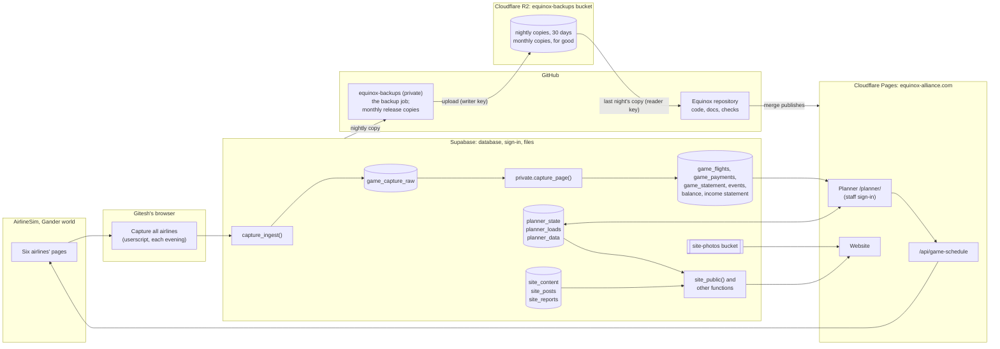

# How equinox. fits together

The map of the whole system: what each part is, where it lives, what runs when, where keys are kept, and what to do when
something breaks. Decision #10. The rules are in `docs/operating-manual.md`, the reasons in `docs/decisions.md`,
the tables in `docs/data.md`.

## The parts

| Part | What it is | Where |
|---|---|---|
| **Website** | The public airline site: home, flights, destinations, live network, our airlines, newsroom, investors, gander monthly. A single page that reads everything from `site_public()`. | `web/index.html`, `web/assets/`; served by Cloudflare Pages at equinox-alliance.com |
| **Planner** | The staff tool: routes, aircraft, hubs, the nightly capture's numbers, the cash forecast, to-dos. One HTML file. It keeps its own state in one database row (`planner_state`), saved 0.3 seconds after every change. Previews are look-only (#8). | `web/planner/index.html`, at equinox-alliance.com/planner/ |
| **Schedule check** | Reads an airline's public schedule from the game and returns it as JSON; the planner's Check screen compares it with the plan. | `functions/api/game-schedule.js`, a Cloudflare Pages Function at `/api/game-schedule` |
| **Database** | Supabase project `ulecwsyedvwcxgdzmhoq` (free plan): 58 tables, 7 views and 32 functions in `public`, 73 internal functions in `private` (which the data API doesn't expose), staff sign-in, and the `site-photos` file bucket. 32 of the tables are the planner's data in proper tables (#13: worlds, airlines, aircraft, routes, flight legs, plan cards, to-dos, settings and more), loaded from `planner_state` and the rest by `private.load_planner()` (#13, pull request 4). The planner still reads and saves `planner_state` until the switch-over; the adapter's getters, `planner_state_get()` and `planner_loads_get()`, already build its documents from the tables, and its write side, `planner_state_put()`, `planner_item_put()` and `planner_item_delete()`, saves into them, writing only what changed (#13, pull request 5). Side by side until the switch-over: every save of `planner_state` or `planner_loads` is copied into the tables when it commits, and the getters are compared with it; each copy and each comparison is a row in `job_runs`, and `adapter_clean_days()` counts the clean days. Every change to the tables is recorded in `change_log`, with who made it. The capture's data is in the new model already: one row per flown flight (`game_flights`) and the payments not tied to a flight (`game_payments`), each with its world and airline. Nothing signed out can read any table or view; the website, the investor page, the capture and the scripts go through functions. | supabase.com; tables in `docs/data.md`; every change in `database/migrations/` |
| **Capture** | A userscript in Gitesh's browser. It asks the database which airlines to capture (`capture_airlines()`, the capture key's world), then one button captures each airline's events, bank statement (last 3 days), income statement, balance sheet and loads, sends them to `capture_ingest()` by the airline's game ID. It doesn't touch salaries. The older userscript (sending names) and the bookmark still work. A second userscript, "Salaries: this airline", sets the open airline's salaries to 10% above the country average when Gitesh presses it (manual §7); it never talks to the database. | `capture/capture_all.user.js` (the key is a placeholder in the repository), `capture/salary_adjust.user.js` |
| **Scripts** | Python scripts Claude runs for the weekly report, gander monthly, the world scan and the schedule optimiser. | `scripts/`, how to run them in `scripts/README.md` |
| **Repository** | All code, database changes, tests and documents. Every change is a pull request that Gitesh approves with "merge" (#2). | GitHub `GiteshJain/Equinox` |
| **Backups** | A nightly copy of the database and files, restored each night to prove it works (#6), then uploaded to Cloudflare R2 (#16). Each night's copy is kept 30 days. The month's first is kept for good, in R2 and as a file on a GitHub release. Copies no longer go into git (since 9 Oct). | The job: GitHub `GiteshJain/equinox-backups` (private). The copies: R2 bucket `equinox-backups` (`nightly/`, `monthly/`, `latest.json`), and releases `backup-<YYYY-MM>` in `equinox-backups` |
| **Checks** | On every pull request: no keys, the schedule check, every planner screen and its key numbers, every website page (#9). The database rehearsal runs when the database or the planner changes (#8): it restores last night's copy from R2 into a full local Supabase on GitHub's runner (database, data API and sign-in), tries the database changes, then lets the pull request's own planner sign in as a test staff user and save into the copy for real, and reads the tables back (#17). | `.github/workflows/`, `tests/`, `database/rehearse.sh`, `database/backup/` |
| **Claude** | The Equinox project in Claude: four chats (Scheduling, Saturday review, Monthly, Building), the manual and decisions in the project files, and a Supabase connection. Big builds go to a helper with a fresh memory, which starts from `CLAUDE.md` (#26). | claude.ai |

## How data moves
1. **Each evening** Gitesh presses *Capture all airlines* in the game. For each airline, `capture_ingest()` checks the
   capture key (each key belongs to one world, and a page for an airline outside it is refused), keeps the raw page
   for 14 days (`game_capture_raw`), and `private.capture_page()` turns it into rows, each with its world and airline:
   - the bank statement's lines go to `game_statement`; each flight's lines (grouped by minute and block) become one
     `game_flights` row with its money, and every other line (leases, salaries, purchases) a `game_payments` row;
   - loads go to `game_flights` too. A flight's money and its loads are matched by route and time into one row
     (`private.match_flights()`) as the pages arrive, using the airports' UTC offsets (loaded by #13, pull request 4).
     A row stays one-sided until its partner arrives (the statement covers 3 days, the loads page 24 hours);
   - payments ahead go to `game_events`;
   - the balance sheet goes to `game_balance` (account 2800 is cash), the income statement to `game_pnl`, each with
     its capture day (the evening it was taken, 10:00 to 10:00 UTC);
   - the views `game_loads`, `game_flight_pnl` (profit per flight) and `game_ops_recent` (the last 24 hours) give
     the planner and the scripts exactly what the old tables gave;
   - loads are copied into the planner's month documents (`planner_loads`); a day counts as done once every active
     airline of the world has all five pages in (not at 6). The planner's own load saves go through `save_loads()`,
     which merges only the days it changed, and writes them to `load_entries` and `load_days` too.
2. **The planner** reads those tables when a staff member signs in. Route profit, the 14-day cash forecast, growth
   signals and the daily load report are all calculated in the browser. Plans and to-dos are saved back to
   `planner_state`.
   - **Side by side** (#13, pull requests 5 to 9): when a save of `planner_state` or `planner_loads` commits, a
     trigger copies it into the planner tables (actor `planner`, detail `mirror`, only the rows that changed) and
     compares `planner_state_get()` or `planner_loads_get()` with it, allowing only the differences the tests allow,
     plus one for a planner tab opened before the evening's capture and saved after it: a cash or next-7-day figure
     the saved document doesn't have yet, where the tables give the capture's. A figure the document has and the
     tables don't give back still fails.
     Each copy (`adapter_mirror`) and each comparison (`adapter_check`) is one `job_runs` row: ok, or failed with where
     it differed. A failure is recorded and never stops the save. The switch-over waits for 3 clean days in a row
     (`adapter_clean_days()`, per capture day in `adapter_check_days`).
3. **The website** calls `site_public()`, which builds everything public from `planner_state` (hubs, schedules),
   `site_content` (photos, logos, markets), `site_posts` and `site_reports`. Investor pages and reports need the
   password (`site_investor()`, `site_report()`).
4. **Claude's scripts** read through the `export_*` functions and write through `ingest_snapshot()`, `site_admin()` and
   `planner_data_set()`, using the ingest secret (kept as it is by #11).
5. **Every night** the backup copies the database (except the key tables and sign-in data) and the photo files,
   restores the copy, uploads it to Cloudflare R2 and records the result in `backup_runs`, which the planner shows.
   `latest.json` in R2 names the newest copy; the database rehearsal reads it to find last night's copy.

## What runs when

| When | What | Where to see it |
|---|---|---|
| Each evening, Chicago time | Gitesh's capture, all of the world's airlines in one press | Planner → Check → Capture |
| Every save of the planner, or of loads (until the switch-over) | The side by side: the save copied into the planner tables and compared with the getters | `job_runs` (`adapter_mirror`, `adapter_check`); `adapter_check_days`, `adapter_clean_days()` |
| 07:17 UTC daily (about 02:17 in Chicago; GitHub can start it hours late, as on 9 Oct at 14:20 UTC) | Nightly backup, restore check and upload to R2 (the month's first copy is also kept in `monthly/` and on a GitHub release) | Planner Home (backup line); `backup_runs` |
| Every pull request | Checks; database rehearsal, with real saves, if the database or the planner changes; a Cloudflare preview | Comments and checks on the pull request |
| Every merge to `main` | Cloudflare publishes the site and planner; the checks run again on `main` | equinox-alliance.com |
| Saturdays | Weekly report and review (Saturday review chat) | The investor library on the website |
| First Saturday of the month | Monthly report, gander monthly, monthly strategy (Monthly chat) | The investor library; gander monthly page |

## Where keys are kept (names only, never the keys)

| Key | Lives in | Used by |
|---|---|---|
| Supabase public (anon) key | In the website and planner code. It's public by design, and access is controlled by the database's rules. | Everything that talks to the database |
| Capture key | Gitesh's copy of the userscript; only its hash is in `capture_keys`, with the world it captures (name it when issuing a key) | The capture |
| Ingest secret | `ingest_secret` table; Claude's scripts read it from a file in Claude's workspace (`~/.ingest_secret`) | Claude's scripts (#11 kept it as it is) |
| Investor password | Its hash is in `report_access` | Investor page and reports |
| `SUPABASE_DB_URL` | GitHub secret on `equinox-backups` | The nightly backup |
| R2 writer key: `R2_ENDPOINT`, `R2_ACCESS_KEY_ID`, `R2_SECRET_ACCESS_KEY` (Object Read & Write, the `equinox-backups` bucket only) | GitHub secrets on `equinox-backups` | The nightly backup uploads its copy to R2 |
| R2 reader key: `R2_ENDPOINT`, `R2_READ_ACCESS_KEY_ID`, `R2_READ_SECRET_ACCESS_KEY` (Object Read only, the `equinox-backups` bucket only) | GitHub secrets on `Equinox` | The database rehearsal reads last night's copy; also used to get a copy for a test sample (`tests/README.md`) |
| Your password | Supabase sign-in (not in any table or backup). Sign-ups are off (#11), so yours is the only account | The planner |
| The rehearsal's local keys and test users | Made on GitHub's runner for the local copy each run, never printed, thrown away when the run ends | The real-saves test (#17) |

## When something breaks

| What | What to do |
|---|---|
| A change broke the site or planner | Revert its pull request on GitHub. Cloudflare republishes the previous version within a couple of minutes. |
| The site is down | Check Cloudflare's dashboard (Workers & Pages → equinox-alliance). The last good deployment can be rolled back there. |
| A capture failed for an airline | Press the capture again. If the game won't cooperate, enter cash and loads in Planner → Review → Manual entry. |
| The planner's data was overwritten or damaged | Restore `planner_state` from last night's copy (the README in `equinox-backups` has the steps). The planner warns if there's no good copy in the last 30 hours. |
| A side-by-side comparison failed (`job_runs`, `adapter_check`) | Nothing is lost: `planner_state` and `planner_loads` are still the truth. The row's note says where the tables differed, and `details` has the paths. Fix the cause in a pull request; the next save is copied in again. To stop the side by side altogether, drop the trigger `adapter_mirror` on both tables (Gitesh runs that in Supabase's SQL editor). |
| A row in one of #13's planner tables was changed or removed by mistake | `private.restore_row('<table>', '<its key>', '<a moment before the mistake>')` puts that one row back from `change_log` (as postgres, after naming the writer with `equinox.actor`, design §6). The restore is logged too. |
| The whole database is lost | Restore everything from a copy into a new Supabase project (the README in `equinox-backups` has the steps), then re-issue the keys, which are never backed up. The copies are in R2; if R2 can't be reached, use the month's GitHub release in `equinox-backups`. |
| A key leaked | Issue a new one and replace it where it lives (table above). For the capture key, also update Gitesh's userscript. |
| A check is red | Don't merge. The pull request's comment says which check and why. |
| The rehearsal can't get last night's copy | Its comment on the pull request says why: the R2 reader key isn't set up, there's no `latest.json`, or the copy doesn't match its SHA-256. Check the backup line on planner Home, fix the cause, then re-run the check. |
| Claude's workspace was reset | Nothing is lost: everything is in GitHub. A new session clones the repository. |
