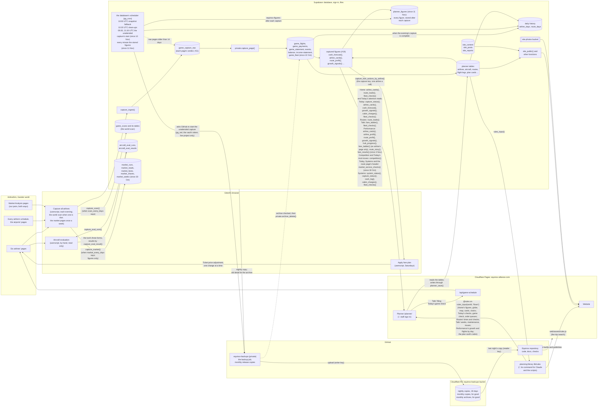

# How equinox. fits together

The map of the whole system: what each part is, where it lives, what runs when, where keys are kept, and what to do when
something breaks. Decision #10. The rules are in `docs/operating-manual.md`, the reasons in `docs/decisions.md`,
the tables in `docs/data.md`.

## The parts

Each part's full detail is in its own file under `docs/map/`, linked from its row. Read the rows, then only the files
for the parts your work touches. The map's size is capped by a check (`tests/map_size_test.py`).

| Part | What it is | Where |
|---|---|---|
| **Website** | The public airline site: home, flights, destinations, live network, our airlines, newsroom, investors, gander monthly. A single page that reads everything from `site_public()` (and gander monthly's issues from `site_newsletter()`, `web/assets/site.js`), our airlines' names, colours and text included (its own copy is only a fallback), and since 15 Oct the airports' names and which city's photo each takes (`content.airport_cities`, from `site_content`; the page no longer keeps them). Its trip search finds connections with the planning library's rule (#19, build pull request 4): from each airport's minimum connection time (`content.mct`, 90 minutes where unknown) to `content.connection_max_wait_h` (8 hours; 8 when the feed lacks it), from `web/assets/rules.js`. | `web/index.html`, `web/assets/` (`rules.js` is built, not committed); served by Cloudflare Pages at equinox-alliance.com |
| **Planner** | The staff tool (#18): React with TypeScript, staff sign-in only. Ten screens: Home, Today, Routes, Tails, Performance, Competition, Interline, Photos, Reference and Systems. It reads the tables and the captured figures, runs the planning library in the browser, and writes only through `planner_save()`, one call per action. Previews are look-only (#8). [In full](map/planner.md). | Source `app/planner/`; built into `web/app/`, served at equinox-alliance.com/planner/ |
| **Planning library** | The planning rules in one home (#19): times, block times, turns, connections, banks, maintenance, an aircraft's week and its issues, the schedule checks, the plan card's cabin and service checks, Home's figures, and the optimisers (one aircraft's day, and 7-day long-haul lines). Plain data in from `rules_input()`, plain data out. Used by the planner, the website's trip search, the weekly report and Claude's command (`node lib/rules/dist/cli.js`). [In full](map/planning-library.md). | `lib/rules/`; the build writes `lib/rules/dist/` and `web/assets/rules.js` |
| **Captured figures** | The figures worked out from what the capture recorded, in the database (#19): `cash_forecast()`, `airline_cards()`, `airline_profit()`, `route_profit()`, `aircraft_profit()`, `growth_signals()`, `hub_progress()`, `competition()`, `route_story()`, `fare_ladder()`, `fare_results()`, `market_service_checks()`, `capture_status()` and the rest. Each takes an "as of" moment; their builders are `private.fig_*`. The planner and staff call them; the scripts get them all through `export_for_report('figures')`. Since 11 Nov each is also stored after every capture (`planner_figures`, the job `equinox-figures`). [In full](map/captured-figures.md). | `database/migrations/`; what each answers in `docs/data.md` |
| **Fares userscript** | Gitesh's second userscript in the game (manual §5). **Apply fare plan** reads this week's fare changes the captures haven't seen, one airline at a time (`capture_fare_actions_by_airline()`, the capture key), and makes each through the game's Ticket price adjustment, 2 seconds apart, stopping at the first problem. Prices only; never on a schedule. [In full](map/fares-userscript.md). | `capture/fares_apply.user.js` |
| **Aircraft evaluation userscript** | Gitesh's third userscript, on the game's aircraft evaluation tool only, by hand. It runs each route in `aircraft_eval_runs` through the tool's own forms and sends each result to `capture_eval_result()`. It changes nothing in the game. [In full](map/aircraft-evaluation-userscript.md). | `capture/aircraft_eval.user.js` |
| **Schedule check** | Reads an airline's public schedule from the game and returns it as JSON; the planner's Game check (on Today since 20 Oct, Check's until then) compares it with the plan, and filing an arrived aircraft (Today's **File into planner**, the planner's Tails) checks its plan card against it. | `functions/api/game-schedule.js`, a Cloudflare Pages Function at `/api/game-schedule` |
| **Database** | Supabase project `ulecwsyedvwcxgdzmhoq` (free plan): the planner's tables (written through `planner_save()`, every change in `change_log`), the capture's data (`game_flights`, `game_payments`, `game_fleet` and more), the daily history kept for good (`airline_days`, `route_days`), the world scans, the market pages, the rule numbers (`settings`, `world_rules`), shared pairs and the jobs on `pg_cron`. Nothing signed out reads a table: the website, the userscripts and the scripts go through functions. [In full](map/database.md). | supabase.com; tables in `docs/data.md`; every change in `database/migrations/` |
| **Capture** | Gitesh's userscript in the game. One press captures every airline's events, bank statement (the whole 24 hours, in parts of at most 500 lines), income statement, balance sheet, loads and fleet pages into `capture_ingest()`, each page checked as it arrives (#21). Then, when due, the world scan and the market pages, and on his press the salaries. [In full](map/capture.md). | `capture/capture_all.user.js` |
| **Unattended capture** | The same capture, run twice a day by a GitHub job in `equinox-backups` (since 11 Nov), started at 09:30 and 21:30 UTC by the database's scheduler (`private.capture_dispatch()`, with the vault's token). Its own key: the world scan and the market pages when due; no salaries, fares or aircraft evaluation. Each start and run is a `job_runs` row; Today and the Systems board warn after 14 hours without a good run. [In full](map/unattended-capture.md). | The job: GitHub `GiteshJain/equinox-backups`; the start: migration `20261110040000_unattended_capture.sql` |
| **Scripts** | Python scripts Claude runs: the weekly report, gander monthly, the world scan by hand (`gscan.py`, the fallback) and the airline briefing (`brief.py <airline>`). They read through `export_for_report()`. [In full](map/scripts.md). | `scripts/`, how to run them in `scripts/README.md` |
| **Repository** | All code, database changes, tests and documents. Every change is a pull request that Gitesh approves with "merge" (#2). The planner's dependencies are pinned in `package.json` and `package-lock.json` (Node 22, `.nvmrc`). | GitHub `GiteshJain/Equinox` (public since 14 Oct, so its Actions minutes are free; `equinox-backups` stays private) |
| **Build** | Cloudflare builds before it publishes: `if [ -f package.json ]; then npm ci && npm run build; fi`, output folder `web` (set in Cloudflare's dashboard, Workers & Pages → equinox-alliance → Settings → Build). The build makes the planner into `web/app/`, the planning library's command into `lib/rules/dist/` (outside `web`, so never published) and its browser file for the website's trip search into `web/assets/rules.js`; the rest of the website needs no build. A build that fails leaves the last good version live, and the checks run the same build on every pull request. | Cloudflare Pages; `package.json` (`build`, `typecheck`, `lint`, `test`) |
| **Backups** | A nightly copy of the database and files, restored each night to prove it works (#6), then uploaded to Cloudflare R2 (#16). Each night's copy is kept 30 days. The month's first is kept for good, in R2 and as a file on a GitHub release. Copies no longer go into git (since 9 Oct). The same job runs the monthly archive (#16, design §7): detail more than one full calendar month old (the change log after 12) is exported to R2 and the month's release, both copies are checked, and only then is it deleted, through `private.archive_delete()`, which refuses anything else. The week's rivals by pair (`scan_pair_airlines`, since 23 Oct) are left alone, so a route's *Rivals on the pair* keeps weekly points from before the archived month. | The job: GitHub `GiteshJain/equinox-backups` (private). The copies: R2 bucket `equinox-backups` (`nightly/`, `monthly/`, `archive/`, `latest.json`), and releases `backup-<YYYY-MM>` in `equinox-backups` (the month's copy and its archive files) |
| **Checks** | On every pull request, `tests/run_all.sh`: no keys, the userscripts on saved pages, the planner's and the library's build and tests, the screens' figures and the optimisers against saved answers, the weekly report, the briefing, the website, and the map's size. The database rehearsal restores last night's copy and tries the database changes, every planner screen and save, and the capture checks. [In full](map/checks.md). | `.github/workflows/`, `tests/`, `database/rehearse.sh`, `database/backup/` |
| **Claude** | The Equinox project in Claude: three chats (Scheduling, Saturday review, which also does the first Saturday's monthly work, and Building), the manual and decisions in the project files, and a Supabase connection. Big builds go to a helper with a fresh memory, which starts from `CLAUDE.md` (#26). | claude.ai |

## How data moves
1. **Each evening** Gitesh presses *Capture all airlines* in the game. For each airline, `capture_ingest()` checks the
   capture key (each key belongs to one world, and a page for an airline outside it is refused), keeps the raw page
   for 14 days (`game_capture_raw`), and `private.capture_page()` turns it into rows, each with its world and airline:
   - **each page is checked** as it is stored (#21, `private.capture_check()`): loads against the airline's flights
     scheduled in the page's window (its flight legs in the 24 hours before the capture, each rotation from the day after
     it launched), the statement against its
     recent nights' median (since 10 Nov, capture 1.16, a statement comes in parts: parts 1 to n-1 are ok as they arrive,
     the last is judged on the run's lines together, broken if a part is missing, and its note says the hours before the
     run's oldest line that no capture read, more than 15 minutes after the airline's previous one; the median counts
     each night's latest run, its parts summed; `private.statement_run()` reads a part's address), the balance sheet for the cash account, events and the income statement for any rows; a page
     that doesn't read is broken. The verdict is kept on the raw page and given in the reply; `capture_status()` and
     `system_status()` give each airline's latest;
   - the bank statement's lines go to `game_statement`; each flight's lines (grouped by minute and block) become one
     `game_flights` row with its money, and every other line (leases, salaries, purchases, cabins, and since 15 Oct the pilot training an order brings, kind cabin) a `game_payments` row;
     a line already kept is written again only when its block changed or its flight is deleted, loses its money or
     changes, so a page read again writes only what is new or different, the rows the same as before (since 11 Nov,
     to-do 204, spec `docs/specs/2026-11-11-statement-no-rewrite.md`);
   - **the cabin charge check** (since 22 Oct, spec `docs/specs/2026-10-21-tidy-ups.md` §3; manual §4): a cabin
     installation line ("Installation of cabin interior (9M-AAV)") names its registration and the airline's aircraft
     (`private.payment_registration()`, `private.payment_aircraft()`), and `cabin_charges()` (staff, read with GET; its
     builder `private.fig_cabin_charges()`, a captured figure) sets each first cabin fit Tails' filing logged in
     `spending_log` since `settings.cabin_charge_check_from` (18 Oct) against them: matches, differs, charged twice, not
     charged yet (none 2 days after it was logged) or not logged. Systems' Cabin charges board lists the problems, with
     **Use the game's amount** (the fit's amount through `planner_save()`), and Today's needs attention has one item;
   - **a fleet page** (since 22 Oct, spec `docs/specs/2026-10-22-fleet-capture.md`) goes to `game_fleet`
     (`private.capture_fleet()`): each aircraft, matched to the planner's by registration within the airline, for the
     page's capture day, the latest capture winning. Its check: short with no aircraft rows, broken when it doesn't read;
     an airline's verdict counts its fleet pages when that day has some (`capture_status()` gives them as `fleet`), and
     `fleet_checks()` (staff, read with GET, its own 30 s limit; builder `private.fig_fleet_checks()`) lists, from the
     latest night, the game's maintenance under `settings.maintenance_min_pct`, no pilots, seats that don't match the
     planner's cabin, aircraft in the game but not the planner, and active aircraft missing from the game's pages (only
     when every fleet page of the airline's latest run that night came in ok), and since 22 Oct (spec
     `docs/specs/2026-10-22-aircraft-age-check.md`; manual §3, replacement by age) an aircraft within
     `settings.replace_warn_days` (60) of its replacement age by the game's age (`replace_new_years` 3 for one marked new in
     `aircraft.acquired`, `replace_used_years` 10 for one marked used), or past it, and one marked new that is older in
     the game than its time with us (the night less its delivery) by more than 0.2 years (an aircraft not delivered yet,
     on order in the planner or at the factory with no seats and no pilots, is left out of these, since 26 Oct): Today's Fleet group, Systems'
     Fleet board (with each aircraft's age and replacement age) and the Tails pop-up read it;
   - loads go to `game_flights` too. A flight's money and its loads are matched by route and time into one row
     (`private.match_flights()`) as the pages arrive, using the airports' UTC offsets (loaded by #13, pull request 4).
     A row stays one-sided until its partner arrives (the statement covers 3 days, the loads page 24 hours);
   - **the links** (since 22 Oct, spec `docs/specs/2026-10-21-links-and-business-index.md`): after every statement and
     loads page, once the matching is done, each flight still without them gets its route and aircraft
     (`private.fill_flight_links()`: the schedule's leg with that number and direction, else the airline's route on its
     airports, either way round, one that isn't removed first; the aircraft by registration), so a flight carries them
     from the evening it's captured. A flight whose money came first is linked by its number once its loads join it.
     Until 22 Oct they were filled only once, at the 10 Oct data load;
   - payments ahead go to `game_events`;
   - the balance sheet goes to `game_balance` (account 2800 is cash), the income statement to `game_pnl`, each with
     its capture day (the evening it was taken, 10:00 to 10:00 UTC). A second capture the same UTC date replaces a
     row's figures and its time together (since #13 pull request 6), so the cash forecast times the cash it shows by
     the capture that gave it;
   - **the daily snapshot:** the page that completes the world's capture for the day (every active airline of ours has
     all five pages) also takes the snapshot (`private.take_snapshot()`): each airline's fleet, weekly schedule and
     cash into `airline_days`, and the flights, passengers, money and payments of that UTC day and the two before
     (recomputed, since a late capture can still add to them) into `airline_days` and `route_days` (each route day with its
     economy and business passengers and seats, business fare and block minutes since 22 Oct, and, the links filled first
     since 22 Oct, its route); one `job_runs` row.
     A second complete capture the same evening takes it again. With no complete capture, the 10:00 UTC job takes it
     (step 6);
   - the views `game_loads`, `game_flight_pnl` (profit per flight) and `game_ops_recent` (the last 24 hours) give
     the planner and the scripts exactly what the old tables gave;
   - **the world scan** (since 21 Oct): after the last airline, when `capture_airlines()` said a scan is due and every
     page went in, the userscript reads the world's airlines and airport pages and sends them to `capture_scan()` with
     the capture key: start (an unfinished scan of the world from the last hour is carried on instead; since 22 Oct one
     left unfinished longer is marked stopped first, with a note of how far it got, and the Systems board's scan line
     says so in amber while no finished scan came after it), each airline's
     schedule and, since 23 Oct (version 1.8, spec `docs/specs/2026-10-23-rival-fleets.md`), its overview page (kind
     `fleet`: its fleet by type with aircraft on order into `scan_airline_fleet`, its totals and general figures into
     `scan_airline_profile`, both kept for good; a page that doesn't read is kept as not read and never stops the scan
     or counts towards its 10%), each airport page, then finish, which marks the scan done and builds its airport summaries
     (`scan_airline_airports`), then (since 23 Oct, spec `docs/specs/2026-10-23-rival-connections.md` §1) works out the
     rivals' one-stop connections on our pairs from the scan's schedules (`private.scan_connections()`, about a second:
     same airline, the connecting airport's minimum connection time to 8 hours, both legs at most
     `settings.rival_connection_detour_max`, 1.5, times the direct distance) into `scan_rival_connections` and
     `scan_rival_connections_week`, its count added to the scan's note ("connections: N rivals on M of our pairs"); a
     calculation that fails never stops the finish (the note says so; `select private.scan_connections(<scan id>);` by hand),
     then (since 23 Oct, spec `docs/specs/2026-10-23-rival-pairs-history.md` §2), when it is the week's kept scan (the
     first finished scan of the world on or after each Saturday, UTC date), keeps each airline's departures a week on
     every pair in the world for good (`scan_pair_airlines`, `private.scan_pairs_keep()`; a second scan the same week
     writes nothing, and a write that fails never stops the finish: the note says "pairs not kept"). Every airline it sees gets an `airlines` row (change log actor `capture`). The work is
     `private.scan_ingest()`, which `ingest_snapshot()` shares; the Systems board's scan line reads the latest finished
     scan, with its fleet pages read and failed since 23 Oct;
   - **the market pages** (since 30 Oct, spec `docs/specs/2026-10-30-market-pages.md`): after the world scan (or the last
     airline when none is due), when `capture_airlines()` said they're due (`market_every_days`, 7) and every capture page
     went in, the userscript reads the Market Analysis page of both directions of every pair our airlines fly, airline by
     airline, and sends the figures to `capture_market()` with the capture key (`private.market_ingest()`): start (an open
     run of the world from the last hour is carried on; one left open longer is marked stopped first, with how far it
     got), each page (a `market_reads` row, ok or failed; its fares by flight prefix and class into `market_fares`, the
     airline by the prefix where the latest finished world scan's schedules give one airline that prefix, else the share
     list's airline with that code, else none; the game's shares into `market_shares`, an enterprise it doesn't know added to
     `airlines`, actor capture; the pair's weeks with figures into `market_weeks`, the latest read winning; the run's pages
     read and failed), then finish (done, refused with more than 10% of the pages failed). No page is kept; the Systems
     board's market line (`system_status()`, the board itself in part 2) reads the latest finished run;
   - the planner's loads come from those rows: `loads_by_day()` gives each day from `game_flights`, with the loads
     typed by hand (`load_entries`, the latest winning) and the day flags typed (`load_days`), by the captured figures'
     rules (`private.fig_load_values()`, `private.fig_load_days()`). A day counts as done once every active airline of
     the world has been captured for it (one rule since #13 pull request 9; not a count to 6). The planner's own load
     saves are `planner_save()` calls on `load_entries` and `load_days`.
2. **The planner** (#18; at `/planner/` since the switch on 14 Oct, the only one since the clean-up the same day)
     reads only what each screen shows, straight from the tables and views under their staff rules,
     through TanStack Query, which keeps a screen's data while you move around and reads it again when it's stale or
     after a save. Tables go stale after a minute; the captured figures after 15 minutes, since they change only with a
     capture (24 Oct; the capture's and the systems' state stay at a minute), and every figure goes through one queue,
     at most four at a time (`data/limit.ts`; Performance's since 22 Oct, every screen's since 24 Oct), so opening a
     screen while the evening's capture and scan write doesn't push the calls past their limits. Home (build pull request 5) and the screens after it also ask the planning library (on `rules_input(world, 'flown')`) and the
     captured figures (at the screen's moment) for its figures, and moves on with the clock each minute. Each action sends one `planner_save()` call with every row it changes (actor
     `planner`, the tab's ID in the change log), each update or delete with
     the row's `updated_at` as it was read. If any of those rows changed since, nothing is written: the answer gives
     them as they are now, and the screen shows them and says what clashed. A call that doesn't get through stays on
     screen as "not saved · retry"; nothing is kept on the device (design §14, choice 3). The old planner, which
     worked its figures out in the browser and saved its whole document through an adapter, went with the clean-up.
3. **The website** calls `site_public()`, which builds everything public from the planner tables (#13, pull request 8:
   hubs, aircraft, schedules, signed interlines, our airlines' names, colours and text, the connection times from
   `world_airports`, and the longest wait for a connection, `connection_max_wait_h`, from `settings`), `site_content`
   (photos, logos), `site_posts` and `site_reports`. The trip search tests every transfer with the planning library's
   connection test (`web/assets/rules.js`, #19). Investor pages and reports need
   the password (`site_investor()`, whose cash and next-7-day costs it works out as the planner rounds them, the
   capture's figure unless typed by hand, and whose money spent is `spending_log`; `site_report()`). The aircraft
   flying are those in service, in the order they were added (since the clean-up).
4. **Claude's scripts** read through the `export_*` functions (`export_for_report()`'s scan kinds read `game_scans` and
   its tables; kind `planner`, the old planner's documents, is refused since the clean-up;
   `export_for_report('rules')` gives the planning library's input, as `rules_input()` gives it to staff, for the
   library's command, `node lib/rules/dist/cli.js`; `export_for_report('figures')` gives every captured figure for every
   airline, as the captured-figures functions give them to staff; `export_for_report('briefing')` gives one airline's
   deliveries with their plan cards and legs, its open to-dos and the group's, its fare plan and its loads by route,
   read only (#24); since 3 Nov `export_for_report('fare_results')` gives one airline's `fare_results()`; the weekly
   report reads `rules` and `figures` with the scan kinds, and `fare_results` for each airline (since 3 Nov), and runs
   the library's command on `rules`; the airline briefing reads all of them for one airline) and write
   through `ingest_snapshot()` (the world scan by hand, `gscan.py`, the fallback since 21 Oct: the same work as the
   capture's `capture_scan()`, which also adds every airline it sees to `airlines` and builds the scan's airport
   summaries; and the weekly report's market summaries, kind `markets`, sent by
   `scripts/report/analyze.py`), `site_admin()` (its
   connection times go to `world_airports`) and `planner_data_set()` (the route research, key `DATA`, goes to
   `countries`, `airports` and `routes`, only the rows that change), using the ingest
   secret (kept as it is by #11). Signed out, each call has 3 seconds before the database cuts it off (signed-in staff
   8); `export_for_report()` has its own 30 seconds, since the figures take about 3 (17 Oct), and so has
   `capture_fare_actions()`, since 10 Nov `capture_scan()` (the scan's finish, the rivals' connections included, timed out under the signed-out limit from 4 Nov), since 9 Nov `capture_ingest()` (a bank statement of 1,500 new lines after three evenings without a capture timed out under the signed-out limit) and, since 2 Nov, `capture_fare_actions_by_airline()` (the fares userscript's list, one airline a call: every airline's fare ladder in one call took about 70 s on 2 Nov, and calls through the API are cut off at 60 s whatever a function's limit) (21 Oct), and since 22 Oct every captured figure the planner reads (24 Oct for `competition()`,
   which Home reads for each airline at once).
5. **Every night** the backup copies the database (except the key tables and sign-in data) and the photo files,
   restores the copy, uploads it to Cloudflare R2 and records the result in `backup_runs` (a view since #13 pull request
   7: the row lands in `job_runs`), which the planner shows. `latest.json` in R2 names the newest copy; the database
   rehearsal reads it to find last night's copy. Then the **monthly archive**: the database lists what's due
   (`private.archive_due()`); for each table and month the job exports the rows with their manifest
   (`private.archive_manifest()`: count, checksum, layout, migration version) in one read-only transaction, puts them in
   R2 (`archive/<table>/<YYYY-MM>.csv.gz`) and on that month's release, reads both back, and calls
   `private.archive_delete()`, which deletes only that month's rows and only if they still match. One `job_runs` row per
   table and month (job `archive`).
6. **Every day, inside the database** (`pg_cron`, as postgres, no key): at 10:00 UTC `private.job_snapshot_fallback()`
   takes the snapshot of the capture day just ended if no complete capture took it (source fallback, marked incomplete,
   cash from the latest balance), and of any earlier day that has none; at 10:20 UTC `private.job_cleanup()` deletes
   raw pages older than 14 days, and statement lines older than 14 days once each is in `game_flights` or
   `game_payments`, while `settings.statement_cleanup_enabled` is true (on since 5 Nov). One `job_runs` row a run. The
   planner's Home warns from `job_runs` and `backup_runs`: no good backup for 30 hours or its last run failed, no
   snapshot for 30 hours, the 10:00 UTC job not run for 30 hours, the month's archive not run by the 3rd, or any job's
   last run failed.
7. **The aircraft evaluation** (since 27 Oct, by hand, while Gitesh watches): the Scheduling chat writes the run list into
   `aircraft_eval_runs` with plain SQL (manual §1's actor line). In the game's aircraft evaluation tool Gitesh presses
   **Aircraft evaluation**; the userscript reads the runs without a result with the capture key (`capture_eval_runs()`),
   runs the tool for each by `fetch` (route, add aircraft, settings: only the tool's own forms), and sends each result to
   `capture_eval_result()`, which checks it (a row for each of `settings.aircraft_eval_types`, every figure a number),
   replaces any earlier result for the run in `aircraft_eval_results` and sets the run's `done_at`. The Scheduling chat reads
   the results as postgres.

## Which call answers which question

The questions the chats ask again and again, each with the one call that answers it (decision #24). **For one airline's
whole background before scheduling (manual §4), start with the briefing:** it gathers the rest. Read this before
guessing a table or column; `docs/data.md` has every table when no call fits.
- **In a chat with the Supabase connection,** call the functions as postgres (`select public.cash_forecast(2);`). Staff
  signed in get the same. The ingest secret is in `ingest_secret`, so a chat can call `export_for_report()` too.
- **From a script,** call `export_for_report()` with the ingest secret (`scripts/README.md`); its kinds give the same
  documents.
- **The planning library's commands** read `rules.json` (kind `rules`, or `rules_input()`): `node lib/rules/dist/cli.js
  <command> rules.json ...`, after `npm ci && npm run build`. A plan card for `check-card` is a file
  `{"aircraft": <registration or id>, "config_id": <its cabin>, "legs": [...]}`, its legs as `plan_card_legs` holds them
  (`flight_no`, `origin_code`, `dest_code`, `days_utc`, `dep_utc_min`, `block_min`, `service_code`) and its cabin as
  `plan_cards.config_id` (or a layout's code); the answer's `cabin` is the cabin its routes call for (since 21 Oct).
  With `--fares fare_ladder.json` (`select public.fare_ladder(<airline id>);` for the card's airline, or the briefing's
  `fare_ladder`) the answer's `fares` is each route's fare level (since 21 Oct), once per direction the card flies it, each
  leg its own direction's (since 26 Oct), each cabin with its level in AS$ (`price`) where the ladder's row has the
  market's default price (since 4 Nov).
- Money is in millions of AS$ and moments are UTC. Our airlines' ids: 1 Pan Am, 2 Kingfisher, 3 Ryanair, 4 Virgin
  Atlantic, 5 China Eastern, 6 Malaysia Airlines.

**Every example below is run on the rehearsal's copy** of last night's backup, exactly as written, on each pull request
that changes the database, the briefing or this map (`tests/briefing_copy_test.py`). A call that's renamed, removed or
called wrongly here fails that check.

| Question | The call | Example (tested on the copy) |
|---|---|---|
| An airline's whole background before scheduling: money, fleet, routes, hubs, deliveries and plan cards, to-dos, fare plan, competition (the top 20 openings and the threats, since 21 Oct), rivals, the capture | the briefing | `python3 scripts/briefing/brief.py KF` |
| Can it order now, when, how much it can spend now (`up_to`, since 26 Oct), and the cash forecast's lowest point | `cash_forecast()` | `select public.cash_forecast(2);` |
| Would an order keep the cushion | `cash_forecast()` with orders | `select public.cash_forecast(2, '[{"type": "A321 NEO LIGHT", "count": 2}]');` |
| Performance's scorecards: profit a day, per aircraft, load over 7 days, next order | `airline_cards()` | `select public.airline_cards();` |
| Profit for each day between captures | `airline_profit()` | `select public.airline_profit(2);` |
| Route profit, and each route's mark (add, sold_out, fix, losing, hold) with why; a route under 7 days old gets none of fix or losing (`growth_new_route_days`); a sold-out route's add or sold_out by its profit per aircraft hour (`aircraft_hours`, `profit_per_aircraft_hour`; sold_out, "sold out · fares climbing", was raise until 31 Oct: the fare ladder raises it); since 5 Nov a joined shared pair's rows carry `shared_role` and `pair` (the other airline's flights, loads and profit, and the pair's combined figures) and their mark is judged on both airlines' flights | `route_profit()` | `select public.route_profit(2, 7);` |
| An aircraft's profit a day, after its lease | `aircraft_profit()` | `select public.aircraft_profit(2, 7);` |
| Ready for another flight, sold out · fares climbing (`sold_out`; `raise_fares` until 31 Oct), fix or reduce, aircraft losing after lease; load patterns; since 5 Nov a joined shared pair listed once, under its owner with `shared_with`, the joiner's row in `follows` | `growth_signals()` | `select public.growth_signals();` |
| Hubs first, and which bases are contested | `hub_progress()` | `select public.hub_progress();` |
| Which routes to open next, ranked (stars, rivals' departures a week, the shorter distance; each with its variant and hubs first), market share by market, the rivals' threats on our pairs and their profiles (manual §3); since 5 Nov a shared pair's opening carries `shared`, and a pair the airline would join is an opening only while its owner can't fund it that evening ("owner can't fund tonight"; `openings_owner_first` counts the rest) | `competition()` | `select public.competition(2, now(), 20);` |
| Which rivals reach our pairs through their own hubs: each rival's one-stop connecting departures a week on the airline's pairs, beside direct and never added to it, by market, opening, rival profile and competitor, with the connecting airports (since 23 Oct) | `competition()`'s `connecting_weekly` and `connecting_via` | `select jsonb_path_query_array(public.competition(2, now(), 0), '$.markets[*].connecting_weekly');` |
| Which rivals are building their fleets: each rival's aircraft and aircraft on order with the change since the week-before scan, and the big order books and airlines with orders but no flights yet, with whether each meets the airline (since 23 Oct) | `competition()`'s `order_flags`, and each competitor's and profile's `fleet` | `select public.competition(2, now(), 0) -> 'order_flags';` |
| Loads by route and by flight over 7 days | `route_loads()` | `select public.route_loads();` |
| How has this route done since launch, and what changed on it: its days and weeks by cabin, profit an aircraft hour, its events (frequencies, aircraft, times, fares, rivals), the rivals on the pair and our share at each scan (the planner's route page); since 5 Nov a route on a joined shared pair gives the pair's one page (the owner's and the joiner's route the same): combined days, weeks and departures, each airline's own money in `pair.airlines`, one timeline marked by airline | `route_story()` | `select public.route_story((select r.id from public.routes r join public.rotations rt on rt.route_id = r.id where r.airline_id = 2 order by r.id limit 1));` |
| Loads by day, as Loads by hand shows them | `loads_by_day()` | `select public.loads_by_day(null, current_date - 6, current_date);` |
| Fare changes seen in the captures | `fare_changes()` | `select public.fare_changes(2);` |
| The fare plan, and whether the captures show each change | `fare_plan_status()` | `select public.fare_plan_status(2);` |
| What the fare ladder has done to each route: each repriced direction's level now, its economy fare, loads and profit a flight before its first seen change and since, profit a week gained and its flags, against the rest of the airline (since 3 Nov; Performance's Fare results); since 5 Nov a joiner's directions take the owner's moves (`follows`) | `fare_results()` | `select public.fare_results(2);` |
| This Saturday's fare moves: each route, cabin and direction's level (per direction since 26 Oct), move and why, its fare index (against the game's default price where the market pages have read it, since 4 Nov), and the game actions that make them, the routes off their level set back first (manual §5); on a shared pair (since 5 Nov) the owner's rows count the joiner's flights (`shared_with`) and the joiner's rows follow the owner's level (`follows`), with set-backs only | `fare_ladder()` | `select public.fare_ladder(2);` |
| The shared pairs: every base-to-base pair of two of our airlines (Ryanair out), its owner and joiner, their routes and flights a week, and when it was joined (since 5 Nov; joining one is `join_pair(<owner's route id>)`, manual §2) | the view `shared_pairs` | `select count(*) as pairs, count(joiner_route_id) as joined from public.shared_pairs;` |
| The joined shared pairs for the group page: both airlines' flights a week, the pair's load over 7 days and its level each way, and the first two Saturdays' 6-pair limit while it applies (since 5 Nov; Performance's Shared pairs row) | `shared_pairs_status()` | `select public.shared_pairs_status();` |
| The game's default price on an airline's routes, as the market pages read it: each direction and cabin's default and our current price from the latest finished market run, the default of the run before it and whether it changed (since 4 Nov; what the fare ladder measures each direction against) | `default_prices()` | `select public.default_prices(2);` |
| Cash and fixed costs by day, the nightly log (Systems → Manual entry) | `cash_log()` | `select public.cash_log();` |
| The capture's state: each airline's pages, and #21's verdict | `capture_status()` | `select public.capture_status();` |
| What needs a look on the latest night's fleet pages (the game's maintenance under 100%, no pilots, seats unlike the planner's cabin, aircraft in one of the game and the planner only), and each aircraft as the game showed it | `fleet_checks()` (or `game_fleet` for any night) | `select public.fleet_checks();` |
| What the game's aircraft evaluation tool showed for each type on each run: whether it can fly the route, its seats, costs, and profit and margin at 50 to 100% load (since 27 Oct; the runs and their order in `aircraft_eval_runs`) | `aircraft_eval_results` with `aircraft_eval_runs` (as postgres) | `select count(*) as n_rows, count(*) filter (where x.can_operate) as can_fly, count(distinct x.run_id) as runs from public.aircraft_eval_results x join public.aircraft_eval_runs r on r.id = x.run_id;` |
| How far the aircraft evaluation has got: the runs on the list and those with a result (the userscript asks `capture_eval_runs()` with the capture key) | `aircraft_eval_runs` (as postgres) | `select count(*) as total, count(done_at) as done from public.aircraft_eval_runs;` |
| The systems' state: capture, snapshot, backup, archive, clean-ups, the scan's age (and a scan that stopped part-way), the latest market run (since 30 Oct), usage | `system_status()` | `select public.system_status();` |
| Does the game's cabin charge match the first fit we logged? (each fit since `cabin_charge_check_from`: matches, differs, charged twice, not charged yet, not logged) | `cabin_charges()` | `select public.cabin_charges();` |
| Rivals' fares on our pairs from the market pages (since 30 Oct): each airline's lowest, average and highest price by class and direction, flights seen and finished sold out, per page read; the airline by flight prefix, null when it couldn't be told | `market_fares` with `market_reads` (as postgres) | `select count(*) as n_rows, count(distinct f.read_id) as pages, count(*) filter (where f.airline_id is null) as unmatched, min(f.price_low) as lowest from public.market_fares f join public.market_reads m on m.id = f.read_id;` |
| Which of our pairs are set to a different service profile in the game than their distance calls for (manual §4) or than the planner has, from the latest market read: the pair, direction, airline, the game's code, the distance's and the planner's (since 30 Oct) | `market_service_checks()` | `select public.market_service_checks();` |
| What the market pages say about one route: each direction's latest read with every airline's fares by class, the game's passenger shares this week and last, and the pair's seats and price by week (since 30 Oct; null before the first read) | `route_story()`'s `market` | `select coalesce(jsonb_agg(jsonb_build_object('route_id', x.id, 'market', public.route_story(x.id) -> 'market')), '[]'::jsonb) as routes from (select r.id from public.routes r join public.rotations rt on rt.route_id = r.id where r.airline_id = 2 order by r.id limit 1) x;` |
| The game's own passenger share on a pair, by week (since 30 Oct), and the pair's weekly seats and price | `market_shares` with `market_reads`; `market_weeks` (as postgres) | `select count(*) as shares, count(distinct s.airline_id) as airlines, max(s.week) as latest_week from public.market_shares s where s.kind = 'passengers';` |
| Whether tonight's capture reads the market pages (the latest finished market run's age against `market_every_days`), an open run, and the pages it would read | `capture_airlines()` with the capture key (its market part, for a chat as postgres) | `select private.capture_market_plan((select id from public.worlds where is_default), now()) - 'market_pages';` |
| Whether tonight's capture scans the world (the latest finished scan's age against `scan_every_days`), an open scan, and the airports it reads | `capture_airlines()` with the capture key (its scan part, for a chat as postgres) | `select private.capture_scan_plan((select id from public.worlds where is_default), now());` |
| The world scans, and how old the latest is | `export_for_report()`, kind `snapshots` | `select public.export_for_report((select secret from public.ingest_secret limit 1), 'snapshots');` |
| The rivals: every airline's schedule in a scan (the briefing counts them by route and airport) | `export_for_report()`, kind `airlines` | `select jsonb_array_length(public.export_for_report((select secret from public.ingest_secret limit 1), 'airlines', (select max(id) from public.game_scans where status = 'done')::text));` |
| Every captured figure for every airline at once | `export_for_report()`, kind `figures` | `select public.export_for_report((select secret from public.ingest_secret limit 1), 'figures', '{}') -> 'as_of';` |
| One airline's deliveries with their plan cards, open to-dos, fare plan, each route's fare level (per direction since 26 Oct) and loads | `export_for_report()`, kind `briefing` | `select public.export_for_report((select secret from public.ingest_secret limit 1), 'briefing', '{"airline": "KF"}');` |
| The planning library's input (`rules.json`) | `rules_input()`, or `export_for_report()` kind `rules` | `select jsonb_array_length(public.rules_input() -> 'flight_legs');` |
| An aircraft's week: its legs, block hours, turns and maintenance | library `aircraft` | `node lib/rules/dist/cli.js aircraft rules.json VT-AAA` |
| Every aircraft's legs a week, block hours a day, maintenance and issues | library `aircraft` | `node lib/rules/dist/cli.js aircraft rules.json` |
| A plan card's check at both ends (with how many connections fall within the 4-hour planning target, since 27 Oct; since 28 Oct the maintenance spacing too, a stretch without a counting stop over `maintenance_max_gap_h` a problem), service codes, the cabin its routes call for and each route's fare level in each direction included | library `check-card` | `node lib/rules/dist/cli.js check-card rules.json card.json --fares fare_ladder.json` |
| Every connection at an airport, with its days, gaps and banks | library `connections` | `node lib/rules/dist/cli.js connections rules.json DEL` |
| The block time of a leg not yet timed | library `block` | `node lib/rules/dist/cli.js block rules.json DEL BOM "A321 NEO LIGHT"` |
| The best day's schedule for one aircraft from a base | library `optimise` | `node lib/rules/dist/cli.js optimise rules.json KUL KCH,PQC,PEN --type "A321 NEO LIGHT" --step 15` |
| The best 7-day rotating line for long haul (since 28 Oct; manual §4, spec `docs/specs/2026-10-27-long-haul-lines.md` §1): its legs by line day with flight numbers and service codes, the 7 aircraft cards with their weekday offsets, the score (connections within 4 hours first) and whether the search finished; the type's reach is `aircraft_types.range_km`, which `rules_input()` carries since 28 Oct (`--range` overrides it), `--seconds` the run-time cap | library `optimise-line` | `node lib/rules/dist/cli.js optimise-line rules.json --airline 1 --type A321XLR --hubs JFK,LAX --routes JFK-LGW,JFK-CDG --work 200 --seconds 30` |
| A line of up to 7 cards checked together (since 28 Oct, the same spec §3): each card as `check-card` checks it, the maintenance spacing included, then whether every flight operates daily once all 7 exist, the days missing until then, and each route both ways daily (the same number on different days of different cards is not a clash); `line.json` is `{"line": {...}, "cards": [...]}`, the optimiser's `best.cards` | library `check-card` on a line file | `node lib/rules/dist/cli.js check-card rules.json line.json` |
| The 7-day lines we keep and their places (since 28 Oct, the same spec §2): each line of an airline, its type, and the aircraft holding each offset (0 to 6) with its status; a line is added from `optimise-line`'s answer, and a card written from it, with the SQL in `scripts/README.md` (or Tails' **Write the next card**) | `plan_lines`, `plan_line_legs` and `plan_cards.line_id`, `line_day_offset` (as postgres) | `select coalesce(jsonb_agg(jsonb_build_object('line', l.name, 'type', t.name, 'offset', c.line_day_offset, 'aircraft', a.registration, 'status', a.status) order by l.id, c.line_day_offset), '[]') as places from public.plan_lines l join public.aircraft_types t on t.id = l.aircraft_type_id left join public.plan_cards c on c.line_id = l.id left join public.aircraft a on a.id = c.aircraft_id where l.airline_id = 1;` |

## What runs when

| When | What | Where to see it |
|---|---|---|
| Each evening, Chicago time | Gitesh's capture, all of the world's airlines in one press, each page checked as it arrives (#21), each airline's fleet pages after its other pages (since 22 Oct, about a minute more); its last page takes the daily snapshot; then, when one is due (`scan_every_days`, 1: every evening), the world scan, a few minutes more (since 21 Oct); then, once a week when due (`market_every_days`, 7), the market pages, about 10 to 15 minutes more (since 30 Oct) | The capture's panel (each airline's verdict); Planner → Systems (the Systems board and Capture); Today's capture line and needs attention list a short or broken page; `game_capture_raw.verdict`, `airline_days`, `job_runs` (job `snapshot`) |
| Every save of the planner | `planner_save()`, one call per action: only the rows it changes, each in `change_log` with the tab's ID | `change_log` (actor `planner`) |
| 10:00 UTC daily (05:00 in Chicago), in the database | The snapshot fallback (`pg_cron` job `equinox-snapshot-fallback`) | Planner → the Systems board (Daily snapshot); Today's needs attention (Nightly jobs); `job_runs` (job `snapshot_fallback`) |
| 10:20 UTC daily, in the database | The clean-ups (`pg_cron` job `equinox-cleanup`) | Planner → the Systems board (Clean-ups); Today's needs attention (Nightly jobs); `job_runs` (job `cleanup`) |
| 09:30 and 21:30 UTC daily (15:00 and 03:00 in India), in the database; since 10 Nov | The unattended capture's start (`pg_cron` job `equinox-capture-dispatch`): asks GitHub to run the capture job in `equinox-backups`, unless a capture is running; at 09:40 and 21:40 UTC GitHub's answer is noted on its row (`equinox-capture-dispatch-answer`). The 09:30 run completes the capture day before the 10:00 UTC fallback. The job (`equinox-backups` #8, since 11 Nov) reads our airlines' pages and fleets, and the world scan and the market pages when they're due, never salaries. With no token in the vault, a start writes a failed row and nothing posts | Planner → the Systems board (Unattended capture); Today's needs attention (Capture; Nightly jobs); `job_runs` (jobs `capture_dispatch`, `capture_unattended`) |
| Every minute, in the database; since 11 Nov | The stored figures (`pg_cron` job `equinox-figures`, `private.figures_refresh()`): once a capture has ended (no page for 5 minutes, no world scan or market run open), every figure the planner reads is worked out once and stored as one new set (`planner_figures`), then the route pages, 40 seconds a minute; after a planner save, a new set once the last save is a minute old. Most minutes there is nothing to do. The planner loads each new set (spec `docs/specs/2026-11-11-stored-figures.md`) | `planner_figures_status()`; `planner_figures_state`; `job_runs` (job `figures`) |
| 07:17 UTC daily (about 02:17 in Chicago; GitHub can start it hours late, as on 9 Oct at 14:20 UTC) | Nightly backup, restore check and upload to R2 (the month's first copy is also kept in `monthly/` and on a GitHub release); then the monthly archive, which has work only on the first night on or after the 1st (or after a failure) | Planner → the Systems board (Nightly backup, Monthly archive); Today's needs attention (backup line, Nightly jobs); `backup_runs`; `job_runs` (job `archive`) |
| Every pull request | Checks (including the planner's and the planning library's build, the screens' figures and the airline briefing on its sample); database rehearsal, with every screen and every kind of save, the airline briefing for every airline and this map's guide on the copy, if the database, the planner, the library, the briefing or this map changes; a Cloudflare preview, built the same way | Comments and checks on the pull request |
| Every merge to `main` | Cloudflare builds the planner and publishes the site and the planner at `/planner/`; the checks run again on `main` | equinox-alliance.com; Planner → the Systems board (Planner build: the time and change it was built from) |
| Saturdays | Weekly report and review (Saturday review chat); the fare plan's changes in the game, by Gitesh's **Apply fare plan** after **Put on the fare plan** (the fares userscript, while he watches) | The investor library on the website; the fares userscript's panel; the fare plan (Performance) once the next capture ticks the changes off |
| First Saturday of the month | The weekly report's page on the month (no separate monthly report since 15 Oct), gander monthly, monthly strategy (Saturday review chat) | The investor library; gander monthly page |

## Where keys are kept (names only, never the keys)

| Key | Lives in | Used by |
|---|---|---|
| Supabase public (anon) key | In the website and planner code (the planner's in `app/planner/src/data/config.ts`). It's public by design, and access is controlled by the database's rules. | Everything that talks to the database |
| Capture key | Gitesh's copies of the capture userscript and, since 21 Oct, the fares userscript, and since 27 Oct the aircraft evaluation userscript; only its hash is in `capture_keys`, with the world it captures (name it when issuing a key; since 10 Nov `private.capture_key_issue(<world>, '<label>', false)` in Supabase's SQL editor issues one) | The capture (`capture_airlines()`, `capture_ingest()`) and its world scan (`capture_scan()`, since 21 Oct) and market pages (`capture_market()`, since 30 Oct); the fares userscript (`capture_fare_actions()`); the aircraft evaluation userscript (`capture_eval_runs()`, `capture_eval_result()`) |
| Unattended capture key (since 10 Nov) | The `CAPTURE_KEY_UNATTENDED` secret on `equinox-backups`; only its hash is in `capture_keys`, marked `unattended`. Gitesh issues it in Supabase's SQL editor, `select private.capture_key_issue(1, 'unattended (GitHub)', true);`, and pastes the answer straight into the secret: it never passes through a chat | The unattended capture's job: `capture_airlines()` and the capture's calls, as its settings allow; the fares and aircraft evaluation calls refuse it |
| `GAME_USERNAME`, `GAME_PASSWORD` (since 10 Nov) | GitHub secrets on `equinox-backups`, added by Gitesh | The unattended capture's sign-in to the game |
| GitHub dispatch token, `github_dispatch_token` (since 10 Nov) | Supabase's vault (Project settings → Vault), beside `project_url`, the project's own address (`https://ulecwsyedvwcxgdzmhoq.supabase.co`), which the start checks so that only the live project posts. A fine-grained GitHub token with only *Actions: read and write* on `equinox-backups`, added by Gitesh. The vault is never in a backup | `private.capture_dispatch()`, the unattended capture's start |
| Ingest secret | `ingest_secret` table; Claude's scripts read it from a file in Claude's workspace (`~/.ingest_secret`) | Claude's scripts (#11 kept it as it is) |
| Investor password | Its hash is in `report_access` | Investor page and reports |
| `SUPABASE_DB_URL` | GitHub secret on `equinox-backups` | The nightly backup |
| R2 writer key: `R2_ENDPOINT`, `R2_ACCESS_KEY_ID`, `R2_SECRET_ACCESS_KEY` (Object Read & Write, the `equinox-backups` bucket only) | GitHub secrets on `equinox-backups` | The nightly backup uploads its copy to R2 |
| R2 reader key: `R2_ENDPOINT`, `R2_READ_ACCESS_KEY_ID`, `R2_READ_SECRET_ACCESS_KEY` (Object Read only, the `equinox-backups` bucket only) | GitHub secrets on `Equinox` | The database rehearsal reads last night's copy; also used to get a copy for a test sample (`tests/README.md`) |
| Your password | Supabase sign-in (not in any table or backup). Sign-ups are off (#11), so yours is the only account | The planner |
| The rehearsal's local keys and test users | Made on GitHub's runner for the local copy each run, never printed, thrown away when the run ends | The planner's tests on the copy (#17, #18) |

## When something breaks

| What | What to do |
|---|---|
| A change broke the site or planner | Revert its pull request on GitHub. Cloudflare republishes the previous version within a couple of minutes. |
| Cloudflare's build failed | The last good version stays live. The deployment's log in Cloudflare's dashboard says which step failed; the same `npm ci && npm run build` runs in the checks, so run `bash tests/run_all.sh` to see it. If the build command itself is missing, set it again (the Build row above). |
| The site is down | Check Cloudflare's dashboard (Workers & Pages → equinox-alliance). The last good deployment can be rolled back there. |
| A call fails with a server error (500), the log saying "canceling statement due to statement timeout" (57014) | The call ran past its role's limit: 3 seconds signed out, 8 signed in; `export_for_report()`, `capture_ingest()` (since 9 Nov), `capture_scan()` (since 10 Nov), `capture_fare_actions()` and the captured figures (`competition()` included since 24 Oct) have 30. A limit above 60 seconds does no good for a call through the API: Supabase cuts those off at 60 s whatever the function sets (found 2 Nov), so a call that needs longer is split, as the fares userscript's was (`capture_fare_actions_by_airline()`). Since 24 Oct each of those plans every call afresh (`plan_cache_mode`), since a plan reused on the data API's pooled connections made the fare ladder about four times slower. Try once more. If it keeps happening, the Building chat times the call (Supabase's logs show each call's time) and either speeds it up or gives that one function its own limit, as `export_for_report()` has. The planner's Systems and Today (Check until 20 Oct) can also slow for a few seconds in the minute after a capture, while the database is busy with it (17 Oct, 07:05 UTC); opening it again a minute later is enough. |
| The stored figures don't move after a capture (since 11 Nov) | `select public.planner_figures_status();` as postgres says why: a capture still running (a world scan or market run left open stops counting after an hour), a new set due or under way, or `last_error` (a figure that fails keeps its last answer; one that keeps failing goes to the Building chat). The job's runs are in `job_runs` (job `figures`) and `cron.job_run_details`. One run by hand: `select private.figures_refresh();`. Off: `select cron.unschedule('equinox-figures');` (back with `select private.schedule_jobs();`); the planner then opens on the last set, with a line saying so. |
| The planner stays on its landing page (since 11 Nov) | It never stays past its limits: 30 minutes of capture (`settings.figures_landing_max_min`), 10 minutes after a capture with no new set, or three failed status calls; then it opens on the last set, the line at the top of every screen saying why. The Systems board's stored-figures line and `job_runs` (job `figures`) say why the set is late: the row above. |
| A capture failed for an airline | Press the capture again. If the game won't cooperate, enter cash and loads in Planner → Systems → Manual entry. |
| A capture page came in short or broken (#21) | The panel, Today and the Systems board say which page and what came ("loads 12 of 78 flights", "fleet ORD didn't read"). Capture that airline again while the game's last 24 hours still hold its loads. If every evening comes in short the same way, a game page may have changed: the raw page stays 14 days in `game_capture_raw` for a look, and the limits are settings (`capture_loads_min_share`, `capture_statement_min_share`). |
| The Planner build line on the Systems board didn't move after a merge | Cloudflare's build failed and the last good version stays live: see the row below. |
| The planner's data was overwritten or damaged | One row: `private.restore_row()` (next line). Many: restore the planner tables from last night's copy (the README in `equinox-backups` says how; ask the Building chat). The planner warns if there's no good copy in the last 30 hours. |
| Home warns about a nightly job | The warning names the job and its last note; `job_runs` has the details. **Snapshot late:** take it now with `select private.job_snapshot_fallback();` (as postgres). **The 10:00 UTC job hasn't run for 30 hours:** the database's scheduler has stopped; restart it from Supabase's settings (its run history is `cron.job_run_details`), and if the jobs are missing, `select private.schedule_jobs();`. **Clean-up failed:** its note says how many statement lines aren't in `game_flights` or `game_payments`; nothing was deleted. **Archive failed:** nothing was deleted; the note says which step failed (a copy that didn't check out, or `archive_delete()`'s refusal: a route day missing means running `private.history_flows()` for that month, statement lines still pointing at flights mean switching the statement clean-up on). It tries again the next night. **Archive not run by the 3rd:** check the backup job's runs in `equinox-backups`. |
| A row in one of #13's planner tables was changed or removed by mistake | `private.restore_row('<table>', '<its key>', '<a moment before the mistake>')` puts that one row back from `change_log` (as postgres, after naming the writer with `equinox.actor`, design §6). The restore is logged too. |
| The whole database is lost | Restore everything from a copy into a new Supabase project (the README in `equinox-backups` has the steps), then re-issue the keys, which are never backed up, and schedule the jobs again (`select private.schedule_jobs();`: a copy switches `pg_cron` on but carries no schedules). The vault isn't in the copies either: the unattended capture's start posts nothing until its token is in the new project's vault, and, since it posts only from `https://ulecwsyedvwcxgdzmhoq.supabase.co`, until a migration gives `private.capture_dispatch()` the new project's address and `project_url` in the vault says the same. The copies are in R2; if R2 can't be reached, use the month's GitHub release in `equinox-backups`. |
| A key leaked | Issue a new one and replace it where it lives (table above). For the capture key, also update Gitesh's userscripts (the capture, the fares userscript and the aircraft evaluation userscript). For the unattended capture's key or token, the row below. |
| The unattended capture failed or is late (since 10 Nov) | GitHub emails Gitesh when a run fails. Today warns when its last good run is over 14 hours old (`settings.capture_unattended_warn_h`) or its last run failed, and the Systems board's line says why. **A run that failed:** its note names the airline, scan or market run that came in short, broken or unfinished; press Capture all airlines while the game still holds the loads. **A start that failed** (`job_runs`, `capture_dispatch`): "no GitHub token in the vault" or "not the live project" (put `github_dispatch_token`, or `project_url` with this project's address, in the vault); "GitHub answered 401" or 403 or 404 (the token expired or lost its access: make a new one, below); "skipped: a capture is running" is not a failure. **No row at 09:30 or 21:30:** the database's scheduler (the 10:00 UTC row above). **Rotate the unattended key:** `select private.capture_key_issue(1, 'unattended (GitHub)', true);` in the SQL editor, put the answer in `CAPTURE_KEY_UNATTENDED` on `equinox-backups`, then remove the old key's row (a removal, so Gitesh runs it, manual §1). **Rotate the token:** a new fine-grained token with only *Actions: read and write* on `equinox-backups`, replacing `github_dispatch_token` in the vault. **Switch it off:** `select cron.unschedule('equinox-capture-dispatch');` (back on with `select private.schedule_jobs();`), or the job off in `equinox-backups`. |
| The world scan is old on the Systems board (amber over 8 days) | The capture's panel says why each evening: not due yet (`scan_every_days`), a capture page failed (capture again; the scan follows while it's due), Stop pressed, or more than 10% of the airline pages failed (the scan isn't finished). Capture again while it's due, or run `gscan.py` by hand (`scripts/README.md`). A long evening: raise `settings.scan_every_days` to 3 (a data-only change a chat makes, manual §1). |
| The market pages stopped or are old (since 30 Oct) | The capture's panel says why (since 1.10 a failed page's error also says what the game served: its title, heading, address, the airline open and Group by flight): not due yet (`market_every_days`), a capture page failed or Stop pressed, a listing filter that wouldn't take (set it on that page by hand, as named), another airline open after the switch, the session lost, or more than 10% of the pages failed (the run isn't finished). Capture again: a run started within the hour carries on where it stopped; an older one is marked stopped and a new one starts. A page the game changed is logged and skipped, and `tests/capture_market_test.mjs` on a newly saved page shows what changed. |
| The fares userscript stopped | Its panel says which change and why. What's done stays done, and the next capture ticks it off. An airport missing from the form or an answer without its rows: check that route in the game's Ticket price adjustment by hand. The session lost or another airline open: sign in again and press **Apply fare plan** again; it reads only what the captures haven't seen yet, and a change made twice does no harm. "Couldn't read the fare plan": check the capture key in the script. |
| The aircraft evaluation userscript stopped | Its panel says which run and why. What's saved stays saved: press **Aircraft evaluation** again and it carries on from the first run without a result. The tool didn't take a route: check the two codes in the tool by hand, and have the Scheduling chat fix or remove that row of `aircraft_eval_runs`. A type it can't add: the tool's name for it changed; the Scheduling chat corrects `settings.aircraft_eval_types` (plain SQL, no code change). The settings didn't take, or the result didn't read: the tool's page may have changed; save the page and bring it to the Building chat. The session lost: sign in again, open the tool and press the button again. "Couldn't read the run list": check the capture key in the script. |
| A check is red | Don't merge. The pull request's comment says which check and why. |
| The rehearsal can't get last night's copy | Its comment on the pull request says why: the R2 reader key isn't set up, there's no `latest.json`, or the copy doesn't match its SHA-256. Check the backup line on planner Systems (Capture), fix the cause, then re-run the check. |
| Claude's workspace was reset | Nothing is lost: everything is in GitHub. A new session clones the repository. |
