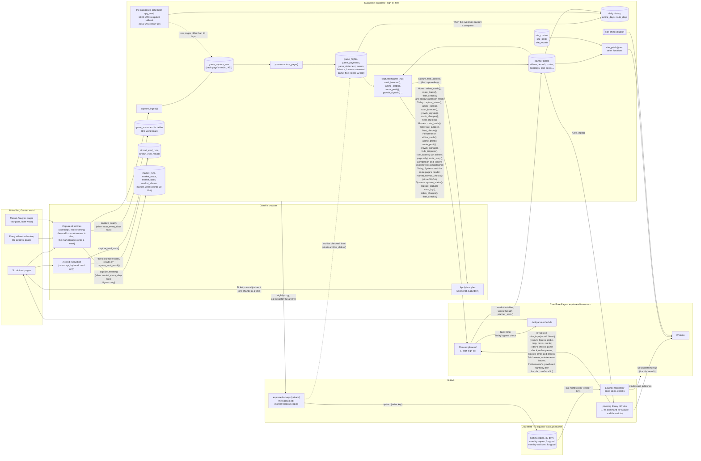

# How equinox. fits together

The map of the whole system: what each part is, where it lives, what runs when, where keys are kept, and what to do when
something breaks. Decision #10. The rules are in `docs/operating-manual.md`, the reasons in `docs/decisions.md`,
the tables in `docs/data.md`.

## The parts

| Part | What it is | Where |
|---|---|---|
| **Website** | The public airline site: home, flights, destinations, live network, our airlines, newsroom, investors, gander monthly. A single page that reads everything from `site_public()` (and gander monthly's issues from `site_newsletter()`, `web/assets/site.js`), our airlines' names, colours and text included (its own copy is only a fallback), and since 15 Oct the airports' names and which city's photo each takes (`content.airport_cities`, from `site_content`; the page no longer keeps them). Its trip search finds connections with the planning library's rule (#19, build pull request 4): from each airport's minimum connection time (`content.mct`, 90 minutes where unknown) to `content.connection_max_wait_h` (8 hours; 8 when the feed lacks it), from `web/assets/rules.js`. | `web/index.html`, `web/assets/` (`rules.js` is built, not committed); served by Cloudflare Pages at equinox-alliance.com |
| **Planner** | The staff tool, rebuilt in React with TypeScript (#18), screen by screen beside the old one, and **the planner at `/planner/` since the switch** (14 Oct, build pull request 13; design `docs/design/2026-10-12-planner-app.md` §11): every address under `/planner/` opens it, the addresses used while it was built (`/planner/next/...`) redirect (301) to the same address under `/planner/`, and the old planner's (`/planner/old/...`) to `/planner/`, since the clean-up (build pull request 14) removed the old planner, its adapter and its documents. The shell (build pull request 1): sign-in and the staff check (`is_planner_user()`), the header (brand, the search box, local/UTC toggle, save state, the Website button, sign-out) with the game clocks under it on every screen (one per time zone of our bases, from the library's `time.clocks`; the old planner's band of the UTC day is there too, hidden as the old planner hides it), the screens' navigation (ten since 21 Oct); Home (build pull request 5, below), Routes (build pull request 6, below), Tails (build pull request 7, below), Hubs (build pull request 8, below), Check (build pull request 9, below), Review (build pull request 10), and Interline, Photos, Reference and the header's search (build pull request 12, below): every screen is rebuilt. **Since 20 Oct the screens are grouped by when they're used** (spec `docs/specs/2026-10-20-today-performance-systems.md`): Home, Today, Routes, Tails, Performance, Competition (since 21 Oct), Interline, Photos, Reference and Systems; Check's and Review's boards moved to Today, Performance and Systems, and Hubs went (below). It reads the tables straight through supabase-js, with types generated from the database (`app/planner/src/db/types.ts`) and TanStack Query, and the database functions that only read with GET (so a preview reads them too), and writes only through `planner_save()`: one call per action, all or nothing (an insert may name the row it makes, and a later change in the same call take its key, so a to-do and its steps are one action). **Its start is light** (design §5): the planning library's input is `rules_input(world, 'flown')`, only the routes that have rotations and the airports they, the legs, the bases and the aircraft use (`'all'`, about 1 MB on live, stays the scripts'). **Home** looks and works as the old Home (the Building chat's review): the operations hero with the globe, needs attention's summary cards (since 23 Oct, spec `docs/specs/2026-10-23-attention-on-home.md`: one card per thing waiting, exactly as Today showed them, each **See all** opening its group's section on Today at `/planner/today#att-<kind>`; Home only shows them: the reads and figures are Today's, `screens/today/useAttention.ts`, shared through the query cache, and the words `today/model.ts`'s `waitingCards`), the network map and the airline cards. Aircraft on order went from Home the same day (Today's Orders and delivery lines show it; `onOrder.ts`, which Aircraft to file still uses, moved to `screens/today/`). Its needs attention (with the old Home's interline line since the switch: the airline–country pairs Interline lists without an agreement, from the same rows, `screens/interline/useRows.ts`, and `interline_agreements`), coming up, the to-do board and aircraft on order's **File into planner** moved to Today on 20 Oct (below), with the sources of theirs listed here. **Its sources** (#19, one home each): from the planning library on that input, the key figures (`summary.keyFigures`), the hero's figures (`summary.now`: aircraft in the air, flights today and in the next hour), the aircraft's positions (`positions`), each airline's card (`summary.airlineCards`), each route's round trips on the map (`summary.roundTrips`) and the schedule checks (maintenance, turns and positions, night bans, flight numbers used twice, the airport caps from `airport_cap_warning_pct`); from the database, the capture warning from `capture_status()` (asked at the moment and a day earlier, reaching back to midnight UTC two days ago as the old Home did; and, since #21, a short or broken page the same night, from each airline's latest verdicts), the backup and job warnings from `backup_runs` and `job_runs`, the group's average economy load and can order from `airline_cards()`, routes to fix (and, with no profit captured, the load patterns) from `growth_signals()`, and each route's loads with one airline picked on the map from `route_loads()`; aircraft on order, plan cards (the map's Planned routes), to-dos and dismissals from their tables; the hub-city photos from `site_public()` (each airline's city from `airlines.photo_city`). The globe is three.js (pinned in `package.json`), loaded only on Home, with the old planner's earth pictures (three-globe's, from cdn.jsdelivr.net); the map draws the website's world outline (`web/assets/world.js`) and the cards its logos (`web/assets/logos.js`), each read from `/assets/`. **Routes** (build pull request 6, spec `docs/specs/2026-10-13-routes.md`) does what the old Routes does: the list (one airline at a time, its filters and sort in the address, `/planner/routes?airline=PA&bases=JFK&sort=load`), a route (`/planner/routes/PA/JFK-ORD`: its header, edit and remove, the next free numbers, its frequencies with every check and the connections at both ends) and the route pop-up Home's map opens. **Its sources:** one airline's `routes` (with their override columns), its `rotations` and `flight_legs`, `markets` (name and, since 21 Oct, only its `layout`: the route's header shows the layout its distance calls for (`card.cabinRange`, since 26 Oct), where it showed the market's aircraft, cabin and fares; a new frequency's price is the airline's launch fare, `fare_launch_pct`, and a frequency with no aircraft is estimated on the airline's most-flown type), `service_profiles`, the aircraft in service and the airports a route uses (`airports`, `world_airports`), read from the tables when the screen needs them, not at start; each route's and each flight's loads over 7 days from `route_loads()` (its `flights`, added for Routes); the load pattern's signal in the pop-up from `growth_signals()`; and from the planning library, on the start's input with the airline's own rows in place of the start's, the frequency's times both ways (`frequency`: typed in local time at each end, stored in UTC, the return on the old planner's day), the block estimates, the bank fit (`banks.wave`), the connections, turns, positions, night bans, flight numbers used twice, the second-daily gap and the next free pair. **Its saves,** one `planner_save()` call each: add a route (a `routes` row, or a removed one brought back), edit it (the override columns), remove routes (`removed`, never a delete); add a frequency (a rotation and its two legs), change one (its legs or its rotation), delete one (the legs, then the rotation); and a UTC offset (`world_airports.utc_offset_override`, with every leg and plan-card leg touching the airport re-timed to keep its local times, after the page lists what moves and asks). **Tails** (build pull request 7, spec `docs/specs/2026-10-13-tails.md`) does what the old Tails does: the list (one airline at a time, base, type and Flying / No flights / Needs a look in the address, `/planner/tails?airline=PA&status=warn`; on a phone, compact rows that open; since 23 Oct the answer as the title and count tiles over it, spec `docs/specs/2026-10-23-planner-look-tails.md`), an aircraft (`/planner/tails/N001AW`: its header, the fields that change it, its issues, its week strip and its legs by flight number), the deliveries board with each plan card (since 28 Oct, spec `docs/specs/2026-10-27-long-haul-lines.md` §2, with the airline's 7-day lines over it, `Lines.tsx`: each line's slots, offset 0 to 6 by day, each with the aircraft holding it and whether it is ordered, arrived, filed or empty, the line's check across the cards that exist from the library's `card.checkLine`, the weekdays missing until all 7 exist, every flight daily, each route both ways, no false flight-number clash, and **Write the next card**; a card on a line shows the line, its offset and its slot, and each leg's local weekdays), filing an arrived aircraft (Today's **File into planner**, Home's until 20 Oct, opens `?file=<registration>`; since 28 Oct a 7-day line's card, on a line or with each flight on one weekday, `isLineCard`, is checked against the game day by day, the library's `game.compareCard(…, byDay)`, and filed day by day: each outbound paired with its return even days later, each leg on its own weekday, `frequency.toLegs(…, backDays)`, the game's times taken but never its days; spec `docs/specs/2026-10-27-long-haul-lines.md` §4) and the aircraft pop-up Today's needs attention opens (`/planner/today?aircraft=<registration>`), which a frequency's aircraft on Routes opens too (`?aircraft=` on the route's address); since 22 Oct the pop-up shows the game's maintenance and condition from the latest night's fleet pages (`fleet_checks()`) beside the planner's own maintenance figure; since 23 Oct (spec `docs/specs/2026-10-23-game-maintenance-on-tails.md`) Tails' Maint. column, the aircraft page's header, the pop-up's Maintenance figure, the maintenance issue and Home's airline cards' lowest maintenance (and their "clean") show the game's figure from the same read for an aircraft on the latest fleet pages (no ≈), the library's estimate for the rest; plan cards and what-ifs keep the estimate, and how the aircraft came and when it's replaced ("came used, replace at 10 years": `aircraft.acquired`, read with the aircraft, and the settings `replace_new_years` and `replace_used_years`). **Its sources:** every aircraft of the world (`aircraft`, any status: those in service, status active, are its list, in the order they were added, and those with a delivery that aren't retired are the deliveries board, since the clean-up; until then the old lists' places in `extra`), `cabin_configs`, `airline_aircraft_types` (the types an aircraft may have), `plan_cards` and `plan_card_legs`, since 28 Oct `plan_lines` and `plan_line_legs` (and a line's size, `settings.line_aircraft`), `worlds.game_host` and `airlines.game_id` (the game link); from the planning library on the start's input, each aircraft's week (`aircraftWeek`), maintenance and issues (`tails`, with the block-hours target `aircraft_block_target_h`), the card's local times (`time`), filing's legs (`frequency.toLegs`) and, since 21 Oct, the cabin the card's routes call for (`card.cabinFor`, by distance since 26 Oct: `card.cabinRange`; `markets.layout` and `cabin_choice` no longer count: the card says "suggested: 321-LP" with its reason beside its **Cabin** box, **Use the suggestion** sets it through the card-cabin save, and a cabin that differs shows in amber; spec `docs/specs/2026-10-21-cabins-new-rule.md` §3), and since 21 Oct the fare level of each route it flies (the card's **Fare level** column, once per route on its first leg, since 26 Oct once per direction on the first leg that way, each its own direction's level: "economy +10%, business +5% of the default price", or "launch (+0% of the default price)" for a route not flown yet; the library's `card.cardFares` on `fare_ladder()` for the card's airline, read while a card is open; nothing stored on the card; spec `docs/specs/2026-10-21-frequencies-and-fares.md` §2); filing takes the plan card's cabin, else the aircraft's `order_config_id` (`tails/model.ts`, `filingCabin`); the planner doesn't call `order_cabin()`, and `cash_forecast()` prices an order's cabin with `private.fig_order_cabin` (since 15 Oct it reads the data Reference changes: the type's `aircraft_types.order_config_id`, or the airline's own in `airline_order_cabins`; filled from the old `DEFAULT_CABIN` rule); and the game's schedule from `/api/game-schedule`. **Its saves,** one `planner_save()` call each: since 28 Oct **Write the next card** on a line (for the aircraft picked, of the line's airline and type, on order or arrived, with no card: its `plan_cards` row with `line_id` and the next free `line_day_offset`, its base the order's else where the line starts, and its `plan_card_legs`, each line leg on its weekday by the library's `card.fromLine`), add a tail (an `aircraft` row in service), change one field of it, remove it (`status` retired and `retired_on`, never a delete), Delete aircraft… (its rotations and legs, and retired), remove a delivery (the old board's remove: the rows the old planner's adapter wrote, an aircraft not in service and nothing pointing at it deleted, one that flew or was paid for retired, one in service only taken off the board, its order details cleared); and **filing** (the aircraft in service with its base and cabin, the cabin the plan card's (`plan_cards.config_id`, since 18 Oct; the card's **Cabin** box sets it) else the order's, never the type's default, and its first fit in `spending_log` at that cabin's price, each outbound and its return as a rotation with its two legs, paired as the old `filePlan` pairs them, local times stored in UTC by Routes' rule, a route added where the airline has none, and, with the game's times, the plan card's legs taking them). **Today** (since 20 Oct, spec `docs/specs/2026-10-20-today-performance-systems.md`) answers "what do I do now?", at `/planner/today` (an aircraft's pop-up `?aircraft=REG`; an old load report's day, `/planner/check?day=…`, goes on to Performance's Flights by day): at the top the answer (**All clear** when nothing is waiting: no order possible, nothing to file, no attention items, no Game check differences; else, since 23 Oct, how many sections have something waiting, each group of needs attention counted as its own) and the capture in one line (complete, or what's missing, short or broken, linking to Systems), then every board open: **Orders** (for each airline, whether it can order now or from when, the types that are safe and each delivery line with when it runs dry; since 28 Oct, spec `docs/specs/2026-10-27-long-haul-lines.md` §5, each open 7-day line, one with fewer cards than `settings.line_aircraft` on aircraft that aren't retired: "XLR line, Pan Am: 3 of 7 ordered (2 arrived)", its type, when its next aircraft can be ordered by the cash forecast's entry for the line's type (priced with its order cabin) and a link to the line on Tails, `/tails?airline=PA#line-<id>`; a full line isn't listed, and the answer's count is unchanged), **Aircraft to file** (arrived with a plan card, with **File into planner**, which files it on Tails), **Needs attention** (moved whole from Home, with dismiss and show again; its summary cards moved back to Home on 23 Oct, and each group's list is its own section with a stable anchor, `#att-<kind>` (Aircraft to file's `#to-file`), which Home's buttons open; each item links to where it's fixed now: the capture, backup and jobs to Systems, routes to fix and can order to Performance; since 22 Oct a Fleet group from `fleet_checks()`, one item per problem worst first, an aircraft the planner has opening its pop-up and one it doesn't Systems' Fleet board, and the game's maintenance under the limit its own card, the most urgent after order now; since 30 Oct a **Service in the game** group from `market_service_checks()` (spec `docs/specs/2026-10-30-market-pages-planner.md` §3), one item per pair and direction whose service profile in the game differs from the code its distance calls for (listed first) or from the planner's, keyed `service|<code>|<from>-<to>|<game's code>`, each linking to the route's page), **Game check** (moved from Check: each airline's schedule read from the game through `/api/game-schedule`, its differences, **Use the game's times**, **Fix all from the game**, **Add to planner**; since 28 Oct each leg read on its own weekdays, a return on its own row's days, so a 7-day line's aircraft shows no false differences, and a line's flight fixed by its times on each of its aircraft, keeping their days, never by its days), the to-do board and Coming up (moved from Home). **Its sources:** Home's (the capture from `capture_status()`, the backups and jobs from `backup_runs` and `job_runs`, can order and the next order from `airline_cards()`, routes to fix and the load patterns from `growth_signals()`, aircraft on order, plan cards, to-dos and dismissals from their tables, and from the planning library on the start's input the schedule checks), Interline's rows and `interline_agreements` (the interline line), `cash_forecast()` for each airline (the safe types), `airline_aircraft_types` and the library's `growth.orderQueues` (the delivery lines; the settings `order_queue_grace_h` and `order_queue_warn_h`), since 28 Oct `plan_lines` and Tails' `plan_cards` read with each card's line and offset (the open lines, counted by Tails' `lineSlots` and `lineSize`, no new database function), and for Game check the library's `game` on the start's input. Its words are `screens/today/model.ts`'s. **Its saves,** one `planner_save()` call each: dismiss and show again (`dismissals`), the to-dos (a tick, an add with its steps, a delete with its steps), and Game check's fixes and adds (the legs whose times change; a route where the airline has none, a rotation launched today and its two legs, through Tails' filing rows). **Performance** (since 20 Oct, the same spec) answers "how are we doing, and why?": the group at `/planner/performance` (Flights by day's day in the address, `?day=2026-10-12`) and an airline at `/planner/performance/<code>`, and since 22 Oct a route at `/planner/performance/<code>/<route>` (the route page, below; until then that address opened the route profit table filtered to the route, which its search box still does), its boards open on arrival (`src/ui/FoldBoard.tsx`, **Collapse all**, **Expand all**). The group: **the scorecards**, one per airline (Review's cards, with the fleet, flights a day and average load each against the same day last week, with an arrow; an airline with no day a week ago shows no change; tap one to open the airline), **the fare ladder**: since 26 Oct (spec `docs/specs/2026-10-26-fare-ladder-one-airline.md`, brief `docs/briefs/2026-10-26-fare-ladder-timeouts.md`) only a link per airline, in our airlines' order, to its page's fare ladder (`/planner/performance/<code>#fare-ladder`), so opening the group page calls `fare_ladder()` not at all (all six at once, beside the other figures, timed out together on the free plan's processor), then the group today (each airline's row, without group totals, manual §5), **Growth signals** (ready for another flight, raise fares, fix or reduce, aircraft losing money after their lease; from the load reports and load patterns when no profit was captured), **Main hubs towards 750** (one bar per main hub, with hub readiness, the cities feeding each bank by region, folded into its line) and **Flights by day** (Check's daily load report, renamed). The airline: its scorecard, then (since 26 Oct, spec `docs/specs/2026-10-26-fare-ladder-one-airline.md` §2) **the fare ladder** for that airline only, open on arrival as a section with the anchor `#fare-ladder` (spec `docs/specs/2026-10-21-fare-ladder.md`, manual §5: this Saturday's moves in one line, the game's Ticket price adjustments to make, numbered and in order, each with copy, **Put on the fare plan**, and the routes table with each route and cabin's level and steps above launch, sold-out share, move and reason, sortable and cut to 10 rows with show all (since 26 Oct, spec `docs/specs/2026-10-26-fare-ladder-per-direction.md` §3, a row per direction and cabin, its route shown as "EDI → FRA", with its own sold-out share, **Load** (that direction's average load over the 7 days), level, move and why; one game action per direction; Put on the fare plan writes each row's direction); since 21 Oct the changes that set a route back to its level first, in their own short list headed "3 routes off their level" (since 26 Oct "3 directions off their level"), each with why, spec `docs/specs/2026-10-21-frequencies-and-fares.md` §3; since 23 Oct, spec `docs/specs/2026-10-23-fare-ladder-under-launch.md` §4, the jumps under launch: each card counts the week's jumps and cut-or-keep decisions ("2 jumps, 1 decision"), the routes table words a jump ("jump to 80%") and the hold after a jump ("hold under launch"; since 26 Oct no revert: judged by loads), and a row that is a decision shows "cut or keep?" beside its reason, never in Needs attention; `screens/performance/FareLadder.tsx`, from the airline page's one `fare_ladder()` read, which the route profit table's fare index shares; while it loads the board says so, and a failed read shows its error on the board alone), then Review's page: the profit chart for the last 14 intervals and the table of reported days, Cash, next 14 days, route profit for 1, 3 or 7 days with its aircraft and fare changes (since 21 Oct each route with its fare index and a 14-day load sparkline; since 26 Oct the index "out · back" where the directions differ), and the fare plan (since 26 Oct each row's direction, out or back, or nothing for both); each route's name in the route profit table opens its route page. **The route page** (since 22 Oct, spec `docs/specs/2026-10-21-route-page.md`; `screens/performance/RoutePage.tsx`, its logic in `model.ts`) tells a route's story since launch, phone first: the header (route and city, stars, airline, distance, market, the layout its distance calls for (since 26 Oct, manual §5: the planning library's `card.cabinRange` on the route's distance, else the great circle, as Routes' header; a low-cost airline Standard; no market or route choice counts), launched with its days, departures a week each way, the types, each cabin's fare level and this Saturday's move, since 26 Oct each direction's ("EDI → FRA economy 105% · up to 110%"); "‹ <airline>" and "Schedule in Routes"), the last 7 days against the 7 before (load, passengers, profit, profit an aircraft hour, the economy and business fares, each with its arrow), then its boards open: **Since launch** (one chart, as the other charts with their tip: economy and business loads by day, the fare level as a step line on its own scale, each event a marker on the day axis; under 14 days of flights it says so), **Profit an aircraft hour** by week (bars; the airline's average isn't drawn, since `route_profit()` covers only the last few days), **Events** (newest first, 10 shown with show all; since 26 Oct a change to the route's own cabin choice is none), **Rivals on the pair** (the table and our share at each scan as a small line, or "no rival flies this pair") and **Connections** (the city pairs its flights connect to at each end and the top 10 with times a week, from the planning library's `connections.connectionsAtBothEnds`, the plan card's rule, on the start's schedule). **Since 30 Oct** (spec `docs/specs/2026-10-30-market-pages-planner.md` §1) ten boards, paired in two columns at 1100 px and wider (one column under it, 380 px with no sideways scroll; a folded board doesn't stretch to its neighbour): Since launch · **Load by direction** (economy load each day out and back as two lines, each direction's fare level as a step line on the right, from `route_story()`'s `days_by_direction` and the fare plan's ladder rows per direction), **Loads by flight** (each flight number on the route over the last 7 days, its way, local departure, average load as a bar, flights and how many were 95% or more, from `route_loads()`'s `flights` on the route's legs; route_loads() has no exactly-sold-out count) · Profit an aircraft hour, **Rival fares** (a table each way from the latest market read: each airline's economy and business fares, flights seen and sold out of finished, ours first and against the cheapest rival, "we're 15% under KLM") · **Market share** (the game's passenger share each way this week against last, as a bar, with the scan's departures share for comparison), Rivals on the pair · **Rivals over time** (each airline's direct departures a week at every scan since launch, ours and the top 5 rivals as lines, from `route_story()`'s `rivals.history`; under it the pair's seats and price per unit by week from `market.weeks`), Events · Connections; each market board says "No market read yet: the capture reads the market pages once a week" until the first read lands. The header says the service set in the game ("service S2 in the game", from `route_story()`'s `market`), amber when `market_service_checks()` has a mismatch on the route. Routes' route detail ("How it's doing ›" on a flown route), the route profit table, Today's routes to fix and Competition's threats link to it. The order rotation's Next move and **Log an order as** went with Check (spec decision 2); `growth_log` keeps its rows. **Its sources,** every money figure the database's: `airline_cards()`, `airline_profit()` (each airline's, for the scorecards' sparklines and the page), `cash_forecast()`, `route_profit()`, `aircraft_profit()`, `fare_changes()`, `fare_plan_status()`, `growth_signals()`, `hub_progress()` and `fare_ladder()` (on the airline page only, one call, `useFareLadder`: its fare ladder board and the route profit table's fare index; since 26 Oct the group page reads none and `useFareLadders`, every airline's at once, is gone); the daily history by route, `route_days` (staff read it: the route profit table's 14-day load sparkline, passengers ÷ seats both ways, `screens/performance/model.ts`'s `loads14`); the daily history `airline_days` (staff read it: each airline's latest day against that day a week before, its `aircraft_total`, `weekly_departures` ÷ 7 and `eco_load_pct` over the 7 days to each day, compared by `screens/performance/model.ts`'s `weekOnWeek`); every route that isn't removed, `route_loads()`, the markets, the aircraft and the plan cards with their legs and airports (the growth lists from the load reports, the readiness), through the library's `growth` (and `growth.suggestedSize`, the setting `suggested_size`); a day's loads from `game_loads`, `load_entries` and `load_days`, and the day's flights from the library's `loadReport.flightsOn`; the rule numbers `order_cushion`, `growth_sold_out_min_departures` and `fare_plan_raise_pct` from the start's settings; for the route page (since 22 Oct) the route its address names (`routes`), `route_story()` (with GET) and, for its connections and its layout, the start's input (`rules_input(world, 'flown')`). **Its saves:** **+ fare plan** and **remove** (`fare_plan`), and the fare ladder's **Put on the fare plan** (a `fare_plan` row for each route and cabin `fare_ladder()` marks `to_plan`, with its `level_pct` and `ladder_move`: since 23 Oct `jump` from the row's `ladder_kind`, else its move; `revert` until 26 Oct), each one `planner_save()` call. **Systems** (since 20 Oct, the same spec) holds the plumbing, at `/planner/systems` (an aircraft's pop-up `?aircraft=REG`): the **Systems board** (#23, spec `docs/specs/2026-10-14-capture-checks-and-systems.md`; at the top of Check until then), always open at the top: one line each, green, amber or red, with when, for each airline's evening capture (when, and #21's verdict on its pages), the daily snapshot, the nightly backup, the monthly archive, the clean-ups, the world scan's age, since 30 Oct the market pages (the latest finished read, its age, pages and failed from `system_status()`'s market, amber over 8 days and red over 15 as the scan's, amber before the first read, with the service check's mismatches from `market_service_checks()`), the planner's own build (the time and change it was built from, written in by `vite.config.ts` and read by `src/data/build.ts`, so a failed deploy shows after a merge) and the database's size, the report PDFs and the size of `site_public()` against their triggers, from `system_status()` (one staff call that only reads), marked by `screens/systems/systems.ts` with needs attention's limits; then four boards, folded on arrival: **Capture** (what the capture collected for each airline and when, `capture_status()`, with **Reload** and the backup's line from `backup_runs`; Check's), **Fleet** (since 22 Oct, spec `docs/specs/2026-10-22-fleet-capture.md` §3: the latest night's fleet of each airline as the game showed it, from `fleet_checks()`, a table each with registration and base, type, location, condition, maintenance, seats and pilots, each problem marked; open on arrival when Today's item sent you, `#fleet`; the evening capture table on the Systems board shows each airline's fleet pages in its verdict), **Cabin charges** (since 22 Oct, spec `docs/specs/2026-10-21-tidy-ups.md` §3: the first cabin fits that don't match the game's charge, from `cabin_charges()`, a differing one with **Use the game's amount**; Today's Needs attention has one item for them, linking here), **Manual entry** (cash and fixed costs, the nightly log from `cash_log()`, loads by hand typed or pasted, a day from `loads_by_day()`; Review's). **The Aircraft checks board went on 22 Oct** (spec `docs/specs/2026-10-22-remove-aircraft-checks.md`; manual §1 has no one-week checks since 15 Oct), with Mark checked, the check in the aircraft pop-up, needs attention's and Coming up's checks, and the library's `checks`; the setting `aircraft_check_after_days` and the columns `aircraft.checked_on` and `schedule_changed_on` stay in the database, read by nothing. **Its saves,** one `planner_save()` call each: cash and fixed costs (`cash_entries`, a figure only where it differs from the capture's), loads by hand typed or pasted (the `load_entries` and `load_days` rows the old `save_loads()` wrote) and, since 22 Oct, Use the game's amount (the fit's `spending_log` amount). **The Cabins board went on 21 Oct** (spec `docs/specs/2026-10-21-cabins-new-rule.md` §1; Check's until 20 Oct): each aircraft's cabin against its markets (the library's `cabins`, with the settings `cabin_refit_cost` and `cabin_refit_share_pct`), with Refitted to, Keep as is and Show again. We no longer refit (manual §5): the plan card suggests its cabin on Tails; the two settings went, `aircraft_cabin_keeps` stays as history (retired, nothing writes to it) and past refits stay in `spending_log`. **Check, Review and Hubs went on 20 Oct:** Check (build pull request 9, spec `docs/specs/2026-10-13-check.md`) and Review (build pull request 10, spec `docs/specs/2026-10-14-review.md`) became Today, Performance and Systems, each board as above, and Hubs (build pull request 8, spec `docs/specs/2026-10-13-hubs.md`; one airport's board on one day, read only) went, unused; their addresses go (301) to `/planner/today`, the same address under `/planner/performance/`, and `/planner/performance` (`web/_redirects`; inside the planner `screens.ts`'s `movedTo`). The planning library's `hubs` (`hubs.board`, `hubs.connectionsTable`), which only the screens' figures check still used, went with the Hubs clean-up (21 Oct, spec `docs/specs/2026-10-21-fare-ladder.md` §4), with its cases and its figures in that check; what Routes uses (the bank fit, the connections) is the library's `banks` and `connections`. **Competition** (since 21 Oct, spec `docs/specs/2026-10-21-competition-analysis.md`; manual §3, market share first) answers "who are we up against, and where do we open next?", read only: the group at `/planner/competition` (the scans' dates at the top, "latest scan 17 Oct, compared with 6 Oct", and the group line, our airlines' departures a week against the world's; a card per airline with its share across its markets and its arrow, its threats and its top 3 openings; every airline's threats; since 23 Oct the board **Order books**, `competition()`'s `order_flags`, biggest share first, each marked with the airlines of ours it meets) and an airline at `/planner/competition/<code>` (the same top, then **Market share**, a card per market with our share, its arrow and the top rivals as a bar; **Threats**, each with the rival, the pair, then and now, ours, the day and until when the route's fares hold (since 22 Oct each linking to the route's page on Performance); **Openings**, the ranked table with rank, pair, stars, distance, rivals, variant and hubs first, cut to 10 with show all; **Rival profiles**, cards, since 23 Oct each with its fleet, "99 aircraft, 44 on order, +6 on order this week", and its top types; since 23 Oct, spec `docs/specs/2026-10-23-rival-connections.md` §4, the rivals' connecting departures beside direct on each market card, the openings' rivals ("3 direct · 14 connecting") and each profile, never added to direct; on a route's page, Rivals on the pair has a Connecting column and the rivals that only connect; since 30 Oct, spec `docs/specs/2026-10-30-market-pages-planner.md` §4, each market card shows the game's passenger share where its pairs have market reads, "game share 38.0% (pairs read: 2 of 3)", with its arrow, beside the scan's departures share and never replacing it, and each airline's card on the group page its game share across its markets, weighted by seats). **Its source:** `competition()` for each airline, with GET (`screens/competition/reads.ts`), the words its `model.ts`'s. **Today's rival moves** (the same build): each airline's `competition()` threats that the latest scan showed, in Needs attention under **Rival moves** ("Air China started on PVG–CAN, 14 a week", keyed `threat|<code>|<pair>|<rival>|<day>`), linking to the airline's Competition page; they aren't fare moves, so the fare ladder's rule doesn't keep them off. The Systems board's scan line says the scan runs with the evening capture (`scan_every_days`, from the start's settings), and since 23 Oct how many fleet pages the latest scan read and failed (`system_status()`'s scan), and Reference → constants has **World scan every** (`scan_every_days`) since 21 Oct. **Interline** (build pull request 12, spec `docs/specs/2026-10-14-interline-photos-reference.md`) does what the old Interline does, at `/planner/interline` (its airline and status filters in the address, `?airline=KF&status=open`): one row per airline and interline country it flies to or has planned on a waiting plan card, with the airports, round trips a day, status, partner, date and notes, and the interline countries with their partners and the rules for a request. **Its sources:** the start's input (rotations, routes, bases, airports and their countries), the waiting plan cards, `countries`, `interline_agreements` and the setting `interline_rules` (the countries, Europe zone, rivals, covered countries, group-only airlines and partners the old planner kept in its code). **Its saves:** each status, partner, date or note is one `planner_save()` call on `interline_agreements`, the row the old planner's adapter writes (inserted, changed in one column, or deleted when nothing is left). **Photos** (the same build) does what the old Photos does: the logos (our airlines in their order) and the destinations (every airport a rotation touches, busiest first), from `site_public()` read with GET; an upload is resized in the browser, put in the `site-photos` bucket under a new name and named on the website through `site_set_airport_photo()` or `site_set_airline_logo()`, and the file it replaces removed; removing one is `site_remove_airport_photo()` or `site_remove_airline_logo()`. Which city's photo an airport takes and the name the website gives it are data since 15 Oct (`site_content` `airport_cities`, read through `site_public()` as the website reads them; spec `docs/specs/2026-10-15-last-leftovers.md` §2). **Reference** (the same build) does what the old Reference does, at `/planner/reference/<section>` (the open section in the address): hubs and banks (`airline_bases`, the minimum connection time in `world_airports.mct_min`), constants (`settings`, the departures cap in `world_rules`; numbers only), aircraft types with the cabin an order comes with (`aircraft_types.order_config_id`) and an airline's own where it differs (`airline_order_cabins`, added, changed or removed; since 15 Oct), configs, markets (Market defaults until 21 Oct; then each market's `layout` only, one `planner_save()` change, spec `docs/specs/2026-10-21-cabins-new-rule.md` §2; since 26 Oct the layout isn't shown or edited, the cabin going by distance), service profiles, removed routes (restored as the old planner restores them, the edits kept), night bans and time zones (`world_airports`, a time zone through the same moves as Routes' offset), the game's schedule pages (from `airlines.game_id`, read-only), storage (the save state and **Save now**) and data (the tables as JSON, the flights as the old CSV; import and clear are gone, design §14). Each box is one `planner_save()` call writing the old planner's rows; a type or config still used elsewhere isn't removed. **The header's search** does what the old one did (flights with or without the airline's code, aircraft, aircraft on order and their planned flights, two airports, an airport or a city's start, at most 14 results), reading the routes, airports, aircraft and plan cards the first time the box is used; a result opens its new screen. Tails' plan cards show the service check's issue on a leg (the library's `service.checkLegs`, with the airline's routes laid into the start's input). Shared parts for later screens are in `src/ui/` (board, pill, attention list, airline mark, dates as words, the in-page question, the game clocks, the website's files), with the old planner's styles as its cascade left them. Previews are look-only (#8): saving only at `equinox-alliance.com` and `www`. Nothing is kept on the device (design §14, choice 3). | Source `app/planner/` (`src/screens/`, `src/data/`, `src/ui/`, `src/db/types.ts`); `npm run build` makes `web/app/` (not committed), served under `/app/`, its page mapped to equinox-alliance.com/planner/ (and below; `web/_redirects`) |
| **Planning library** | The planning rules in one home (#19, design §7): local and UTC times, block times, turns, connections (at both ends of a leg, and a hub's city pairs across our airlines), bank windows, maintenance, an aircraft's week and its issues (`tails`, build pull request 7), the game check, daily load report and growth lists (`game`, `loadReport`, `growth`, build pull request 9; Check's, and since 20 Oct Today's, Performance's and Systems'; the Cabins board's `cabins` went with it on 21 Oct; a rotation with no aircraft estimates on the airline's most-flown type, `game.mostFlownType`, its market's default type until then), the service profile a route takes and the plan card's service check (`service`; a leg's code against the one its route's distance calls for, build pull request 10), the plan card's cabin (`card.cabinFor`, 21 Oct, manual §5; by distance since 26 Oct: each route's distance range, `card.cabinRange`, Leisure under `cabin_leisure_max_km`, Leisure Plus to under `cabin_leisure_plus_max_km`, Comfort beyond; the range over `cabin_route_share_pct` of the card's block time decides, otherwise the most seats, Ryanair Standard; `markets.layout` and `routes.cabin_choice` no longer count; `checkCard` flags a card whose cabin is missing or differs), the schedule checks (night bans, the second-daily gap, flight numbers used twice, airport caps, the next free flight numbers), where each aircraft is at a moment, Home's figures (`summary`: key figures, the hero, the airline cards, round trips), the game clocks (`time.clocks`), and the optimiser. TypeScript with no screen code, no clock and no network: plain data in, plain data out. Every number comes from the database through one call, `rules_input(world)` (staff; the new planner asks `rules_input(world, 'flown')`, only the routes with rotations and the airports they, the legs, the bases and the aircraft use), or `export_for_report(secret, 'rules')` for the scripts (always the whole document): settings (an airline's own where it has one), world rules, aircraft types, airports, airlines, bases, aircraft, routes, rotations, every flight leg and the service profiles (since build pull request 10). Its callers since build pull request 4: Claude's schedule optimiser (the command's `optimise`; `scripts/planning/plan.py` is retired), the weekly report (each airline's aircraft, routes, flights, seats and block hours a day, through the command's `aircraft`) and the website's trip search (its connection test, from `web/assets/rules.js`). The planner imports it from source as `@rules` from its screens: Home since pull request 5, for its figures (`summary`), the globe's positions, the game clocks and the attention checks. **Long haul in 7-day lines** (since 28 Oct, build pull request 1 of the spec `docs/specs/2026-10-27-long-haul-lines.md`; manual §4 lists it under Decided, not yet built until the last merges): `lineOptimiser.optimiseLine` finds the best 7-day rotating line for an airline, a type, its hubs and the candidate routes (one aircraft's 168 hours as a closed walk over the routes from a hub, each flown once each way; feasible on turns, night bans, the same-route gap, the type's reach, maintenance and the spacing; scored by connections within the planning target at the hubs, then all connections, routes covered, block hours, maintenance; a greedy chain through the hubs' bank ladders kept as a beam, then local moves, under a budget of work or a run-time cap, and it says when the search didn't finish; no randomness) and hands back the 7 aircraft cards with their weekday offsets, each leg numbered from the airline's pool; `maintenance.spacing` gives every card's and aircraft's longest stretch without a counting maintenance stop against `settings.maintenance_max_gap_h` (reported in the maintenance figures, flagged by `check-card` and the Tails issues); and `card.checkLine` checks a line of up to 7 cards together (each card, then every flight daily once all 7 exist, the days missing until then, each route both ways daily). The settings `line_min_km`, `maintenance_max_gap_h` and `line_aircraft` came with it (migration `20261028120000`). Claude runs it as a command: `node lib/rules/dist/cli.js` with block, connections, aircraft, check-card (a card or a line file), optimise or optimise-line | `lib/rules/` (`src/`, its tests in `test/`, hand-made cases in `cases/`, `README.md`); `npm run build` writes the command to `lib/rules/dist/` and `src/browser.ts` to `web/assets/rules.js` (neither committed) **Stations** (since 22 Oct, manual §2; spec `docs/specs/2026-10-22-station-role.md`): an `airline_bases` row with role `station` is an airport flown point-to-point from without making it a base; the library gives it no banks ("station · no banks"), its flight numbers from the airline's one station pool (`station_flight_no_from` to `station_flight_no_to`, 100 to 999), and never counts it as a hub, a focus city or a growth base (`cases/stations.json`). |
| **Captured figures** | The figures worked out from what the capture recorded, in one home, the database (#19, design §8): `cash_forecast()` ("Cash, next 14 days" and when an airline can order, manual §3, with several orders tested together), `airline_cards()` (Performance's scorecards and the group today, Today's orders), `airline_profit()` (profit for each day between captures), `route_profit()` and `aircraft_profit()` (over 1, 3 or 7 days; a route's aircraft hours a flight and an aircraft's flights a day read each leg on its own weekdays, so a 7-day line's route, flown by 7 aircraft once a week each, has the same hours a flight as a plain one and a line aircraft its week's flights over 7 days, held by `database/tests/long_haul_lines_figures_test.sql` since 28 Oct, as is the capture's loads check expecting that weekday's line flights only), `fare_changes()`, `growth_signals()` (Performance's growth signals and the load patterns), `hub_progress()` (hubs first, with contested bases from the latest world scan), `competition()` (since 21 Oct, manual §3 and spec `docs/specs/2026-10-21-competition-analysis.md`: the Competition screen, Today's rival moves and the briefing's openings; from the world scans: the scans used (latest, week before, previous), market share by the airline's markets with the group line, the threats on its pairs (`private.competition_threats()`, which the fare ladder's rival pause reads too), its openings ranked with the default line's variant (since 27 Oct the A350-900 up to `settings.a350_1000_from_km` and the A350-1000 beyond; no E190-E2 note) and hubs first (in November, `settings.trunk_month_from` to `trunk_month_to`, the trunks first, shortest first, hubs first suspended for them, manual §4), and the rival profiles; `private.scan_pair_flights()` reads the scans' schedules on the airline's pairs only; freighters are no one's rivals, by the weekly report's rule, `private.scan_passenger()`; since 23 Oct, spec `docs/specs/2026-10-23-rival-fleets.md` §4, each competitor's and rival profile's `fleet` from its overview page with the change since the week-before scan, `private.scan_fleet()`, and the world-wide `order_flags`, `private.scan_order_flags()`: rivals whose aircraft on order reach `settings.rival_orders_flag_pct` of their fleet with at least `rival_orders_flag_min`, and those with orders and no flights yet, each marked whether it meets the airline; no flag feeds the openings, the contested test or the fare pause; since 23 Oct, spec `docs/specs/2026-10-23-rival-connections.md` §3, each market, opening, rival profile and competitor has `connecting_weekly` with its connecting airports, the rivals' one-stop departures on the airline's pairs from `scan_rival_connections`, beside direct and never added to it: share, threats, the openings' order, the contested test, hubs first, the three biggest competitors and the fare pause read direct only; since 30 Oct, spec `docs/specs/2026-10-30-market-pages-planner.md` §4–5, each market's `game_share`, the game's passenger share over its pairs read in the latest finished market run weighted by each direction's seats in the latest week (`market_weeks`), null with no read, `market_run`, and `contested`: each pair the airline flies where a rival has at least as many departures a week as ours, with each way's economy fare against the cheapest rival's and the game's share this week and last, `private.fig_market_pair()`, which the weekly report's competition section reads through `export_for_report('figures')`), `route_story()` (since 22 Oct, spec `docs/specs/2026-10-21-route-page.md` §2: the route page and the Scheduling chat's "how has this route done since launch, and what changed on it": the route with its launch (since 26 Oct no cabin: the route page works the layout out from the distance with the planning library), now (departures each way, types, the fare ladder's rows), its days and 13 weeks from the daily history by cabin with block hours and profit an aircraft hour, its events (the schedule's saves from `change_log`, the fare plan, rivals between scans by competition analysis's rule) and the rivals on the pair with our share at each scan since launch, since 23 Oct each rival with its connecting departures and airports beside direct, the rivals that only connect, and each scan's (`connecting_only`, `connecting_scans`); since 30 Oct (spec `docs/specs/2026-10-30-market-pages-planner.md` §2) also `days_by_direction`, `rivals.history` (each airline's direct departures at each scan since launch, ours included) and `market` (each direction's latest page read in a finished market run: fares by airline and class, the game's passenger shares this week and last, the pair's seats and price by week; null with no read); `private.fig_route_story()`), `market_service_checks()` (since 30 Oct, spec `docs/specs/2026-10-30-market-pages-planner.md` §3: each pair and direction read in the latest finished market run whose service profile in the game differs from the code its distance calls for, manual §4, or from the planner's codes on the legs that way (the route's rotations), the distance's first; `private.fig_market_service_checks()`; Today's Service in the game, the Systems board's market line, the route page's header),  `fare_ladder()` (since 21 Oct, manual §5: Performance's fare ladder, each route and cabin's level and this Saturday's move with the game actions that make them; since 26 Oct, spec `docs/specs/2026-10-26-fare-ladder-per-direction.md`, **per direction**: a row per route, cabin and direction (out from the hub, back to it; `direction`, `from`, `to`, and `load`, that direction's average load), each direction's level, move, hold after a step down, under-launch jumps and set-back judged on its own flights (and since 26 Oct, spec `docs/specs/2026-10-26-fare-ladder-hold-after-step-up.md`, **the hold after a step up**: a direction whose latest step up is under `fare_ladder_up_hold_weeks` (1) old holds the next Saturday, "held after a step up on 26 Oct", because bookings open 3 days ahead and the week after a change mostly flies at the old price; a jump or a set-back never starts it), a new route, the capacity hold, the rival pause and the 60% floor the whole route's, one game action per direction; its levels from the fare plan's ladder rows, `fare_plan.level_pct` with `fare_plan.direction` (a direction's own latest row, or a both-directions row, `direction` null, if that is later), which `fare_plan_status()` ticks off in their own cabin and, for a row with a direction, on that direction's fares; also since 21 Oct, spec `docs/specs/2026-10-21-frequencies-and-fares.md`: a route that gained a flight holds while its newest rotation is under `fare_ladder_capacity_hold_days` old, the fare index compares each flight of the latest captured day with its direction's fare on 21 Oct 2026, when every route was at its launch level (or its first captured fare, for a route launched later), and a route more than a point off its level gets set-back changes, `fix`, first in its actions (since 26 Oct a direction, its own change); since 23 Oct, spec `docs/specs/2026-10-23-fare-ladder-under-launch.md`, **under launch**: a cabin at launch averaging under `fare_under_launch_load_pct` (80%) full over `fare_under_launch_days` (14) with at least `fare_under_launch_min_flights` (10) flights **jumps** to the first of `fare_under_launch_levels` (80%, then 60%; Ryanair's own row 75%, then 60%), holds 14 days from the day the captures saw it, and since 26 Oct (spec `docs/specs/2026-10-26-under-launch-by-loads.md`) is then **judged on its loads** like any direction: sold out, it steps up (with the hold after a step up) on through launch to the cap and never jumps again; 90–99% sold out, it holds; under 90% sold out, the next level, or at the last level it holds there marked `decide`, a cut-or-keep decision for Gitesh (that hold goes on the fare plan once, and the cabin stays marked until it climbs); under launch it only climbs or holds; no revenue test and no revert (`fare_under_launch_decide_load_pct` is no longer read); each row's `ladder_kind` (a jump is move down), `under_launch` and `decide`, and `moves` counts jumps and decisions; the plan card's fare levels and the briefing's `fare_ladder` come from it too), `capture_status()` (the capture board on Systems and Today's capture line; since #21 each airline's latest capture's verdicts too), `route_loads()` (each route's and, since build pull request 6, each flight number's loads over 7 days, the old `loadStats`; for Home's map and Routes), and for Review (build pull request 10; Performance and Systems since 20 Oct) `cash_log()` (each reported day's cash and fixed costs per airline, the old nightly log, with today's figures the cash entry form saves against) and `fare_plan_status()` (each fare change planned against the captured fares, and each route's latest fare). Since build pull request 10 `airline_profit()` also gives each day's profit per aircraft, `route_profit()` the average flight's profit and margin, and the group today each airline's leases and closing together, figures the old Review worked out on its screen. `airline_cards()` also gives the group's average economy load over 7 days (the old Home's figure) and `growth_signals()` whether any profit was captured. Each is a faithful port of the old planner's code, takes an "as of" moment (now by default) and uses only what the capture had recorded by then; staff call them, the scripts get them all through `export_for_report('figures')`. Their builders are `private.fig_*`. The weekly report takes all its money from them since build pull request 4 (no surplus figure, no group totals), and the planner's screens show them. Since the clean-up (build pull request 14) a payment's and a flight's moment use the airport's UTC offset in the world, with its correction (`world_airports.utc_offset_override`), as the schedules do | `database/migrations/20261012210000_captured_figures.sql`; what each answers in `docs/data.md` |
| **Fares userscript** | A second userscript in Gitesh's browser in the game (since 21 Oct, manual §5; spec `docs/specs/2026-10-21-fares-userscript.md`). One button, **Apply fare plan**, after **Put on the fare plan** in Performance: it asks the database for this week's fare changes the captures haven't seen yet (`capture_fare_actions()` with the capture key: for each active airline of ours in the key's world, its `fare_ladder()` actions whose every class is on the fare plan this week, planned and not applied, with the plan rows (since 26 Oct one action per direction, matched to that direction's rows), and since 21 Oct the set-back changes, `fix`, with no plan rows, which its panel marks "set back"), shows each airline's count and asks once in its panel (no browser dialogs), then for each airline switches to it (`/app/enterprise/dashboard?select=<game id>`), opens the game's Ticket price adjustment (`/action/enterprise/flightsPrices`), maps each IATA code to the form's own airport id (`a:<id>`, never a country), and makes each change as one GET of that form (`adjust=true`, the two airports, any service profile, + or −, the percent, baseline default price, the classes), checking the answer's Changed Airport Pairs for that From and To and each class, 2 seconds apart. It stops at the first problem and says which change and why: an airport missing from the form, an answer without the expected rows, an HTTP error, the session lost, or the game showing another airline open (its selected-airline cookie, where the browser lets the page read it). What's done stays done: run again, it reads only what's still unseen (changes made since the last capture show as unseen until then; setting a level twice does no harm). Its panel shows progress ("Pan Am: 12 of 50"), a **Stop** button, and at the end each airline's count of changes made. Its state is kept in `sessionStorage`, as the capture's, so the page loads it makes carry on where it was. It reads only the fares page and its answers and changes only prices; never on a schedule. The next capture ticks the changes off on the fare plan (`fare_plan_status()`). | `capture/fares_apply.user.js` (the key is a placeholder in the repository; its logic tested in `tests/fares_userscript_test.mjs`) |
| **Aircraft evaluation userscript** | A third userscript in Gitesh's browser in the game (since 27 Oct; spec `docs/specs/2026-10-27-aircraft-evaluation-script.md`, the Building chat's design), on the game's aircraft evaluation tool (`/app/aircraft/evaluation`) only. One button, **Aircraft evaluation**: it reads the run list with the capture key (`capture_eval_runs()`: the runs of the key's world without a result, in pass and seq order, and the types every run compares, `settings.aircraft_eval_types`, 17 by the tool's names), asks once in its panel ("212 runs left of 520, about 15 minutes…", Go ahead or Cancel; no browser dialogs), then runs the tool route by route, all by `fetch` with the session's cookies and no page loads, the tab staying where it is. Each run: the route form with the two codes (the answer must name both airports), the add form for any of the 17 not in the table (matched by text in that page's add list: its values are positions that shift), the settings form when the page isn't on age 0, Economy, 100% and the run's seat (values read by their option text), then the table read (each type either cannot operate or 17 cells that read as numbers) and sent to `capture_eval_result()`. The tool is a stateful page (Wicket): every POST uses the form actions of the latest page fetched. 2 seconds between runs, half a second between the POSTs in a run. It stops at the first problem and says which run and why (a route the tool didn't take, a type it can't add, settings that didn't take, a result that didn't read, the session lost, the database refusing). Stop is there throughout; run again, it carries on from the first run without a result, and a reload carries on via `sessionStorage` unless it was idle over 3 minutes. Read only: it sends only the tool's three forms, never opens another page and changes nothing in the game. The Scheduling chat writes the run list (`aircraft_eval_runs`) with plain SQL and reads the results (`aircraft_eval_results`) as postgres; nothing in the planner or the website reads them. | `capture/aircraft_eval.user.js` (the key is a placeholder in the repository; its logic tested in `tests/aircraft_eval_userscript_test.mjs`) |
| **Schedule check** | Reads an airline's public schedule from the game and returns it as JSON; the planner's Game check (on Today since 20 Oct, Check's until then) compares it with the plan, and filing an arrived aircraft (Today's **File into planner**, the planner's Tails) checks its plan card against it. | `functions/api/game-schedule.js`, a Cloudflare Pages Function at `/api/game-schedule` |
| **Database** | Supabase project `ulecwsyedvwcxgdzmhoq` (free plan): 73 tables, 7 views and 49 functions in `public`, 131 internal functions in `private` (which the data API doesn't expose), staff sign-in, and the `site-photos` file bucket. 35 of the tables are the planner's data in proper tables (#13: worlds, airlines, aircraft, routes, flight legs, plan cards, to-dos, settings and more; the 33rd, `airline_order_cabins`, since 15 Oct; the 34th and 35th, `plan_lines` and `plan_line_legs`, since 28 Oct: the 7-day lines, each with its legs by line day, and a plan card's `line_id` and `line_day_offset`, one card per line and offset among aircraft that aren't retired, kept by `private.plan_line_slot()`; spec `docs/specs/2026-10-27-long-haul-lines.md` §2), loaded from the old planner's storage (#13, pull request 4), and the truth since the switch-over (pull request 9). The planner writes through `planner_save()`: one call per action, all or nothing, refused if any row it changes was changed elsewhere since it was read (its `updated_at`), only the 35 planner tables, actor planner with the tab's ID. Other chats write through it too, or plain SQL after the `equinox.actor` line (manual §1). The old planner's documents (`planner_state`, `planner_loads`, `planner_meta`, `planner_data`), the adapter that read and wrote them, and the tables #13 renamed and kept went with the clean-up (build pull request 14). Every change to the tables is recorded in `change_log`, with who made it. The rule numbers are rows too (`settings`, `world_rules`), and nothing else holds a copy. The capture's data is in the new model already: one row per flown flight (`game_flights`) and the payments not tied to a flight (`game_payments`), each with its world and airline. The daily history is kept for good (#15, #13 pull request 6): `airline_days` (each airline's fleet, schedule and cash each evening, and each UTC day's flights, passengers, money and payments) and `route_days` (per route, direction and day; since 22 Oct also each cabin's passengers and seats, the business fare and the block minutes, filled back for every day `game_flights` held), filled back to 29 Sep. The world scans are `game_scans` and its tables, with each airline's totals and its departures per airport and per market kept for good (`scan_airline_airports`, `scan_airline_markets`), and since 23 Oct each airline's fleet by type and its overview page's figures (`scan_airline_fleet`, `scan_airline_profile`: RLS on with no rule, read through functions only; spec `docs/specs/2026-10-23-rival-fleets.md`), and since 23 Oct each rival's one-stop connections on our pairs, worked out at the scan's finish (`scan_rival_connections`, by rival, pair, direction and connecting airport, detail the monthly archive takes with the scan schedules; `scan_rival_connections_week`, by rival and pair, kept for good; both RLS on with no rule; spec `docs/specs/2026-10-23-rival-connections.md`); since 21 Oct the evening capture fills them when a scan is due (`capture_scan()`), and `gscan.py` by hand through `ingest_snapshot()` is the fallback, both through `private.scan_ingest()`. Two jobs run inside the database on Supabase's scheduler (`pg_cron`, #13 pull request 7): the 10:00 UTC snapshot fallback and the 10:20 UTC clean-ups. Every job's runs are in `job_runs` (the nightly backup's too: `backup_runs` is now a view of it). Each capture page's check (#21) is kept on its raw page (`game_capture_raw.verdict`, `verdict_note`, `verdict_facts`; the limits `capture_loads_min_share` and `capture_statement_min_share` in `settings`), and `system_status()` gives the Systems board's figures (#23). **The fleet** (since 22 Oct, spec `docs/specs/2026-10-22-fleet-capture.md`): `game_fleet` keeps each of our aircraft as the game's fleet pages show it, one row per aircraft per capture day (condition, maintenance, seats Y/C/F, pilots, location, flight, owned, contract, its fleet), the latest capture of the day winning, kept for good (about 140 rows a night: what fitting the planner's maintenance figure to the game will learn from); `fleet_checks()` lists what needs a look on the latest night. Since 22 Oct each aircraft says whether it came new or used (`aircraft.acquired`, manual §3; no default since 26 Oct, #104), which decides its replacement age (`settings.replace_new_years`, `replace_used_years`) and `fleet_checks()`'s replacement warning (`replace_warn_days`). Since 27 Oct the aircraft evaluation script's run list and results (`aircraft_eval_runs`, `aircraft_eval_results`: RLS on, staff read only; written only by `capture_eval_result()`). **The market pages** (since 30 Oct, spec `docs/specs/2026-10-30-market-pages.md`): each run (`market_runs`, kept for good), each page read (`market_reads`, with our service profile on the pair), each airline's fares by class on it (`market_fares`, nothing per flight), the game's passenger and cargo shares (`market_shares`) and each pair's weekly seats and price (`market_weeks`, kept for good); reads, fares and shares are detail the monthly archive takes after a full calendar month, the reads after their fares and shares. All five RLS on, staff read only; written only by `capture_market()`. Since 30 Oct (part 2, spec `docs/specs/2026-10-30-market-pages-planner.md`) the planner reads them through `route_story()`, `competition()` and `market_service_checks()`, and the weekly report through `export_for_report('figures')`. Nothing signed out can read any table or view; the website, the investor page, the capture, the fares userscript, the aircraft evaluation userscript and the scripts go through functions. | supabase.com; tables in `docs/data.md`; every change in `database/migrations/` Since 22 Oct `airline_bases.role` may be `station` (`airline_bases_role_kinds`, `airline_bases_station_shape`: no banks, block or parent, never the main hub; the old hub-or-focus rule went in a removals file Gitesh ran); every read that means "our hubs and focus cities" leaves stations out: `competition()`'s trunks, contested bases and hubs first (a station opening waits for the main hub's 750, "hubs first: stations wait for <MAIN>'s 750"), `hub_progress()` and `site_public()`'s hubs. |
| **Capture** | A userscript in Gitesh's browser. It asks the database which airlines to capture (`capture_airlines()`, the capture key's world), then one button captures each airline's events, bank statement (last 3 days), income statement, balance sheet and loads, sends them to `capture_ingest()` by the airline's game ID. Each page is checked as the database stores it (#21): ok, short or broken, kept on the raw page; after the loads page (each airline's last) the reply's rows are the panel's words for the airline ("all good", or what came in short or broken), so the userscript prints the verdict without a change. **The world scan** (since 21 Oct, version 1.5; spec `docs/specs/2026-10-21-scan-in-capture.md`): `capture_airlines()` also says whether a scan is due (the latest finished scan at least `settings.scan_every_days` capture days old, 1 to start: every evening), an unfinished one started within the hour, and the airports to read (our bases, `gscan.py`'s big rival hubs and the latest scan's 20 busiest airports). When one is due and no capture page failed, the userscript then reads every airline in the world (the 26 letter pages, each airline's schedule and, since 23 Oct (version 1.8, spec `docs/specs/2026-10-23-rival-fleets.md` §2), its overview page with its fleet by type and aircraft on order, every airline the letter pages list, flying or not) and those airport pages, exactly as `gscan.py` reads them and at its pace (0.4, 0.5 and 0.25 seconds between pages, 0.5 before each overview page), and sends them with the capture key to `capture_scan()` (start, airline, fleet, airport, finish), which stores them as `ingest_snapshot()` does, in the key's world. A failed page is logged and skipped; with more than 10% of the airlines failed the scan isn't finished (a failed overview page never counts towards that; the finish note and "World scan done" add "N fleet pages, M failed"). Its state is in the tab's `sessionStorage`, so a reload carries on; the panel shows the progress and a Stop button. **The fleet pages** (since 22 Oct, version 1.6; spec `docs/specs/2026-10-22-fleet-capture.md`): after each airline's other pages, the userscript reads its fleet list (`/app/fleets`, which is also the Default fleet's page) and every fleet with aircraft in it (`/app/fleets/<id>`, one per hub), half a second apart, and sends each to `capture_ingest()` as page kind fleet (the run, which page of how many, the fleet, the airline's fleets and every aircraft as the page shows it; a page that doesn't read is sent with its error). The panel says "Pan Am: fleet 2 of 3". **The panel** (since 22 Oct, version 1.7) never grows past the window: its lines scroll inside it and follow the newest one unless Gitesh scrolls up, so "Done" and "World scan done" stay in view. Fleet pages take no part in the day's completeness or the snapshot, and don't hold back the world scan. **The market pages** (since 30 Oct, version 1.9; spec `docs/specs/2026-10-30-market-pages.md`): `capture_airlines()` also says whether they're due (the latest finished market run at least `settings.market_every_days` capture days old, 7: once a week; 0 off), an open run started within the hour, and the pages to read: for each of our active airlines, both directions of each pair it flies (routes with rotations, not removed), a pair two of ours fly listed once, the open run's pages left out. After the world scan (or the last airline when no scan is due), when no capture page failed and Stop wasn't pressed, the userscript switches to each airline as the fares userscript does (`/app/enterprise/dashboard?select=<game id>`), checks the first page shows it open (the page's `fixedEnterpriseId`), and reads `/app/com/markets/<FROM><TO>` by `fetch`, half a second apart: the listing's filters, Current Availability (each flight's classes, prices, seats left and status), Market Shares, our service profile on the pair (the settings form's On-Board Service, read only) and the historic weeks. When a listing filter differs from the saved setup (every class and status ticked, Ignore own flights off, Group by flight on) it sets it through that filter's own Wicket listing call, reads the page again, and stops only if one still differs, naming it; those four calls are the only posts it makes to the game, and it never sends the page's Pricing or settings forms. Since 1.10 (the first live run, 30 Oct: four airlines' pages all failed, because with Group by flight off the game shows a flat list without the grouped table and 1.9 judged the page before setting the filter) each page goes: the airline open (the first page after a switch, and any page without its table: the wrong one stops the run), the filters (set when they differ), then the page read; a page that still doesn't read is sent failed with what the game served (title, heading, address, the airline open, Group by flight). A pair where only we fly is a normal page. The service code sent is the profile's leading token ("S2 (min 800km)" → S2; `capture_market()` keeps only the token too, `private.market_service_token()`, and the service check compares by it, so the reads of 30 Oct check right). It sends only the figures (fares by flight prefix and class, shares, weeks; never the HTML) to `capture_market()` with the capture key (start, page, finish); a page that doesn't parse is sent as failed and skipped; the airline not open or the session lost stops the run; with more than 10% failed it isn't finished. The panel says "Market pages: 120 of 686 (Pan Am)…", then "Market pages done: 686, N failed", with Stop; a reload (each switch is one) carries on from `sessionStorage`, and the run ends back on the airline the capture started with. It doesn't touch salaries. The older userscript (sending names) still works; the one-airline bookmark was retired on 26 Oct. A second userscript, "Salaries: this airline", sets the open airline's salaries to 10% above the country average when Gitesh presses it (manual §7); it never talks to the database. | `capture/capture_all.user.js` (the key is a placeholder in the repository; its tests `tests/capture_scan_test.mjs`, `tests/capture_fleet_test.mjs` and `tests/capture_market_test.mjs`), `capture/salary_adjust.user.js` |
| **Scripts** | Python scripts Claude runs for the weekly report, gander monthly, the world scan by hand (the fallback since the capture scans, 21 Oct) and the airline briefing. The weekly report's money comes from the captured figures and its airlines, bases and networks from the planning library's input, through `export_for_report()`; since 22 Oct each airline against its three biggest competitors comes from the figures too (`competition()`'s `competitors`, `self` and `scans`, growth against the week-before scan; manual §7), since 23 Oct with each rival's fleet, aircraft on order and the week's change, and the flagged rivals in the risks (`order_flags`), and each rival's connecting departures on the airline's pairs in a column beside direct, never added (`connecting_weekly`), and since 30 Oct each airline's contested pairs with our economy fare against the cheapest rival's and the game's passenger share each way from the latest market read (`contested`, `market_run`; spec `docs/specs/2026-10-30-market-pages-planner.md` §5); its week's words from a `notes.json` the Saturday review writes. The airline briefing (#24, `scripts/briefing/brief.py <airline>`) gathers one airline's whole background before scheduling, each figure from its one home (below, *Which call answers which question*). The schedule optimiser is the planning library's command. | `scripts/`, how to run them in `scripts/README.md` |
| **Repository** | All code, database changes, tests and documents. Every change is a pull request that Gitesh approves with "merge" (#2). The planner's dependencies are pinned in `package.json` and `package-lock.json` (Node 22, `.nvmrc`). | GitHub `GiteshJain/Equinox` (public since 14 Oct, so its Actions minutes are free; `equinox-backups` stays private) |
| **Build** | Cloudflare builds before it publishes: `if [ -f package.json ]; then npm ci && npm run build; fi`, output folder `web` (set in Cloudflare's dashboard, Workers & Pages → equinox-alliance → Settings → Build). The build makes the planner into `web/app/`, the planning library's command into `lib/rules/dist/` (outside `web`, so never published) and its browser file for the website's trip search into `web/assets/rules.js`; the rest of the website needs no build. A build that fails leaves the last good version live, and the checks run the same build on every pull request. | Cloudflare Pages; `package.json` (`build`, `typecheck`, `lint`, `test`) |
| **Backups** | A nightly copy of the database and files, restored each night to prove it works (#6), then uploaded to Cloudflare R2 (#16). Each night's copy is kept 30 days. The month's first is kept for good, in R2 and as a file on a GitHub release. Copies no longer go into git (since 9 Oct). The same job runs the monthly archive (#16, design §7): detail more than one full calendar month old (the change log after 12) is exported to R2 and the month's release, both copies are checked, and only then is it deleted, through `private.archive_delete()`, which refuses anything else. The week's rivals by pair (`scan_pair_airlines`, since 23 Oct) are left alone, so a route's *Rivals on the pair* keeps weekly points from before the archived month. | The job: GitHub `GiteshJain/equinox-backups` (private). The copies: R2 bucket `equinox-backups` (`nightly/`, `monthly/`, `archive/`, `latest.json`), and releases `backup-<YYYY-MM>` in `equinox-backups` (the month's copy and its archive files) |
| **Checks** | On every pull request: no keys, the schedule check, the planner's and the planning library's type check, lint, unit tests (the library's hand-made cases included) and build (#18, #19), the planner's screen figures on a dated sample against saved answers (`tests/planner_figures.mjs`: Home's key figures, cards and figures now, every aircraft's week, maintenance and issues, and the schedule checks, on the 12 Oct report sample), the library's optimiser against plan.py's saved answer on one fixed input (`tests/optimiser_saved_answer_test.py`), the line optimiser against its saved line on the Pan Am A350 sample (`tests/line_saved_answer_test.py`, 28 Oct), the weekly report end to end on a small sample from the rehearsal's copy with each airline's money checked against the figures (`tests/report_test.py`; its PDF is the run's `weekly-report` artifact), the market definitions as `scripts/report/scan_markets.py` and gander monthly's `nl_analyze.py` load them, on that sample (`tests/market_definitions_test.py`), the capture's world scan against `gscan.py` on the same saved pages (`tests/capture_scan_test.mjs`, 21 Oct; since 23 Oct with Icelandair's saved overview page, `tests/fixtures/enterprise_overview_101_2026-10-23.html`), the capture's fleet pages on a saved fleet page (`tests/capture_fleet_test.mjs`, 22 Oct), the aircraft evaluation userscript on the tool's two saved pages, with whole runs against a stand-in for the game (`tests/aircraft_eval_userscript_test.mjs`, 27 Oct), every website page, the trip search on the library's connection rule, every airport's name and photo with the lists as data against the answers recorded before they moved out of the code (`tests/fixtures/airport_cities.expected.json`, 15 Oct), and the planner's addresses (#9: the planner's sign-in at `/planner/` and a screen's own address, `/planner/next/...` redirected to the same address under `/planner/`, `/planner/old/...` to `/planner/`; `tests/harness.py` serves `web/_redirects` as Cloudflare does). The database rehearsal runs when the database, the planner or the planning library changes (#8): it restores last night's copy from R2 into a full local Supabase on GitHub's runner (database, data API and sign-in), tries the database changes and the database tests, writes every captured figure the changes moved, before and after, to its `figures-moved` artifact (never the log; `database/figures_moved.py`), checks the descriptions (its `data-guide` artifact is `docs/data.md` as the copy gives it) and that `database/current/functions.sql` lists exactly the copy's functions, by schema, name and arguments, each with the definition the copy gives it, ignoring whitespace (`database/reference.py`, the definitions since 15 Oct; its `current-functions` artifact has every definition as the copy gives it), generates the planner's types again from the copy and fails if they differ from `app/planner/src/db/types.ts` (the `planner-types` artifact), builds the planner and has it sign in, read and save through `planner_save()` on the copy, open every screen at a frozen moment (the copy's latest capture plus one hour) at 1280 and 380 px with no errors and no sideways scroll, and check its addresses (`tests/planner_next_test.py`; the screenshots are the `planner-screens` artifact); then it saves through every kind of save each screen has and checks the rows each writes against the recorded ones (`tests/planner_saves_test.py`, `tests/fixtures/planner_saves.expected.json`; the answers found are the `planner-saves` artifact); the capture checks (#21, #23): one airline's saved evening of each page kind (`tests/fixtures/capture_pages_<day>.json.gz`) gives exactly its saved rows and is judged ok while the cases that must fail are judged short or broken (`database/tests/capture_checks_test.sql`), every kept page replayed is judged ok evening by evening (`capture_data_replay_test.sql`), the Systems board opens on the copy with every line marked, and a short page made on purpose shows on Today (its needs attention and its capture line) and the board, then goes; and when there were database changes, it backs the copy up and restores it into an empty database as the nightly job does, every table's rows and every permission the same. These replaced the side by sides with the old planner at the clean-up (build pull request 14; `tests/README.md`). | `.github/workflows/`, `tests/`, `database/rehearse.sh`, `database/backup/` |
| **Claude** | The Equinox project in Claude: three chats (Scheduling, Saturday review, which also does the first Saturday's monthly work, and Building), the manual and decisions in the project files, and a Supabase connection. Big builds go to a helper with a fresh memory, which starts from `CLAUDE.md` (#26). | claude.ai |

## How data moves
1. **Each evening** Gitesh presses *Capture all airlines* in the game. For each airline, `capture_ingest()` checks the
   capture key (each key belongs to one world, and a page for an airline outside it is refused), keeps the raw page
   for 14 days (`game_capture_raw`), and `private.capture_page()` turns it into rows, each with its world and airline:
   - **each page is checked** as it is stored (#21, `private.capture_check()`): loads against the airline's flights
     scheduled in the page's window (its flight legs in the 24 hours before the capture, each rotation from the day after
     it launched), the statement against its
     recent nights' median, the balance sheet for the cash account, events and the income statement for any rows; a page
     that doesn't read is broken. The verdict is kept on the raw page and given in the reply; `capture_status()` and
     `system_status()` give each airline's latest;
   - the bank statement's lines go to `game_statement`; each flight's lines (grouped by minute and block) become one
     `game_flights` row with its money, and every other line (leases, salaries, purchases, cabins, and since 15 Oct the pilot training an order brings, kind cabin) a `game_payments` row;
   - **the cabin charge check** (since 22 Oct, spec `docs/specs/2026-10-21-tidy-ups.md` §3; manual §4): a cabin
     installation line ("Installation of cabin interior (9M-AAV)") names its registration and the airline's aircraft
     (`private.payment_registration()`, `private.payment_aircraft()`), and `cabin_charges()` (staff, read with GET; its
     builder `private.fig_cabin_charges()`, a captured figure) sets each first cabin fit Tails' filing logged in
     `spending_log` since `settings.cabin_charge_check_from` (18 Oct) against them: matches, differs, charged twice, not
     charged yet (none 2 days after it was logged) or not logged. Systems' Cabin charges board lists the problems, with
     **Use the game's amount** (the fit's amount through `planner_save()`), and Today's needs attention has one item;
   - **a fleet page** (since 22 Oct, spec `docs/specs/2026-10-22-fleet-capture.md`) goes to `game_fleet`
     (`private.capture_fleet()`): each aircraft, matched to the planner's by registration within the airline, for the
     page's capture day, the latest capture winning. Its check: short with no aircraft rows, broken when it doesn't read;
     an airline's verdict counts its fleet pages when that day has some (`capture_status()` gives them as `fleet`), and
     `fleet_checks()` (staff, read with GET, its own 30 s limit; builder `private.fig_fleet_checks()`) lists, from the
     latest night, the game's maintenance under `settings.maintenance_min_pct`, no pilots, seats that don't match the
     planner's cabin, aircraft in the game but not the planner, and active aircraft missing from the game's pages (only
     when every fleet page of the airline's latest run that night came in ok), and since 22 Oct (spec
     `docs/specs/2026-10-22-aircraft-age-check.md`; manual §3, replacement by age) an aircraft within
     `settings.replace_warn_days` (60) of its replacement age by the game's age (`replace_new_years` 3 for one marked new in
     `aircraft.acquired`, `replace_used_years` 10 for one marked used), or past it, and one marked new that is older in
     the game than its time with us (the night less its delivery) by more than 0.2 years (an aircraft not delivered yet,
     on order in the planner or at the factory with no seats and no pilots, is left out of these, since 26 Oct): Today's Fleet group, Systems'
     Fleet board (with each aircraft's age and replacement age) and the Tails pop-up read it;
   - loads go to `game_flights` too. A flight's money and its loads are matched by route and time into one row
     (`private.match_flights()`) as the pages arrive, using the airports' UTC offsets (loaded by #13, pull request 4).
     A row stays one-sided until its partner arrives (the statement covers 3 days, the loads page 24 hours);
   - **the links** (since 22 Oct, spec `docs/specs/2026-10-21-links-and-business-index.md`): after every statement and
     loads page, once the matching is done, each flight still without them gets its route and aircraft
     (`private.fill_flight_links()`: the schedule's leg with that number and direction, else the airline's route on its
     airports, either way round, one that isn't removed first; the aircraft by registration), so a flight carries them
     from the evening it's captured. A flight whose money came first is linked by its number once its loads join it.
     Until 22 Oct they were filled only once, at the 10 Oct data load;
   - payments ahead go to `game_events`;
   - the balance sheet goes to `game_balance` (account 2800 is cash), the income statement to `game_pnl`, each with
     its capture day (the evening it was taken, 10:00 to 10:00 UTC). A second capture the same UTC date replaces a
     row's figures and its time together (since #13 pull request 6), so the cash forecast times the cash it shows by
     the capture that gave it;
   - **the daily snapshot:** the page that completes the world's capture for the day (every active airline of ours has
     all five pages) also takes the snapshot (`private.take_snapshot()`): each airline's fleet, weekly schedule and
     cash into `airline_days`, and the flights, passengers, money and payments of that UTC day and the two before
     (recomputed, since a late capture can still add to them) into `airline_days` and `route_days` (each route day with its
     economy and business passengers and seats, business fare and block minutes since 22 Oct, and, the links filled first
     since 22 Oct, its route); one `job_runs` row.
     A second complete capture the same evening takes it again. With no complete capture, the 10:00 UTC job takes it
     (step 6);
   - the views `game_loads`, `game_flight_pnl` (profit per flight) and `game_ops_recent` (the last 24 hours) give
     the planner and the scripts exactly what the old tables gave;
   - **the world scan** (since 21 Oct): after the last airline, when `capture_airlines()` said a scan is due and every
     page went in, the userscript reads the world's airlines and airport pages and sends them to `capture_scan()` with
     the capture key: start (an unfinished scan of the world from the last hour is carried on instead; since 22 Oct one
     left unfinished longer is marked stopped first, with a note of how far it got, and the Systems board's scan line
     says so in amber while no finished scan came after it), each airline's
     schedule and, since 23 Oct (version 1.8, spec `docs/specs/2026-10-23-rival-fleets.md`), its overview page (kind
     `fleet`: its fleet by type with aircraft on order into `scan_airline_fleet`, its totals and general figures into
     `scan_airline_profile`, both kept for good; a page that doesn't read is kept as not read and never stops the scan
     or counts towards its 10%), each airport page, then finish, which marks the scan done and builds its airport summaries
     (`scan_airline_airports`), then (since 23 Oct, spec `docs/specs/2026-10-23-rival-connections.md` §1) works out the
     rivals' one-stop connections on our pairs from the scan's schedules (`private.scan_connections()`, about a second:
     same airline, the connecting airport's minimum connection time to 8 hours, both legs at most
     `settings.rival_connection_detour_max`, 1.5, times the direct distance) into `scan_rival_connections` and
     `scan_rival_connections_week`, its count added to the scan's note ("connections: N rivals on M of our pairs"); a
     calculation that fails never stops the finish (the note says so; `select private.scan_connections(<scan id>);` by hand),
     then (since 23 Oct, spec `docs/specs/2026-10-23-rival-pairs-history.md` §2), when it is the week's kept scan (the
     first finished scan of the world on or after each Saturday, UTC date), keeps each airline's departures a week on
     every pair in the world for good (`scan_pair_airlines`, `private.scan_pairs_keep()`; a second scan the same week
     writes nothing, and a write that fails never stops the finish: the note says "pairs not kept"). Every airline it sees gets an `airlines` row (change log actor `capture`). The work is
     `private.scan_ingest()`, which `ingest_snapshot()` shares; the Systems board's scan line reads the latest finished
     scan, with its fleet pages read and failed since 23 Oct;
   - **the market pages** (since 30 Oct, spec `docs/specs/2026-10-30-market-pages.md`): after the world scan (or the last
     airline when none is due), when `capture_airlines()` said they're due (`market_every_days`, 7) and every capture page
     went in, the userscript reads the Market Analysis page of both directions of every pair our airlines fly, airline by
     airline, and sends the figures to `capture_market()` with the capture key (`private.market_ingest()`): start (an open
     run of the world from the last hour is carried on; one left open longer is marked stopped first, with how far it
     got), each page (a `market_reads` row, ok or failed; its fares by flight prefix and class into `market_fares`, the
     airline by the prefix where the latest finished world scan's schedules give one airline that prefix, else the share
     list's airline with that code, else none; the game's shares into `market_shares`, an enterprise it doesn't know added to
     `airlines`, actor capture; the pair's weeks with figures into `market_weeks`, the latest read winning; the run's pages
     read and failed), then finish (done, refused with more than 10% of the pages failed). No page is kept; the Systems
     board's market line (`system_status()`, the board itself in part 2) reads the latest finished run;
   - the planner's loads come from those rows: `loads_by_day()` gives each day from `game_flights`, with the loads
     typed by hand (`load_entries`, the latest winning) and the day flags typed (`load_days`), by the captured figures'
     rules (`private.fig_load_values()`, `private.fig_load_days()`). A day counts as done once every active airline of
     the world has been captured for it (one rule since #13 pull request 9; not a count to 6). The planner's own load
     saves are `planner_save()` calls on `load_entries` and `load_days`.
2. **The planner** (#18; at `/planner/` since the switch on 14 Oct, the only one since the clean-up the same day)
     reads only what each screen shows, straight from the tables and views under their staff rules,
     through TanStack Query, which keeps a screen's data while you move around and reads it again when it's stale or
     after a save. Tables go stale after a minute; the captured figures after 15 minutes, since they change only with a
     capture (24 Oct; the capture's and the systems' state stay at a minute), and every figure goes through one queue,
     at most four at a time (`data/limit.ts`; Performance's since 22 Oct, every screen's since 24 Oct), so opening a
     screen while the evening's capture and scan write doesn't push the calls past their limits. Home (build pull request 5) and the screens after it also ask the planning library (on `rules_input(world, 'flown')`) and the
     captured figures (at the screen's moment) for its figures, and moves on with the clock each minute. Each action sends one `planner_save()` call with every row it changes (actor
     `planner`, the tab's ID in the change log), each update or delete with
     the row's `updated_at` as it was read. If any of those rows changed since, nothing is written: the answer gives
     them as they are now, and the screen shows them and says what clashed. A call that doesn't get through stays on
     screen as "not saved · retry"; nothing is kept on the device (design §14, choice 3). The old planner, which
     worked its figures out in the browser and saved its whole document through an adapter, went with the clean-up.
3. **The website** calls `site_public()`, which builds everything public from the planner tables (#13, pull request 8:
   hubs, aircraft, schedules, signed interlines, our airlines' names, colours and text, the connection times from
   `world_airports`, and the longest wait for a connection, `connection_max_wait_h`, from `settings`), `site_content`
   (photos, logos), `site_posts` and `site_reports`. The trip search tests every transfer with the planning library's
   connection test (`web/assets/rules.js`, #19). Investor pages and reports need
   the password (`site_investor()`, whose cash and next-7-day costs it works out as the planner rounds them, the
   capture's figure unless typed by hand, and whose money spent is `spending_log`; `site_report()`). The aircraft
   flying are those in service, in the order they were added (since the clean-up).
4. **Claude's scripts** read through the `export_*` functions (`export_for_report()`'s scan kinds read `game_scans` and
   its tables; kind `planner`, the old planner's documents, is refused since the clean-up;
   `export_for_report('rules')` gives the planning library's input, as `rules_input()` gives it to staff, for the
   library's command, `node lib/rules/dist/cli.js`; `export_for_report('figures')` gives every captured figure for every
   airline, as the captured-figures functions give them to staff; `export_for_report('briefing')` gives one airline's
   deliveries with their plan cards and legs, its open to-dos and the group's, its fare plan and its loads by route,
   read only (#24); the weekly report reads `rules` and `figures` with the scan kinds, and runs the library's command on
   `rules`; the airline briefing reads all of them for one airline) and write
   through `ingest_snapshot()` (the world scan by hand, `gscan.py`, the fallback since 21 Oct: the same work as the
   capture's `capture_scan()`, which also adds every airline it sees to `airlines` and builds the scan's airport
   summaries; and the weekly report's market summaries, kind `markets`, sent by
   `scripts/report/analyze.py`), `site_admin()` (its
   connection times go to `world_airports`) and `planner_data_set()` (the route research, key `DATA`, goes to
   `countries`, `airports` and `routes`, only the rows that change), using the ingest
   secret (kept as it is by #11). Signed out, each call has 3 seconds before the database cuts it off (signed-in staff
   8); `export_for_report()` has its own 30 seconds, since the figures take about 3 (17 Oct), and so has
   `capture_fare_actions()`, the fares userscript's list, which works out every airline's fare ladder in one call (21 Oct), and since 22 Oct every captured figure the planner reads (24 Oct for `competition()`,
   which Home reads for each airline at once).
5. **Every night** the backup copies the database (except the key tables and sign-in data) and the photo files,
   restores the copy, uploads it to Cloudflare R2 and records the result in `backup_runs` (a view since #13 pull request
   7: the row lands in `job_runs`), which the planner shows. `latest.json` in R2 names the newest copy; the database
   rehearsal reads it to find last night's copy. Then the **monthly archive**: the database lists what's due
   (`private.archive_due()`); for each table and month the job exports the rows with their manifest
   (`private.archive_manifest()`: count, checksum, layout, migration version) in one read-only transaction, puts them in
   R2 (`archive/<table>/<YYYY-MM>.csv.gz`) and on that month's release, reads both back, and calls
   `private.archive_delete()`, which deletes only that month's rows and only if they still match. One `job_runs` row per
   table and month (job `archive`).
6. **Every day, inside the database** (`pg_cron`, as postgres, no key): at 10:00 UTC `private.job_snapshot_fallback()`
   takes the snapshot of the capture day just ended if no complete capture took it (source fallback, marked incomplete,
   cash from the latest balance), and of any earlier day that has none; at 10:20 UTC `private.job_cleanup()` deletes
   raw pages older than 14 days, and statement lines older than 14 days once each is in `game_flights` or
   `game_payments`, while `settings.statement_cleanup_enabled` is true (it ships off). One `job_runs` row a run. The
   planner's Home warns from `job_runs` and `backup_runs`: no good backup for 30 hours or its last run failed, no
   snapshot for 30 hours, the 10:00 UTC job not run for 30 hours, the month's archive not run by the 3rd, or any job's
   last run failed.
7. **The aircraft evaluation** (since 27 Oct, by hand, while Gitesh watches): the Scheduling chat writes the run list into
   `aircraft_eval_runs` with plain SQL (manual §1's actor line). In the game's aircraft evaluation tool Gitesh presses
   **Aircraft evaluation**; the userscript reads the runs without a result with the capture key (`capture_eval_runs()`),
   runs the tool for each by `fetch` (route, add aircraft, settings: only the tool's own forms), and sends each result to
   `capture_eval_result()`, which checks it (a row for each of `settings.aircraft_eval_types`, every figure a number),
   replaces any earlier result for the run in `aircraft_eval_results` and sets the run's `done_at`. The Scheduling chat reads
   the results as postgres.

## Which call answers which question

The questions the chats ask again and again, each with the one call that answers it (decision #24). **For one airline's
whole background before scheduling (manual §4), start with the briefing:** it gathers the rest. Read this before
guessing a table or column; `docs/data.md` has every table when no call fits.
- **In a chat with the Supabase connection,** call the functions as postgres (`select public.cash_forecast(2);`). Staff
  signed in get the same. The ingest secret is in `ingest_secret`, so a chat can call `export_for_report()` too.
- **From a script,** call `export_for_report()` with the ingest secret (`scripts/README.md`); its kinds give the same
  documents.
- **The planning library's commands** read `rules.json` (kind `rules`, or `rules_input()`): `node lib/rules/dist/cli.js
  <command> rules.json ...`, after `npm ci && npm run build`. A plan card for `check-card` is a file
  `{"aircraft": <registration or id>, "config_id": <its cabin>, "legs": [...]}`, its legs as `plan_card_legs` holds them
  (`flight_no`, `origin_code`, `dest_code`, `days_utc`, `dep_utc_min`, `block_min`, `service_code`) and its cabin as
  `plan_cards.config_id` (or a layout's code); the answer's `cabin` is the cabin its routes call for (since 21 Oct).
  With `--fares fare_ladder.json` (`select public.fare_ladder(<airline id>);` for the card's airline, or the briefing's
  `fare_ladder`) the answer's `fares` is each route's fare level (since 21 Oct), once per direction the card flies it, each
  leg its own direction's (since 26 Oct).
- Money is in millions of AS$ and moments are UTC. Our airlines' ids: 1 Pan Am, 2 Kingfisher, 3 Ryanair, 4 Virgin
  Atlantic, 5 China Eastern, 6 Malaysia Airlines.

**Every example below is run on the rehearsal's copy** of last night's backup, exactly as written, on each pull request
that changes the database, the briefing or this map (`tests/briefing_copy_test.py`). A call that's renamed, removed or
called wrongly here fails that check.

| Question | The call | Example (tested on the copy) |
|---|---|---|
| An airline's whole background before scheduling: money, fleet, routes, hubs, deliveries and plan cards, to-dos, fare plan, competition (the top 20 openings and the threats, since 21 Oct), rivals, the capture | the briefing | `python3 scripts/briefing/brief.py KF` |
| Can it order now, when, how much it can spend now (`up_to`, since 26 Oct), and the cash forecast's lowest point | `cash_forecast()` | `select public.cash_forecast(2);` |
| Would an order keep the cushion | `cash_forecast()` with orders | `select public.cash_forecast(2, '[{"type": "A321 NEO LIGHT", "count": 2}]');` |
| Performance's scorecards: profit a day, per aircraft, load over 7 days, next order | `airline_cards()` | `select public.airline_cards();` |
| Profit for each day between captures | `airline_profit()` | `select public.airline_profit(2);` |
| Route profit, and each route's mark (add, raise, fix, losing, hold) with why; a route under 7 days old gets none of fix or losing (`growth_new_route_days`); a sold-out route's add or raise by its profit per aircraft hour (`aircraft_hours`, `profit_per_aircraft_hour`) | `route_profit()` | `select public.route_profit(2, 7);` |
| An aircraft's profit a day, after its lease | `aircraft_profit()` | `select public.aircraft_profit(2, 7);` |
| Ready for another flight, raise fares, fix or reduce, aircraft losing after lease; load patterns | `growth_signals()` | `select public.growth_signals();` |
| Hubs first, and which bases are contested | `hub_progress()` | `select public.hub_progress();` |
| Which routes to open next, ranked (stars, rivals' departures a week, the shorter distance; each with its variant and hubs first), market share by market, the rivals' threats on our pairs and their profiles (manual §3) | `competition()` | `select public.competition(2, now(), 20);` |
| Which rivals reach our pairs through their own hubs: each rival's one-stop connecting departures a week on the airline's pairs, beside direct and never added to it, by market, opening, rival profile and competitor, with the connecting airports (since 23 Oct) | `competition()`'s `connecting_weekly` and `connecting_via` | `select jsonb_path_query_array(public.competition(2, now(), 0), '$.markets[*].connecting_weekly');` |
| Which rivals are building their fleets: each rival's aircraft and aircraft on order with the change since the week-before scan, and the big order books and airlines with orders but no flights yet, with whether each meets the airline (since 23 Oct) | `competition()`'s `order_flags`, and each competitor's and profile's `fleet` | `select public.competition(2, now(), 0) -> 'order_flags';` |
| Loads by route and by flight over 7 days | `route_loads()` | `select public.route_loads();` |
| How has this route done since launch, and what changed on it: its days and weeks by cabin, profit an aircraft hour, its events (frequencies, aircraft, times, fares, rivals), the rivals on the pair and our share at each scan (the planner's route page) | `route_story()` | `select public.route_story((select r.id from public.routes r join public.rotations rt on rt.route_id = r.id where r.airline_id = 2 order by r.id limit 1));` |
| Loads by day, as Loads by hand shows them | `loads_by_day()` | `select public.loads_by_day(null, current_date - 6, current_date);` |
| Fare changes seen in the captures | `fare_changes()` | `select public.fare_changes(2);` |
| The fare plan, and whether the captures show each change | `fare_plan_status()` | `select public.fare_plan_status(2);` |
| This Saturday's fare moves: each route, cabin and direction's level (per direction since 26 Oct), move and why, its fare index, and the game actions that make them, the routes off their level set back first (manual §5) | `fare_ladder()` | `select public.fare_ladder(2);` |
| Cash and fixed costs by day, the nightly log (Systems → Manual entry) | `cash_log()` | `select public.cash_log();` |
| The capture's state: each airline's pages, and #21's verdict | `capture_status()` | `select public.capture_status();` |
| What needs a look on the latest night's fleet pages (the game's maintenance under 100%, no pilots, seats unlike the planner's cabin, aircraft in one of the game and the planner only), and each aircraft as the game showed it | `fleet_checks()` (or `game_fleet` for any night) | `select public.fleet_checks();` |
| What the game's aircraft evaluation tool showed for each type on each run: whether it can fly the route, its seats, costs, and profit and margin at 50 to 100% load (since 27 Oct; the runs and their order in `aircraft_eval_runs`) | `aircraft_eval_results` with `aircraft_eval_runs` (as postgres) | `select count(*) as n_rows, count(*) filter (where x.can_operate) as can_fly, count(distinct x.run_id) as runs from public.aircraft_eval_results x join public.aircraft_eval_runs r on r.id = x.run_id;` |
| How far the aircraft evaluation has got: the runs on the list and those with a result (the userscript asks `capture_eval_runs()` with the capture key) | `aircraft_eval_runs` (as postgres) | `select count(*) as total, count(done_at) as done from public.aircraft_eval_runs;` |
| The systems' state: capture, snapshot, backup, archive, clean-ups, the scan's age (and a scan that stopped part-way), the latest market run (since 30 Oct), usage | `system_status()` | `select public.system_status();` |
| Does the game's cabin charge match the first fit we logged? (each fit since `cabin_charge_check_from`: matches, differs, charged twice, not charged yet, not logged) | `cabin_charges()` | `select public.cabin_charges();` |
| Rivals' fares on our pairs from the market pages (since 30 Oct): each airline's lowest, average and highest price by class and direction, flights seen and finished sold out, per page read; the airline by flight prefix, null when it couldn't be told | `market_fares` with `market_reads` (as postgres) | `select count(*) as n_rows, count(distinct f.read_id) as pages, count(*) filter (where f.airline_id is null) as unmatched, min(f.price_low) as lowest from public.market_fares f join public.market_reads m on m.id = f.read_id;` |
| Which of our pairs are set to a different service profile in the game than their distance calls for (manual §4) or than the planner has, from the latest market read: the pair, direction, airline, the game's code, the distance's and the planner's (since 30 Oct) | `market_service_checks()` | `select public.market_service_checks();` |
| What the market pages say about one route: each direction's latest read with every airline's fares by class, the game's passenger shares this week and last, and the pair's seats and price by week (since 30 Oct; null before the first read) | `route_story()`'s `market` | `select coalesce(jsonb_agg(jsonb_build_object('route_id', x.id, 'market', public.route_story(x.id) -> 'market')), '[]'::jsonb) as routes from (select r.id from public.routes r join public.rotations rt on rt.route_id = r.id where r.airline_id = 2 order by r.id limit 1) x;` |
| The game's own passenger share on a pair, by week (since 30 Oct), and the pair's weekly seats and price | `market_shares` with `market_reads`; `market_weeks` (as postgres) | `select count(*) as shares, count(distinct s.airline_id) as airlines, max(s.week) as latest_week from public.market_shares s where s.kind = 'passengers';` |
| Whether tonight's capture reads the market pages (the latest finished market run's age against `market_every_days`), an open run, and the pages it would read | `capture_airlines()` with the capture key (its market part, for a chat as postgres) | `select private.capture_market_plan((select id from public.worlds where is_default), now()) - 'market_pages';` |
| Whether tonight's capture scans the world (the latest finished scan's age against `scan_every_days`), an open scan, and the airports it reads | `capture_airlines()` with the capture key (its scan part, for a chat as postgres) | `select private.capture_scan_plan((select id from public.worlds where is_default), now());` |
| The world scans, and how old the latest is | `export_for_report()`, kind `snapshots` | `select public.export_for_report((select secret from public.ingest_secret limit 1), 'snapshots');` |
| The rivals: every airline's schedule in a scan (the briefing counts them by route and airport) | `export_for_report()`, kind `airlines` | `select jsonb_array_length(public.export_for_report((select secret from public.ingest_secret limit 1), 'airlines', (select max(id) from public.game_scans where status = 'done')::text));` |
| Every captured figure for every airline at once | `export_for_report()`, kind `figures` | `select public.export_for_report((select secret from public.ingest_secret limit 1), 'figures', '{}') -> 'as_of';` |
| One airline's deliveries with their plan cards, open to-dos, fare plan, each route's fare level (per direction since 26 Oct) and loads | `export_for_report()`, kind `briefing` | `select public.export_for_report((select secret from public.ingest_secret limit 1), 'briefing', '{"airline": "KF"}');` |
| The planning library's input (`rules.json`) | `rules_input()`, or `export_for_report()` kind `rules` | `select jsonb_array_length(public.rules_input() -> 'flight_legs');` |
| An aircraft's week: its legs, block hours, turns and maintenance | library `aircraft` | `node lib/rules/dist/cli.js aircraft rules.json VT-AAA` |
| Every aircraft's legs a week, block hours a day, maintenance and issues | library `aircraft` | `node lib/rules/dist/cli.js aircraft rules.json` |
| A plan card's check at both ends (with how many connections fall within the 4-hour planning target, since 27 Oct; since 28 Oct the maintenance spacing too, a stretch without a counting stop over `maintenance_max_gap_h` a problem), service codes, the cabin its routes call for and each route's fare level in each direction included | library `check-card` | `node lib/rules/dist/cli.js check-card rules.json card.json --fares fare_ladder.json` |
| Every connection at an airport, with its days, gaps and banks | library `connections` | `node lib/rules/dist/cli.js connections rules.json DEL` |
| The block time of a leg not yet timed | library `block` | `node lib/rules/dist/cli.js block rules.json DEL BOM "A321 NEO LIGHT"` |
| The best day's schedule for one aircraft from a base | library `optimise` | `node lib/rules/dist/cli.js optimise rules.json KUL KCH,PQC,PEN --type "A321 NEO LIGHT" --step 15` |
| The best 7-day rotating line for long haul (since 28 Oct; manual §4, spec `docs/specs/2026-10-27-long-haul-lines.md` §1): its legs by line day with flight numbers and service codes, the 7 aircraft cards with their weekday offsets, the score (connections within 4 hours first) and whether the search finished; the type's reach is `aircraft_types.range_km`, which `rules_input()` carries since 28 Oct (`--range` overrides it), `--seconds` the run-time cap | library `optimise-line` | `node lib/rules/dist/cli.js optimise-line rules.json --airline 1 --type A321XLR --hubs JFK,LAX --routes JFK-LGW,JFK-CDG --work 200 --seconds 30` |
| A line of up to 7 cards checked together (since 28 Oct, the same spec §3): each card as `check-card` checks it, the maintenance spacing included, then whether every flight operates daily once all 7 exist, the days missing until then, and each route both ways daily (the same number on different days of different cards is not a clash); `line.json` is `{"line": {...}, "cards": [...]}`, the optimiser's `best.cards` | library `check-card` on a line file | `node lib/rules/dist/cli.js check-card rules.json line.json` |
| The 7-day lines we keep and their places (since 28 Oct, the same spec §2): each line of an airline, its type, and the aircraft holding each offset (0 to 6) with its status; a line is added from `optimise-line`'s answer, and a card written from it, with the SQL in `scripts/README.md` (or Tails' **Write the next card**) | `plan_lines`, `plan_line_legs` and `plan_cards.line_id`, `line_day_offset` (as postgres) | `select coalesce(jsonb_agg(jsonb_build_object('line', l.name, 'type', t.name, 'offset', c.line_day_offset, 'aircraft', a.registration, 'status', a.status) order by l.id, c.line_day_offset), '[]') as places from public.plan_lines l join public.aircraft_types t on t.id = l.aircraft_type_id left join public.plan_cards c on c.line_id = l.id left join public.aircraft a on a.id = c.aircraft_id where l.airline_id = 1;` |

## What runs when

| When | What | Where to see it |
|---|---|---|
| Each evening, Chicago time | Gitesh's capture, all of the world's airlines in one press, each page checked as it arrives (#21), each airline's fleet pages after its other pages (since 22 Oct, about a minute more); its last page takes the daily snapshot; then, when one is due (`scan_every_days`, 1: every evening), the world scan, a few minutes more (since 21 Oct); then, once a week when due (`market_every_days`, 7), the market pages, about 10 to 15 minutes more (since 30 Oct) | The capture's panel (each airline's verdict); Planner → Systems (the Systems board and Capture); Today's capture line and needs attention list a short or broken page; `game_capture_raw.verdict`, `airline_days`, `job_runs` (job `snapshot`) |
| Every save of the planner | `planner_save()`, one call per action: only the rows it changes, each in `change_log` with the tab's ID | `change_log` (actor `planner`) |
| 10:00 UTC daily (05:00 in Chicago), in the database | The snapshot fallback (`pg_cron` job `equinox-snapshot-fallback`) | Planner → the Systems board (Daily snapshot); Today's needs attention (Nightly jobs); `job_runs` (job `snapshot_fallback`) |
| 10:20 UTC daily, in the database | The clean-ups (`pg_cron` job `equinox-cleanup`) | Planner → the Systems board (Clean-ups); Today's needs attention (Nightly jobs); `job_runs` (job `cleanup`) |
| 07:17 UTC daily (about 02:17 in Chicago; GitHub can start it hours late, as on 9 Oct at 14:20 UTC) | Nightly backup, restore check and upload to R2 (the month's first copy is also kept in `monthly/` and on a GitHub release); then the monthly archive, which has work only on the first night on or after the 1st (or after a failure) | Planner → the Systems board (Nightly backup, Monthly archive); Today's needs attention (backup line, Nightly jobs); `backup_runs`; `job_runs` (job `archive`) |
| Every pull request | Checks (including the planner's and the planning library's build, the screens' figures and the airline briefing on its sample); database rehearsal, with every screen and every kind of save, the airline briefing for every airline and this map's guide on the copy, if the database, the planner, the library, the briefing or this map changes; a Cloudflare preview, built the same way | Comments and checks on the pull request |
| Every merge to `main` | Cloudflare builds the planner and publishes the site and the planner at `/planner/`; the checks run again on `main` | equinox-alliance.com; Planner → the Systems board (Planner build: the time and change it was built from) |
| Saturdays | Weekly report and review (Saturday review chat); the fare plan's changes in the game, by Gitesh's **Apply fare plan** after **Put on the fare plan** (the fares userscript, while he watches) | The investor library on the website; the fares userscript's panel; the fare plan (Performance) once the next capture ticks the changes off |
| First Saturday of the month | The weekly report's page on the month (no separate monthly report since 15 Oct), gander monthly, monthly strategy (Saturday review chat) | The investor library; gander monthly page |

## Where keys are kept (names only, never the keys)

| Key | Lives in | Used by |
|---|---|---|
| Supabase public (anon) key | In the website and planner code (the planner's in `app/planner/src/data/config.ts`). It's public by design, and access is controlled by the database's rules. | Everything that talks to the database |
| Capture key | Gitesh's copies of the capture userscript and, since 21 Oct, the fares userscript, and since 27 Oct the aircraft evaluation userscript; only its hash is in `capture_keys`, with the world it captures (name it when issuing a key) | The capture (`capture_airlines()`, `capture_ingest()`) and its world scan (`capture_scan()`, since 21 Oct) and market pages (`capture_market()`, since 30 Oct); the fares userscript (`capture_fare_actions()`); the aircraft evaluation userscript (`capture_eval_runs()`, `capture_eval_result()`) |
| Ingest secret | `ingest_secret` table; Claude's scripts read it from a file in Claude's workspace (`~/.ingest_secret`) | Claude's scripts (#11 kept it as it is) |
| Investor password | Its hash is in `report_access` | Investor page and reports |
| `SUPABASE_DB_URL` | GitHub secret on `equinox-backups` | The nightly backup |
| R2 writer key: `R2_ENDPOINT`, `R2_ACCESS_KEY_ID`, `R2_SECRET_ACCESS_KEY` (Object Read & Write, the `equinox-backups` bucket only) | GitHub secrets on `equinox-backups` | The nightly backup uploads its copy to R2 |
| R2 reader key: `R2_ENDPOINT`, `R2_READ_ACCESS_KEY_ID`, `R2_READ_SECRET_ACCESS_KEY` (Object Read only, the `equinox-backups` bucket only) | GitHub secrets on `Equinox` | The database rehearsal reads last night's copy; also used to get a copy for a test sample (`tests/README.md`) |
| Your password | Supabase sign-in (not in any table or backup). Sign-ups are off (#11), so yours is the only account | The planner |
| The rehearsal's local keys and test users | Made on GitHub's runner for the local copy each run, never printed, thrown away when the run ends | The planner's tests on the copy (#17, #18) |

## When something breaks

| What | What to do |
|---|---|
| A change broke the site or planner | Revert its pull request on GitHub. Cloudflare republishes the previous version within a couple of minutes. |
| Cloudflare's build failed | The last good version stays live. The deployment's log in Cloudflare's dashboard says which step failed; the same `npm ci && npm run build` runs in the checks, so run `bash tests/run_all.sh` to see it. If the build command itself is missing, set it again (the Build row above). |
| The site is down | Check Cloudflare's dashboard (Workers & Pages → equinox-alliance). The last good deployment can be rolled back there. |
| A call fails with a server error (500), the log saying "canceling statement due to statement timeout" (57014) | The call ran past its role's limit: 3 seconds signed out, 8 signed in; `export_for_report()`, `capture_fare_actions()` and the captured figures (`competition()` included since 24 Oct) have 30. Since 24 Oct each of those plans every call afresh (`plan_cache_mode`), since a plan reused on the data API's pooled connections made the fare ladder about four times slower. Try once more. If it keeps happening, the Building chat times the call (Supabase's logs show each call's time) and either speeds it up or gives that one function its own limit, as `export_for_report()` has. The planner's Systems and Today (Check until 20 Oct) can also slow for a few seconds in the minute after a capture, while the database is busy with it (17 Oct, 07:05 UTC); opening it again a minute later is enough. |
| A capture failed for an airline | Press the capture again. If the game won't cooperate, enter cash and loads in Planner → Systems → Manual entry. |
| A capture page came in short or broken (#21) | The panel, Today and the Systems board say which page and what came ("loads 12 of 78 flights", "fleet ORD didn't read"). Capture that airline again while the game's last 24 hours still hold its loads. If every evening comes in short the same way, a game page may have changed: the raw page stays 14 days in `game_capture_raw` for a look, and the limits are settings (`capture_loads_min_share`, `capture_statement_min_share`). |
| The Planner build line on the Systems board didn't move after a merge | Cloudflare's build failed and the last good version stays live: see the row below. |
| The planner's data was overwritten or damaged | One row: `private.restore_row()` (next line). Many: restore the planner tables from last night's copy (the README in `equinox-backups` says how; ask the Building chat). The planner warns if there's no good copy in the last 30 hours. |
| Home warns about a nightly job | The warning names the job and its last note; `job_runs` has the details. **Snapshot late:** take it now with `select private.job_snapshot_fallback();` (as postgres). **The 10:00 UTC job hasn't run for 30 hours:** the database's scheduler has stopped; restart it from Supabase's settings (its run history is `cron.job_run_details`), and if the jobs are missing, `select private.schedule_jobs();`. **Clean-up failed:** its note says how many statement lines aren't in `game_flights` or `game_payments`; nothing was deleted. **Archive failed:** nothing was deleted; the note says which step failed (a copy that didn't check out, or `archive_delete()`'s refusal: a route day missing means running `private.history_flows()` for that month, statement lines still pointing at flights mean switching the statement clean-up on). It tries again the next night. **Archive not run by the 3rd:** check the backup job's runs in `equinox-backups`. |
| A row in one of #13's planner tables was changed or removed by mistake | `private.restore_row('<table>', '<its key>', '<a moment before the mistake>')` puts that one row back from `change_log` (as postgres, after naming the writer with `equinox.actor`, design §6). The restore is logged too. |
| The whole database is lost | Restore everything from a copy into a new Supabase project (the README in `equinox-backups` has the steps), then re-issue the keys, which are never backed up, and schedule the jobs again (`select private.schedule_jobs();`: a copy switches `pg_cron` on but carries no schedules). The copies are in R2; if R2 can't be reached, use the month's GitHub release in `equinox-backups`. |
| A key leaked | Issue a new one and replace it where it lives (table above). For the capture key, also update Gitesh's userscripts (the capture, the fares userscript and the aircraft evaluation userscript). |
| The world scan is old on the Systems board (amber over 8 days) | The capture's panel says why each evening: not due yet (`scan_every_days`), a capture page failed (capture again; the scan follows while it's due), Stop pressed, or more than 10% of the airline pages failed (the scan isn't finished). Capture again while it's due, or run `gscan.py` by hand (`scripts/README.md`). A long evening: raise `settings.scan_every_days` to 3 (a data-only change a chat makes, manual §1). |
| The market pages stopped or are old (since 30 Oct) | The capture's panel says why (since 1.10 a failed page's error also says what the game served: its title, heading, address, the airline open and Group by flight): not due yet (`market_every_days`), a capture page failed or Stop pressed, a listing filter that wouldn't take (set it on that page by hand, as named), another airline open after the switch, the session lost, or more than 10% of the pages failed (the run isn't finished). Capture again: a run started within the hour carries on where it stopped; an older one is marked stopped and a new one starts. A page the game changed is logged and skipped, and `tests/capture_market_test.mjs` on a newly saved page shows what changed. |
| The fares userscript stopped | Its panel says which change and why. What's done stays done, and the next capture ticks it off. An airport missing from the form or an answer without its rows: check that route in the game's Ticket price adjustment by hand. The session lost or another airline open: sign in again and press **Apply fare plan** again; it reads only what the captures haven't seen yet, and a change made twice does no harm. "Couldn't read the fare plan": check the capture key in the script. |
| The aircraft evaluation userscript stopped | Its panel says which run and why. What's saved stays saved: press **Aircraft evaluation** again and it carries on from the first run without a result. The tool didn't take a route: check the two codes in the tool by hand, and have the Scheduling chat fix or remove that row of `aircraft_eval_runs`. A type it can't add: the tool's name for it changed; the Scheduling chat corrects `settings.aircraft_eval_types` (plain SQL, no code change). The settings didn't take, or the result didn't read: the tool's page may have changed; save the page and bring it to the Building chat. The session lost: sign in again, open the tool and press the button again. "Couldn't read the run list": check the capture key in the script. |
| A check is red | Don't merge. The pull request's comment says which check and why. |
| The rehearsal can't get last night's copy | Its comment on the pull request says why: the R2 reader key isn't set up, there's no `latest.json`, or the copy doesn't match its SHA-256. Check the backup line on planner Systems (Capture), fix the cause, then re-run the check. |
| Claude's workspace was reset | Nothing is lost: everything is in GitHub. A new session clones the repository. |
